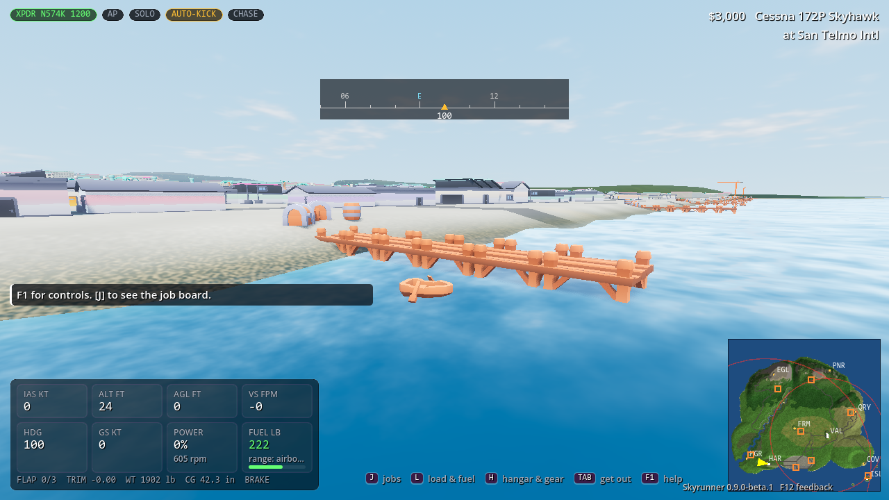
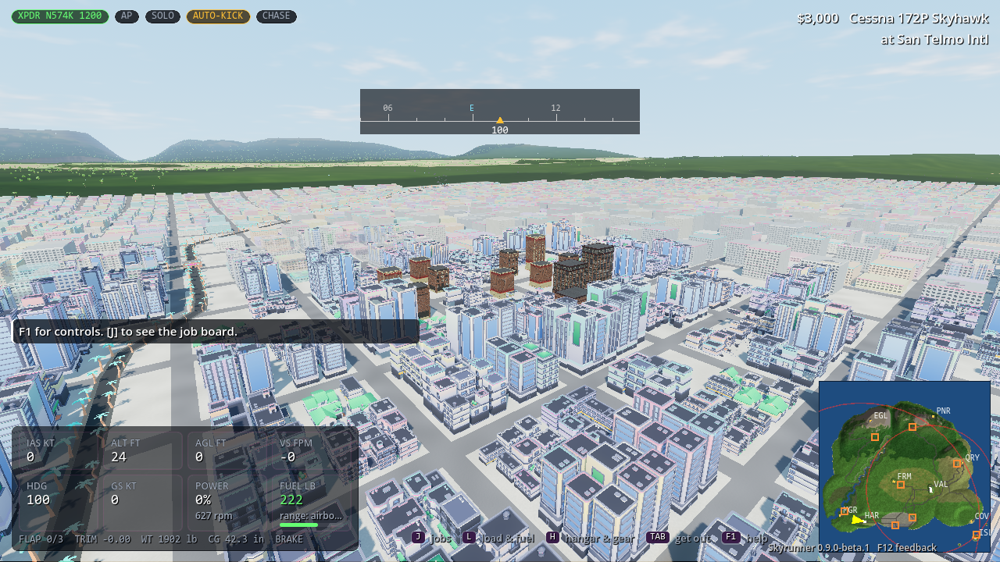

# Skyrunner design: runners, kickers and the task force

> This is the design document of the Godot game (the one game). It began life with the original
> Python prototype, which is now kept only as the reference that generated the frozen parity
> fixtures in `tests/fixtures/`; nothing in the Godot build needs it. Sections 10-12 cover what
> the Godot build added.

This is the plan for taking Skyrunner from a single-player bush-flying game to an
asymmetric **traffickers vs. law enforcement** game. It supports solo play against AI,
co-op crews, and team-vs-team multiplayer, and it follows a campaign that gets harder
year by year.

Status legend: **[done]** in the code now · **[planned]** historical proposals unless present in [ROADMAP.md](ROADMAP.md). Later decisions and verified code take precedence; the October review is a dated record, not the current queue.

## 0. Where the game is heading (owner-approved direction, 8 October 2026)

The owner's answers to a gameplay questionnaire (recorded by Codex in PR #249) set the target the rest of this
document grows towards. They take precedence over conflicting older plans, including the deferrals in
[EMPIRE_MILESTONE.md](archive/EMPIRE_MILESTONE.md). This section is a **design target, not a feature list**: status tags
say what exists. The delivery order is in [ROADMAP.md](ROADMAP.md).

**The core experience: build an empire from nothing.** Mount & Blade: Warband is the principal reference. The
game starts small and personal, then the player takes on more complexity: personal action, recruitment, trade,
relationships, conquest, command and the stories that emerge from them. Schedule I adds hands-on work, setting up
a business and automating it. Cities: Skylines adds interconnected systems that the player diagnoses and manages;
decorative city-building is not a goal. No activity is forced: a solo player delegates to AI, co-op players
specialise, and a mature organisation can operate across every business area. There is no prescribed ratio of
flying to management to combat.

**The start [PR #296, awaiting merge].**
- A new story begins with the player as a hired pilot for a legitimate aviation business (Costa Brava Air
  Services), flying the employer's aircraft straight away.
- The business slides into smuggling, and in the main story that becomes unavoidable: there is no permanent
  legitimate-only branch.
- Owning an aircraft is an earned milestone, not a starting gift. The draft's first price is $18,000 for the
  employer's Cessna, uncalibrated.
- The sandbox (open mode) remains a way to progress without the campaign. The four flying lessons and twelve
  story chapters stay.

**Economy and workers.**
- *Economy:* interconnected. Civilian businesses provide jobs and supplies, residents create demand, disruption
  reduces trade, and neighbourhood prosperity changes what is on offer. The formulas are not designed yet
  [planned].
- *Automation:* manual operation always remains possible; automation is earned with enough workers and resources
  and with the player's own setup.
  - Basic explicit assignments come first [partly done: payroll assignments, §17].
  - Then repeatable conditional orders (e.g. restock below a threshold) and configured multi-step task sequences
    [planned].
- *Workers:* they follow instructions. Competence never means autonomous strategic spending or expansion. When
  delegation fails, the preferred cause is the player's poor planning.
- *Money:* it chiefly buys convenience, and the organisation's properties visibly develop as it grows [planned].

**Turf, factions and the law.**
- *Territory:* it pays for itself in income, safer routes, recruiting, services, influence and physical occupation.
  Control can change through presence, negotiation, economic disruption, battles and important sites; the exact
  rules are open.
- *Turf war:* it arrives mainly later, or early if the player goes looking for it.
- *Rivals:* they have recognisable leaders and goals, different starting strengths, and grow through the economy.
  There is no automatic level-matching and no unearned catch-up money.
- *Diplomacy and combat:* diplomacy shifts as the player's expansion threatens or displaces other factions. Combat
  can be led in person, from nearby or remotely. Experienced crew are valuable, so retreating is a real decision.
- *The police:* response escalates. Pressure is handled by laying low, changing routes, legitimate business, legal
  measures or sacrificing operations. Travel stays relevant; upgrades, bribes and relationships (the Company, the
  Family) improve access and security.

**Loss and recovery [planned unless noted].**
- *The player:* death does not end the game. The player respawns or recovers in hospital, paying a
  situation-dependent mix of time, money, carried goods and equipment.
- *The organisation:* while the player recovers, it carries on with only the last instructions it was given; AI
  never invents new assignments.
- *Workers:* they can be injured or permanently killed [partly done: jail and death in §17]. After a defeat, the
  player rebuilds with the survivors.
- *Aircraft and vehicles:* they can be lost, impounded or (rarely) destroyed. There are several ways to recover an
  impounded one: fees, legal or faction help, physical retrieval.
- *Terminal outcomes:* bankruptcy and imprisonment as game-enders are configurable.
- *Discovered risk:* some risk is learned from experience and reports, with facts kept apart from uncertainty.

**World and campaign.**
- *The map:* a compact Costa Brava, with interiors where they serve gameplay. The visual target is stylised period
  cinema; the weathered 1979–82 look (ASSET_BIBLE.md) works within that style. Functional structures and traffic
  come before ornament.
- *The campaign:* playing it is optional, and finishing it leaves the sandbox running.
- *Unlocks:* business access opens through money, reputation and demonstrated activity, with campaign missions as
  an alternative route to the same unlocks. No essential sandbox system is gated behind the campaign only
  [planned; today the story gates systems by chapter, §21].

**Multiplayer.**
- *Modes:* co-operative and competitive play are both part of the first full experience, as separate modes for
  2–16 players [the lobby already allows 16].
- *Roles:* players take organisation, rival-faction or police roles. One person owns an organisation and assigns
  responsibilities.
- *Leaving:* when the leader leaves, the session halts; a lower-ranked player leaving does not halt it. An absent
  leader's authority is never handed to AI or a deputy automatically [planned; today an empty seat falls back to AI,
  §12].
- *Separate proposals:* multiplayer racing and the hidden informant remain separate proposals.

**Product order.**
1. The early rise: employed start, the slide into smuggling, the first aircraft.
2. Setup-driven automation.
3. Faction competition and the civilian economy.
4. Multiplayer teamwork and competition.

Physical reliability (access, routes), command clarity and the regression gates are prerequisites inside every
step. Network ownership contracts are specified early, so step 4 doesn't force a rewrite, but multiplayer features
don't jump the queue. Don't silently change payroll, aircraft performance, combat authority or balance to reach
these goals: each mechanical change needs explicit rules, save compatibility and evidence.

**What to borrow from the references** (Codex's research note, PR #249; these are hypotheses to test in play):

| Reference | Borrow | Don't copy |
|---|---|---|
| Mount & Blade (original → Bannerlord) | Personal skill that stays useful as the player becomes a commander. A good pilot can still save a shipment in person. Each multiplayer seat does real work (pilot, dispatcher, quartermaster, ground commander). | A bigger arsenal before the current weapons' trade-offs are legible |
| Mount & Blade: War Sails | Geography matters: aircraft, road and boat access are strategically different | Naval combat |
| Schedule I | Do a job by hand, understand it, then delegate it and handle the exceptions. Show each worker's assignment, load, destination and blocked reason. | Repetitive handling minigames or production recipes |
| Cities: Skylines I and II | See a problem, pull an understandable lever, watch it improve. Show the supply chain: source stock, carrier, route, loading access, destination need. Clicking a blocked order highlights the obstacle. | A municipal simulator or costly cosmetic traffic |

**Playtest questions** to answer with recorded human sessions:
- After one flown run and one delegated run, can a player explain the trade-off?
- Can they find why a delivery is blocked using only the map?
- Do named crew and battle reports make losses matter?
- Do two players each have useful work during one shipment?
- Does a setback leave an understandable way to recover?

**Open questions for the owner:**
- The employer's details, the transition's stages, the pay and the first aircraft's price.
- Recovery costs and time, what happens to inventory, and property seizure.
- Impound rules.
- Automation budgets, rule syntax and permission limits.
- What counts as a "leader" in each mode, and how reconnect, resume and abandonment work.
- The civilian-economy and district-control formulas.
- Tone, personal skills and favourite locations.

---

## 1. Pillars

1. **The aircraft is the puzzle.** Weight, balance and fuel are one budget: every pound of
   fuel is a pound of cargo you can't carry. The flight model flies the result honestly.
2. **Information is the weapon.** Neither side sees the truth. Traffickers work from radar
   warnings, scanner chatter and spotter calls. Police work from radar tracks, tips and
   direction-finding fixes. Most of the game is about controlling what the other side knows.
3. **Every tool has a counter.** Each gadget exists together with the thing that beats it
   (see the matrix in §4). Balance comes from the pairs, not from raw stats.
4. **Complexity arrives one year at a time.** The campaign adds one system per chapter, so
   by 1986 you juggle all of them, but you learned each one alone.
5. **From hired pilot to empire (§0).** You start flying someone else's aircraft and earn everything after it.
   Flying stays worth doing, delegation is a reward you set up yourself, and losses (money, crew, aircraft) are
   real but recoverable.

## 2. Modes

| Mode | Humans | AI fills | Status |
|---|---|---|---|
| **Solo runner** | Pilot | Police, optional AI co-pilot | [done] |
| **Solo task force** | Controller | AI smuggler flights + boats | [done] |
| **Co-op crew** | Pilot + co-pilot (+ spotter) | Police | [done] (co-pilot and spotter use the station client) |
| **Versus** | Runner crew vs. controller (+ interceptor pilot) | Empty roles | [done]; controller and spotter use the station client; the interceptor pilot flies in a 3D seat (`RemoteSeat`) |
| **Campaign** | Solo or co-op | Scripted threats per chapter | [done]: four flying tutorial chapters and twelve Costa Brava story chapters; former tutorial chapters 5–8 are retired |

Any seat without a human is filled by AI, so the same match can be played by one person or a full table (the lobby
and dedicated server allow up to 16). The direction (§0) adds separate co-op and competitive modes for 2–16
players, with organisation, rival-faction and police sides [planned].

## 3. Roles

### Runner side

| Role | Job | Sees | Status |
|---|---|---|---|
| **Pilot** | Flies. Transponder, flaps, autopilot. | Out the window, HUD, radar-detector light | [done] |
| **Co-pilot / kicker** | Loads the aircraft (twice the loading speed), pumps ferry fuel, kicks bales out over drop zones, runs the radio scanner and calls the boat | Tactical map: own aircraft, boat, bales, intercepted police traffic, radar-warning status | [done] (station client + AI fallback) |
| **Spotter** | Watches one airstrip from the ground. Reports police units and roadblocks near it. Can relocate (takes time). | Units within 5 km of the watched strip, reported with a delay | [done] (AI-driven reports; human uses the station client) |
| **Boat captain** | Go-fast boat. Waits at the rendezvous, fishes bales out of the water, runs for the cove. | Surface picture around the boat | [done] AI; a human takes the seat at a 2D desk and right-clicks to send the go-fast |
| **Fixer** | Books jobs, hires spotters, buys gear, manages heat and money between flights | Job boards, the crew, the Family | [done] (section 36) |
| **Mechanic** | Field refuelling from caches, quick repairs at bush strips | The aircraft's true condition, the cost of the work | [done] (section 39) |

### Law side

| Role | Job | Sees | Status |
|---|---|---|---|
| **Controller** (radar/intel desk) | Reads the fused radar picture, classifies tracks, dispatches helicopters, interceptors and cutters, sets radio encryption, requests the aerostat | Radar tracks (with position noise, no identity for non-squawking targets), tips, DF bearings. Never the true runner position. | [done] (station client + AI fallback) |
| **Interceptor pilot** | Flies the chase aircraft and makes the visual ID | Out the window, its own radar | AI [done]; human pilot [done] (`RemoteSeat`) |
| **Coast Guard cutter** | Hunts boats and seizes floating bales | Surface radar | [done] AI; a human takes the seat at a 2D desk and sends the cutter |
| **Analyst** | Works the informant network, fuel-purchase records and tail numbers | Tip feed | [done] (section 34) |
| **Undercover agent** | Plants a tracking beacon on a runner aircraft on the ground | The strip the aircraft is parked at, the odds, their cover | [done] (section 35) |

### Hidden role (versus, [planned])
**The informant.** One runner-side player may secretly be working for the task force. They
score if the crew gets busted and lose if they're caught leaking, so they have to sabotage
quietly (a bad load plan, "forgetting" to pump fuel, calling the boat on an open channel).
This is the social-deduction layer that gives crews a reason to watch each other.

## 4. Gadgets and counters

| Runner tool | What it does | Law counter | Counter to the counter |
|---|---|---|---|
| **Flying low** | Below the radar floor (≈45 m AGL + 9 m per km of range), and behind terrain, primary radar can't see you | **Aerostat radar** (tethered balloon at 2.5 km altitude: huge line of sight, low floor) | Stay out of its footprint; it's winched down in high wind or lightning [done] (HQ season) |
| **Transponder off** | No secondary return, so no identity | An unidentified primary track builds suspicion fast | Keep squawking to look like legit traffic. But turning it *off* while tracked ("squawk lost") is a big red flag. |
| **Transponder on** | You look like a normal charter | You're tracked the whole time you're in coverage; an informant tip names your tail | Only squawk on legit legs |
| **Radar detector** ("fuzzbuster") | Warns when a radar illuminates you, and whether you're above its detection floor | No direct counter (passive) | – |
| **Radio scanner** | Hears police dispatch in plain voice: unit, base, heading | **Encrypted radio** (controller toggle): dispatch becomes garbled static | Encryption slows coordination (dispatch delay +8 s) |
| **Boat radio calls** | Needed to bring the boat to the drop point | **Direction finding**: every transmission gives the task force a bearing, and two stations give a fix | Keep calls short, call from a different spot than the drop, or pre-plan the rendezvous with no call (the boat waits longer, and waiting boats get spotted) |
| **Ground spotters** | Early warning of police at your destination | **Informants**: a hired spotter may leak your destination (a tip with a 3 km circle) | Pay more for trusted spotters [planned], vary destinations |
| **Ferry tanks** | Long runs from offshore, no fuel stops | **Fuel-purchase tracking**: buying ferry fuel at a police field raises a tip chance | Fuel caches at bush strips (fly the drums in first) |
| **Airdrops to boats** | Never land with the goods | **Coast Guard cutters** and the "drop pattern" classifier (a slow, low track circling over water) | Drop fast, drop in the dark [planned], decoy boats [planned] |
| **Decoy flights** [done] (the HQ season's decoy crews) | A clean aircraft flies the obvious route | Controller has limited units: committing to the decoy is the cost | – |

**Resource limits keep the controller honest.** The task force starts with 1 helicopter,
2 interceptors and 1 cutter, each with a launch delay and a fuel endurance. They're
refuelled and recommitted at a base. The runner crew is always cheaper to field
than the full response, which is how the side with less information stays viable.

## 5. Systems

### 5.1 Fuel is weight [done]
- The flight model burns fuel from real tank locations, so the CG moves during the flight.
- The HUD shows endurance and still-air range from the live fuel flow.
- **Ferry bladder tanks** are cargo items (25 lb empty + fuel) that take up a cabin station.
  Their fuel only reaches the engine if someone pumps it into the wing tanks. The co-pilot
  pumps 60 lb/min; solo, the pilot can run the electric pump at 25 lb/min.
- Buying fuel beyond wing-tank capacity at a police field has a chance to produce a tip.

### 5.2 Loading takes time [done]
- Every item moved on the ground takes `4 s + 0.02 s/lb` of crew time. Crew = pilot, plus
  co-pilot, plus the ramp crew at hubs. Loading at a bush strip while the spotter reports
  police inbound is the tension beat.

### 5.3 Airdrops [done]
- Droppable items (bales) are kicked out of the door by a crew member: 2 s per bale for the
  co-pilot, 4 s for the pilot on autopilot. Above 130 kt the door can't be used.
- Each bale is a ballistic object with drag (terminal velocity ≈ 35 m/s) that inherits the
  aircraft's velocity. If it lands in the water, it floats and drifts. If it lands on land,
  it's lost (ground drop zones with a pickup truck are [planned]).
- The boat collects bales within 40 m (5 s each), then runs for the cove. The job pays per
  bale delivered to the cove.
- **Autopilot** (wing leveller + altitude hold) exists so a solo pilot can go aft and kick.

### 5.4 Sensors and the track picture [done]
- Every emitter and target produces a `Signature`: position, height above ground, speed,
  transponder state, recent radio transmissions.
- Sensors (ground radar, aerostat, unit eyeball/FLIR, direction-finding stations) turn
  signatures into **tracks** with position noise and an age.
- AI police steer to the **last known position**, not the truth. Break contact and they
  search the last place they saw you.

### 5.5 Radio [done]
- One message log per channel (`police`, `runner`). Police dispatch is plain voice
  unless encrypted. The runner scanner intercepts plain police messages. Runner
  transmissions can be heard by DF stations.

## 6. Storyline (the Costa Brava flying tutorial)

**Decision (2026-10-03):** the campaign is four chapters, a tutorial that teaches one system at a time. The long game is the Costa Brava story (`Story.CHAPTERS`, DESIGN 25 and the later story sections). The former chapters 5 to 8 (The Balloon, Blue Water, The Leak, Last Run / Flip) are cut; the paragraphs below about them are the original pitch and are not planned.

**Setting (updated 2026-10-07).** Costa Brava, the game's fictional coastal region,
1979–1982 for these four flying lessons. The twelve-chapter Costa Brava story remains
the long game. Classic island geometry is retained only for internal regression references.
The tone draws on the era's documentaries and dramas about the South Florida
smuggling boom and the Miami-based task forces sent to stop it (the *Cocaine Cowboys*
documentaries, *Miami Vice*, *American Made*, *Blow*, *Air America*, *Narcos*). All characters
and events here are original.

**Protagonist.** *Jack "Dusty" Callahan*, a bush pilot who owes the bank for a tired
Cessna 172. His sister *Rosa* runs the mail contract and is your first co-pilot. The fixer is
*Benny Ruiz*, who works for Rafa Quintero and arranges boat runs from Smuggler's Cove. The antagonist on the law side is
*Special Agent Evelyn Hart*, who takes over the island's interdiction desk in 1983.

| Ch. | Year | Title | Introduces | Objectives | Status |
|---|---|---|---|---|---|
| 1 | 1979 | **Mail Run** | Flying, W&B, short strips | Earn $5,000 legally, land at Mesa del Aguila | [done] |
| 2 | 1980 | **A Favor for Benny** | Contraband, radar floors, flying low | Deliver one hot cargo without reaching wanted ★ | [done] |
| 3 | 1981 | **Kickers** | Co-pilot, airdrops, boat rendezvous, radio calls | Drop 4 bales to the *Lady Luck*, 3 must reach the cove | [done] |
| 4 | 1982 | **Long Legs** | Ferry tanks, fuel planning, offshore entry, fuel caches | Fly in from the south entry point with a ferry tank and make a drop | [done] |

**Historical pitch, retired (not scheduled).** The task-force campaign (law side, 1983–1986) would replay the same years from Hart's desk:
building the radar net, getting encryption budget approved, turning Callahan's spotters. In
chapter 8 the two campaigns meet: the runner's "Flip" branch hands you Hart's desk for the
final interdiction.

**Historical difficulty pitch, not the current tutorial schedule.** Each chapter would raise the threat level: 1 radar site in 1979, plus
interceptors in 1981, the aerostat and cutters in 1983, encryption and DF in 1984, informants
in 1985. It also removes a crutch, such as a free loadmaster or a daytime-only schedule.

## 7. Multiplayer architecture

```
 Pilot's game (3D, Godot 4) ─────────────┐   authoritative Session (flight + AI + rules), 60 Hz
   └─ listen server (HostServer, TCP) ───┤   snapshots 20 Hz, filtered per role (fog of war)
                                         │
 Station clients (2D tactical UI) ◄──────┘   TCP, newline-delimited JSON
   co-pilot · spotter · controller           commands -> Session.command(role, name, args)
```

- **Authoritative host.** The pilot's machine runs the only simulation. Remote players send
  *commands* (validated against a per-role permission table) and receive *snapshots* built
  for their side only. A controller snapshot contains radar tracks, never the true runner
  position.
- **Why TCP + JSON now:** zero dependencies, trivial to debug, and fine at 20 Hz on a LAN or a
  decent WAN. Station UIs are map views, so a 100 ms delay is invisible there.
- **Phase 3:** a remote *pilot* (interceptor or second runner) needs UDP with client-side
  prediction of their own flight model (ENet through Godot's MultiplayerPeer), with the
  server reconciling. Snapshots already carry sequence numbers for this.
- **Dedicated server:** `Session` has no rendering dependency, so a headless server is the same
  code minus the window (`godot --headless --script res://scripts/net/dedicated.gd`).
- **The wire's safety contracts [done, October 2026, #259/#260]** (`host_server.gd`):
  - *Bounded framing:* a line over 1 MiB closes the connection before it is parsed, and at most 64 lines are
    handled per connection per poll.
  - *Commands run at most once:* sequence numbers must rise per connection. A repeat gets the cached
    acknowledgement (the last 256 are kept); an old or out-of-order sequence is refused unexecuted. At most 64
    commands are pending per connection.
  - *No stale seats:* a command queued before a seat change or disconnect is refused, not run under the new seat.
  - *No stale sticks:* flight input not refreshed for one second is neutralised; ownership doesn't change.
- **Read-only previews [done]:** a host advertises `action_previews` in its welcome. A client then asks
  `preview_request` and gets the same `ActionDescriptions` result a local desk shows (consequence text, enabled or
  disabled reason). Execution re-checks everything; a preview is never a reservation. Older hosts simply lack the
  capability.
- **Who may stop the game [planned, §0]:** when an organisation's leader leaves, the session halts; other players
  leaving do not halt it. This replaces the current "empty seat becomes AI" rule for leaders only, once "leader"
  is defined per mode.

## 8. Balance notes and tuning knobs

| Knob | Default | Effect |
|---|---|---|
| Radar floor | 45 m + 9 m/km | Lower = police stronger; tune per chapter |
| Aerostat floor | 20 m + 3 m/km | Makes flying low necessary but not sufficient |
| Suspicion rate | 8–33 %/s in coverage | How long a runner can clip radar coverage |
| Bust time | ~4.5 s within 350 m | How close an interceptor must fly formation |
| Encryption dispatch delay | +8 s | Cost of denying the scanner |
| Spotter leak chance | 15% per hired spotter per job | Informant pressure |
| Ferry-fuel tip chance | 25% at police fields | Pushes runners to caches |

Balance target for versus: a competent crew completes about 55% of runs against a competent
controller. The AI controller should land at about 70% for new players.

## 9. Roadmap

*Historical: the 2025–26 phase plan. The current queue is [ROADMAP.md](ROADMAP.md) and the direction is §0;
items below marked as later phases are not commitments.*

1. **Phase 1 [done]:** single-player core. Flight-model W&B, tight strips, jobs, radar/wanted, AI police.
2. **Phase 2 [done] (framework):** roles and permissions, command API, event bus, sensors and
   tracks, radio/scanner/DF, spotters and informants, transponder, radar detector, aerostat, ferry
   tanks, loading time, autopilot, airdrops, boats and cutters, AI smuggler, controller mode,
   campaign engine with chapters 1–4, listen server + station client, role-filtered snapshots.
3. **Phase 3 [done] (seats, HQs, bots, balance):** remote 3D seats (co-pilot in the right seat; police
   pilot flying a heli/interceptor with the AI units' envelope, fog-of-war visuals) over TCP with
   interpolation; boss and chief HQ seats and a season of nights (`scripts/sim/hq.gd`, `nights.gd`); decoy
   flights and contract crews; rule layers scaled by player count (`scripts/sim/layers.gd`); a pilot bot flying
   the aircraft, HQ bots, and feasibility / tactical / strategic simulators that drove the balance changes
   in [BALANCE.md](BALANCE.md); textured graphics with low/medium/high presets. Design reasoning:
   [MULTIPLAYER.md](MULTIPLAYER.md).
4. **Phase 4 (depth):** UDP snapshots with prediction, human-driven boats, night and FLIR, wind,
   AEW patrol aircraft, fixer/mechanic roles, the hidden informant, planted beacons, persistent
   career across chapters, chapters 5–8 and the task-force campaign, smarter runner bots.
5. **Phase 5 (content):** bigger map (mainland coast + island chain), more aircraft (from the
   JSBSim-format `L410`, `C130` data), audio, real 3D models, matchmaking and a dedicated server.

## 10. What the Godot build added

- **Engine.** Godot 4.7 (from 4.4), GDScript only: no GDExtension, so a stock editor opens, runs and exports it
  to Linux, Windows and macOS. The simulation is in `scripts/sim/`; the Python-exact RNGs, maths and terrain
  generator in `scripts/util/` stay bit-exact with the Python reference where the fixtures say so
  ([PORTING.md](PORTING.md)). The flight model (`scripts/sim/flight/`, `FlightDynamics`) is the game's own: a
  6-DOF rigid body at 120 Hz with quaternion attitude, reading JSBSim-format aircraft files as data (their
  aerodynamic functions and tables, flight-control channels, mass and tanks, gear contacts, piston and
  turboprop engines with propeller C_T/C_P tables and a constant-speed governor), spring-damper gear with
  rolling, braking and side friction, the ISA atmosphere, wind and Gauss-Markov gusts. It replaced JSBSim
  1.3.1, which the game used to link through a C++ extension. The C172's propeller carries calibration factors
  (static rpm, ground roll, climb against the handbook): its stock tables left a 160 hp engine short.
- **Realism layer.** Weather and moon, pattern of life, canary traps, rival tempers, spare-helicopter
  patrols, nerves ([BALANCE.md](BALANCE.md) entries 14-19).
- **Radar and radio** that behave like the real thing (`sensors.gd`, `comms.gd`): radar horizon, clutter,
  MTI, scan rates, Pd, trails, Mode C, squawk codes and coverage; VHF line of sight, channels,
  push-to-talk length, least-squares DF with an error ellipse, jamming.
- **Upgrade trees** for both sides (`upgrades.gd`), paid from runner cash and task-force funds.
- **Costa Brava**, the city coast and default map (`map_city.gd`): the port city of San Telmo, estuary,
  farm plain, jungle range, quarry, cays; stash houses (`stashes.gd`) with trucked deliveries and raids.
- **Markets** (`economy.gd`): prices per good per market, moved by rivals, police, seizures, gluts,
  fuel, weather and the news.

## 11. The ground war, gun running and arsenals

- **Arsenals** (`arsenal.gd`): the organisation, the task force and Los Cuervos each hold weapons by
  tier (pistols, rifles, machine guns, RPGs) and ammunition. Gun runs bring crates in; on delivery you
  **sell** them at the street price or **stock** your own arsenal. Everything the police seize
  (busted loads, trucks, raided stashes, lost firefights) goes into *their* arsenal and arms their
  patrols.
- **Squads** (`ground.gd`): gang soldiers, Los Cuervos' crews and police patrols, on foot, in cars and
  in trucks, driving the city's roads (`road_graph.gd`). They guard stashes, escort trucks, set
  checkpoints, patrol and raid. Where they meet, a firefight is resolved with Lanchester's square law
  on each side's weapons, cover and morale. Squad-minutes in a zone move the turf, and turf moves the
  markets and the season.
- **Commanders.** Each faction's squads are run by an AI commander by default; a human
  **lieutenant** (runner side) or **patrol commander** (law side) can take over at any time, and the
  boss and chief set the budgets.
- **On foot.** Out of the aircraft you can draw a weapon from your side's arsenal and shoot it out
  with squads near you, who are simulated man by man inside a 300 m bubble.

**What it costs** (section 24, BALANCE entry 29). The live-play simulator steps the war. The organisation's AI keeps a $30k reserve, raises a squad at most every 30 minutes (only when it has none or is outnumbered), and pays soldiers only for the squads it fields. With the war on, three hours end at $50.0k against $62.5k without it.

## 12. Seats: every role AI until a human takes it

Every role in every mode exists from the start and is run by the AI. Humans join mid-game and
claim any free seat from the role picker; leaving (or dropping for more than 30 s) hands it back to
the AI. The host's `Seats` table is the single place this happens. See [MULTIPLAYER.md](MULTIPLAYER.md)
for the protocol, the roster and chat.

## 13. The Agency, and the history the season runs through

**The Company** (`scripts/sim/agency.gd`) is a covert intelligence agency running guns south to
the Contras through the island's strips: a fourth player in the drug war, and the task force's most
awkward opponent. It offers "southern front" arms flights on the shady strips' boards. Carrying its
cargo, or for half an hour after a run, you're protected: a bust is quashed by a call from
Washington ("national security"), and police checkpoints are told to wave your trucks through. A
trusted organisation gets favours (crates of rifles, an informant "reassigned"). Every quash and
flight leaves a trail; the task force can dig (V at the desk: subpoenas and bank records, cheaper
the more cases were quashed) and at 100% exposure the hearings end it: no more protection, the
task force gets the budget, and the organisation's pilots are named in the testimony.

It is fiction inspired by the documented record, not a claim about real people:

- the **Boland Amendments** (1982, and Boland II in 1984) barred U.S. funding for the Contras, and
  the supply effort went private and covert
  ([Boland Amendment](https://en.wikipedia.org/wiki/Boland_Amendment));
- in October 1986 a Contra supply plane was shot down over Nicaragua and its surviving crewman
  talked; the **Iran-Contra affair** broke that November
  ([Iran-Contra affair](https://en.wikipedia.org/wiki/Iran%E2%80%93Contra_affair));
- the Senate subcommittee chaired by John Kerry (the **Kerry Committee**, report 1989) found that
  people involved in Contra supply networks were also involved in drug trafficking, and that U.S.
  agencies were at times aware of it
  ([Kerry Committee report](https://en.wikipedia.org/wiki/Kerry_Committee_report)).
  Stronger claims made later (for example in the "Dark Alliance" series) remain disputed, and the
  game doesn't rely on them.

The **Chronicle** also runs a timeline of real headlines, one per stretch of play, in order: the
1979 Dadeland mall shootout, the 1980 Mariel boatlift, Operation Greenback, the 1982 South Florida
Task Force, the Boland Amendments, Customs' air-interdiction jets and Blackhawks, crack reaching
the streets, the 1986 shoot-down, Iran-Contra, the 1986 Anti-Drug Abuse Act and the Kerry
inquiry. Each moves something in the game: the task force's funds and arsenal, Los Cuervos'
recruits, the markets, and the Agency's exposure.

## 14. The Family, the Company's double game, and the research behind them

**The Family** (`scripts/sim/family.gd`) is a fictional Cosa Nostra crime family, the Morettis,
out of Tampa by way of New York. It runs the docks' union, casino count rooms, bookmakers and a
loan-sharking book. The design rule is that **every helping hand might be a trap**:

- Each offer carries a hidden `honest` flag and a *read* (what our people notice, e.g. "the
  steward was seen at the federal building"). The read is right about four times in five, so
  accepting is a judgement call.
- The offers are: a loan (the con: the vig "changes" and the enforcers come), laundering through a
  count room (the con: a skim and a wiretap), the union at the docks (the con: the Coast Guard gets
  the schedule), a gun fence (the con: a buy-bust), a crew of the Family's soldiers (the con: a
  stash sold to Los Cuervos) and a lawyer (the con: he reports to the prosecutor).
- Honesty falls with greed, low respect and pressure. The task force's RICO case grows; past 60% a
  made man may flip, and a family with a rat in it sells everyone out. At 100% the Commission
  trial ends the Family, and what it knew about our stash houses goes into evidence.
- Unasked, the Family also: levies a street tax on a rich organisation, sells rifles to Los
  Cuervos too, puts a sergeant on the payroll who leaks raids, and moves in on a weak organisation's
  stash.

**Talking to them.** The offers can be taken with a key, or at a sit-down with Sal Moretti
(`dialogue/family.dialogue`, run by Dialogue Manager): he pitches the offer in his own words, your man
gives his read, and you can take it, turn it down, or **press him** - a second read, an independent
roll just as likely right, for two points of respect. Two agreeing reads are right about 94% of the
time; two that disagree are a coin toss. That makes asking a real decision. The tribute can be paid,
refused or **stalled** (five more minutes, once, for five points of respect).

**The Company's double game** (in `agency.gd`, on its own RNG stream):

- The limited hangout: at high exposure it may give our names to the task force itself.
- A stung flight: it hands a flight to the DEA. The notes may say "the contact changed at the last
  minute", a hint that is right about three times in four.
- "The check's in the mail": part of the pay is withheld.
- Both sides: Los Cuervos' planes get waved through too.
- Disinformation, both ways.
- Brokering its cash through the Family's casinos.

### What the research found, and where it went

Fiction built on documented history. No real person appears in the game; events are reported as
the papers did.

| History | In the game |
|---|---|
| The CIA recruited mobsters (Giancana, Roselli, Trafficante) to kill Castro in 1960-63; it came out in the Church Committee hearings (1975); Roselli was later found in an oil drum in Biscayne Bay ([CIA plots on Castro](https://en.wikipedia.org/wiki/CIA_assassination_attempts_on_Fidel_Castro), [Mob Museum](https://themobmuseum.org/blog/mob-attempts-assassinate-castro/)) | The Company and the Family know each other: the Company's cash goes through the Family's casinos with us as go-between; the "drum_found" event (a witness silenced, the RICO case sets back) |
| The Kerry report (1989): the State Department paid Contra "humanitarian" contracts to companies run by traffickers, including SETCO Air and a Costa Rican seafood firm, Frigorificos de Puntarenas, set up to launder drug money ([Kerry Committee](https://en.wikipedia.org/wiki/Kerry_Committee_report), [report text](https://archive.org/stream/KerryCommitteeReport/Kerry%20Committee%20Report_djvu.txt)) | Crates marked "humanitarian aid"; the "shrimp_front" laundering event; the 1989 headline raises the Agency's exposure |
| A cocaine pilot flew out of Mena, Arkansas, flipped to become a DEA informant in 1983, flew a camera-rigged C-123 on a CIA-linked mission, and was shot dead in 1986 ([Barry Seal](https://en.wikipedia.org/wiki/Barry_Seal)) | The "pilot_flips" event; the 1986 headline (informants go quiet); the stung flight |
| Norman's Cay, Bahamas: a private island with a 1,000 m strip, armed guards, dogs and radar, used as a transshipment base (1978-82) ([Norman's Cay](https://en.wikipedia.org/wiki/Norman%27s_Cay), [Carlos Lehder](https://en.wikipedia.org/wiki/Carlos_Lehder)) | The offshore pickup island (next phase) |
| Operation Greenback (1980) followed the cash through the banks; the Opa-locka seizure; Great American Bank fell in 1982 ([Operation Greenback](https://en.wikipedia.org/wiki/Operation_Greenback)) | Headlines; laundering costs; the "bank_collapse" event |
| 1986: a DEA probe of Eastern Airlines baggage handlers at Miami International, who moved cocaine past customs and dogs for years ([CS Monitor, 1986](https://www.csmonitor.com/1986/0214/aline.html)) | The 1986 headline tightens the airports; airport smuggling with bought handlers (next phase) |
| The Pizza Connection trial (1985-87) and the Commission trial (1985-86, bosses convicted under RICO) ([Pizza Connection](https://en.wikipedia.org/wiki/Pizza_Connection_Trial), [Commission trial](https://en.wikipedia.org/wiki/Mafia_Commission_Trial)) | Both headlines raise the RICO case |
| 1988: Noriega indicted in Miami for selling traffickers safe passage; his money sat in BCCI ([Manuel Noriega](https://en.wikipedia.org/wiki/Manuel_Noriega)) | The 1988 headline: laundering costs more |
| Cuba, 1989: General Ochoa and Colonel de la Guardia were executed after a trial for arranging cocaine drops in Cuban waters, handed to speedboats for Florida ([Arnaldo Ochoa](https://en.wikipedia.org/wiki/Arnaldo_Ochoa)) | The island's corrupt officers and their purge (next phase) |

Storylines and jobs these suggest, some of them built next:

- **The island**: a Cuba-like offshore state with cheaper product, corrupt officers selling safe
  passage in its waters, and its own politics. A purge can close the route overnight.
- **Airport runs**: mules and bought baggage handlers at the international airport, against
  customs, dogs and a crackdown after a scandal.
- **Informant flights**: the DEA flips your pilot and wants photographs of the next pickup.
- **The seafood front**: aid contracts that launder money until an inquiry reads the books.

## 15. Isla Soberana: the island trade, the airport and the port

An island republic about 23 km off San Telmo, beyond the map's southern edge (`scripts/sim/island.gd`,
drawn by `scripts/render/island_render.gd`). Its strip (SOB) is landable but isn't one of the mainland's
strips (`MapLayout.foreign`), so the mainland's boards, AI and police are unchanged. It is fiction
inspired by the Ochoa affair (section 14): officers who sold cocaine drops in their waters until
their own government tried them.

- **Cheap product.** The island's board sells loads: a job with a price paid up front ($18/lb)
  worth the street price home ($55/lb before the market). A defector wanting a ride north pays
  well and costs the General's goodwill.
- **Three routes home.**
  - **Air:** the usual game, flown.
  - **Mules:** four on the airliner (Shift+U, or U at the lieutenant's desk). Each is caught
    independently; odds start at 10%.
  - **A container:** 500 lb on the freighter (Shift+I / I). One roll; odds start at 8%.

  Both are timed shipments, resolved on arrival against the odds then. So a crackdown ordered
  after they left still counts.
- **Where it lands.** With logistics on (live play, the dedicated server, the story from 1980), a
  cleared container or a mule run pays nothing on arrival: its pounds go into the stash by the docks
  and the airport (`logistics.site_at("HAR")`, Warehouse 7 by the port), or the nearest stash if
  that one is burned, and warms that stash as any load arriving does. From there it's sold like any
  other load (section 22). Without logistics the
  old instant payout at the street price stays. BALANCE entry 30 has why: 500 lb sold at once, past
  the dealers and the buyers' caps, paid $150k-$800k over a 12-hour story.

  | Factor | Mule caught | Container found |
  |---|---|---|
  | Heat after a catch (decays) | x(1 + heat) | x(1 + heat) |
  | Sniffer dogs (law) | x1.6 | x1.15 |
  | Passenger profiling (law) | x1.4 | |
  | Container X-ray (law) | | x1.7 |
  | Crackdown / inspections (law, 30 min) | x1.8 | x1.5 |
  | Trained mules / forged papers / baggage handlers (ours) | /1.25, /1.3, /2.2 | |
  | False bottoms (ours) | | /2 |
  | The Family's docks deal (honest / a rat) | | x0.5 / x2 |
  | A boatlift swamping the Coast Guard | | x0.7 |

  A caught mule may talk (unless her papers are forged). The desks show the odds and every factor.
- **Sovereign airspace.** South of the territorial line the task force's aircraft break off and
  won't re-acquire. The island's MiGs may intercept a plane that hasn't bought the General's
  passage (a "landing fee").
- **The island's politics.** Hurricanes hold the freighters and close the strip's board; shortages
  raise prices; a glut drops them; a boatlift swamps the Coast Guard; the General's birthday. A
  purge (random when relations are low, or the 1989 headline) closes the island: no loads, no
  passage, and soldiers on the ramp for whoever lands.
- **The General's aide.** Captain Ibarra (`dialogue/general.dialogue`) meets you on the ramp when
  you land and answers the island frequency (Shift+G, G at the lieutenant's desk). He sells passage,
  gives the island's news (and a warning when the General's friends are in danger - relations
  under 40 are where purges happen), and takes orders for mules and containers, with customs' current
  odds in the answer text. During a purge a stranger answers.

## 16. The court: lawyers, bail, pleas and juries

Without a court a bust is a fine and the impound. With one (`scripts/sim/court.gd`, `court: true`
in live play, RNG seed + 107), a bust opens a federal case against the pilot. It is modelled on
how 1980s South Florida drug cases ran, with invented lawyers and judges.

| Stage | What happens | Choices |
|---|---|---|
| Arrest | Charges from the case: possession (any load), importation and trafficking (over 150 lb), a firearm (weapons aboard, or armed strip guards), conspiracy (a heavy case). Evidence is built from the load, the task force's suspicion, informants, an undercover agent, witnesses (arrested soldiers talk), and whether there was a chase. The load is seized as evidence. | - |
| Bail hearing (90 s) | A judge is drawn: Pike (hard), Ruiz (by the book) or Dunne (lives well for a judge). Bail is $10k per charge weight × the judge × 1.5 for a flight risk (rich, or the General's friend). | Post it all (returned at trial), a bond (10%, gone), or custody. The prosecutor can ask for no bail. |
| Pretrial (20 min) | On bail you fly; a new arrest revokes it (+15 evidence). In custody the aircraft sits and you can fast-forward. | Hire a lawyer; file motions (suppress, discovery, continuance); lean on a witness or pay the judge through the Family; take a plea; sign a cooperation deal. |
| Trial | Conviction odds: logistic((evidence − 50)/12 + judge bias × 3 − lawyer skill × 2.2 + 0.25 per witness + jury noise). A close jury can hang (retrial in 10 min, evidence −10). | Skipping the trial on the island makes you a fugitive: failure to appear, a warrant, the bail forfeit. |
| Sentence | Years from the charges × the judge (trafficking has a 10-year minimum after the 1986 act), 2 game minutes a year up to an hour. A fine plus 30% of the cash (80% to the task force), and the aircraft is forfeited, except the first time in a story game when it is the only aircraft the pilot owns (`Court.SPARE_ONLY`, D-94: the fine stands, the aircraft stays with a warning, `aircraft_spared`; saved as `court.spared`). The story opens the court with The Task Force, after the takeover, and the bust before it never takes the aircraft, so that first sentence is the early one. | One appeal (15% + 40% × the lawyer's skill to reverse); or wait it out. |

**The lawyers.**

| Lawyer | Cost | Skill | Notes |
|---|---|---|---|
| The public defender | free | 0.15 | |
| Arturo Vega | $6,000 | 0.4 | |
| Roy Kessler | $25,000 | 0.65 | |
| Leonard Castellano | the Family's offer | 0.7 | If the Family's offer was a con, he works for the prosecutor: +1.5 on the trial's odds and worse pleas. |

Skill drives three things:
- **Suppression:** 10% + 50% × skill, +25% when the stop had no cause (a random landing check below 40% suspicion). Success takes 30 points off the evidence.
- **The trial's odds** (the formula above).
- **The appeal.**

**Off the books.**
- **Leaning on a witness** ($5,000 to the Family): 35% it becomes obstruction (+20 evidence, bail revoked); otherwise one witness fewer and −12 evidence.
- **Paying Judge Dunne** ($20,000): 30% it's a sting (45% with an undercover agent), and Judge Pike takes the case; otherwise the judge leans your way.

**Deals.**
- **The plea:** the top charge at 45% of the years (30% on the second, lenient offer), more as the evidence grows.
- **Cooperation:** a tenth of the time. In exchange every stash house gets +35 police intel, the Family's respect drops to 0 and its RICO case jumps, and the organisation's soldiers lose heart.

**The task force's side** (controller's desk N W K D Y, or the AI prosecutor when nobody human
sits the law's chair):
- no bail;
- immunity for a crewman ($4,000: +1 witness, +10 evidence);
- the bank records (a civil forfeiture: 20% of the cash, 80% of it to the task force);
- a conspiracy count (at 50% evidence);
- a plea offer.

**The lawyer's conversation** (`dialogue/lawyer.dialogue`, Shift+L, L at the desks) walks
through all of it: the hearing, the case as he sees it (the exact odds once discovery is in),
each option, the witness and the judge in lowered voices, the deal, and the appeal.

## 17. Hired hands: the payroll, and NPCs in every system

`scripts/sim/payroll.gd` (`payroll: true` in live play, RNG seed + 109). Both outfits, the
organisation and Los Cuervos, hire people and pay them.

| Role | Wage / payday | What they do | If lost |
|---|---|---|---|
| Soldier | $80 | Crew the ground war's squads. An outfit raises a squad only from soldiers on its payroll; events and the Family's lent crew are exempt. | Men lost in a fight are 40% arrested, 60% dead |
| Driver | $100 | Takes a stash truck through the checkpoints; a sharp one talks his way past (skill × 40%). No driver hired means a street driver: triple fee, less loyal. | Arrested when the truck is stopped |
| Mule | $60 | Flies the island's airliner run (a practised mule is harder to read: odds × (1.2 − 0.4 × skill)). Short of mules, street mules. | Arrested when caught at customs |
| Lookout | $50 | Posted at a stash house, sees a raid coming (35% + 45% × skill; not if disloyal). The house comes up empty and cold. | - |
| Accountant | $250 | Clean books cool the task force's case every payday (−4 × skill). A sour one skims 5% of the cash. | Knows the most (flip weight 1.5) |
| Contract pilot | $300 | Flies a run of his own every 20 min: $2,400–3,600, less likely as the case heats up. | A bust: arrested (or dead) |

**The labour market and loyalty.**
- Candidates refresh every 10 minutes. Skill shows; loyalty shows only as a hint ("did two years
  and never said a word" vs "asked a lot of questions about the money"), right about 80% of the time.
- Hiring costs two wages up front.
- Each payday pays the loyal first. Paid workers gain +0.02 loyalty; unpaid ones lose 0.25.
- Under 0.35 loyalty, each payday brings a 15% chance of trouble:
  - they skim $500–2,000;
  - they walk off the job;
  - they tip the task force (a stash house, the suspicion, weighted by what they know).
- A bonus (a wage each) buys +0.1 loyalty.
- A fired man with a grudge may talk.

**The jailed.**
- Arrested workers get their own cases (15 minutes).
- A flip's chance is 35% × (1 − loyalty), which:
  - halves if the outfit paid a $2,000 lawyer (and the crew sees you look after your own);
  - doubles with the prosecutor's deal (A at the controller's desk);
  - is 1.5× for street hires.
- A flip gives up what he knows:
  - for the organisation, stash-house intel and suspicion;
  - for Los Cuervos, cash seized and their corners raided.
- Otherwise the worker is convicted (gone) or released (back to work).

**NPCs in every system.**
- Los Cuervos' AI hires, pays (from the cartel's cash), loses and flips people the same way. It
  sends containers of its own through Isla Soberana's customs every 20 minutes: a glut on the
  street, or the task force's seizure.
- The organisation's AI (when no human boss or lieutenant sits):
  - hires to its needs (soldiers, drivers, lookouts per stash, mules for the island, an
    accountant and a contract pilot when rich);
  - posts lookouts at the hottest houses;
  - pays lawyers for the jailed who know things;
  - gives bonuses when the crew is sour;
  - lays people off when the money runs out.

The AI prosecutor and the Family were already NPCs in these systems (sections 14, 16).

**The hiring hall** (`dialogue/crew.dialogue`, Shift+W / W): Manny Ortega shows four candidates
with their skill, wage and the hint, and handles bonuses and lawyers for the jailed.


## 18. The street: supply and demand, and the Company's pipeline

Prices were a random walk with premiums (rivals, police, seizures, gluts, news). Under it there is now a street
(`scripts/sim/market.gd`): for each hot good (cocaine, marijuana, guns) and each market, **supply** and **demand**
(1 = normal); for each market a **disruption** of its distribution network; for each good an upstream
**source**. The street price follows (demand / supply)^0.55, clamped to x0.55-x1.9. Supply relaxes toward
source x (1 - 0.6 x disruption) in about 15 minutes. Demand recovers in about 40, networks heal in about
25, the source in about 60.

**What moves it** (the session's event bus):

| Event | Effect |
|---|---|
| The pilot busted, a cooperation deal, an informant | the organisation's markets (its stash-house zones) lose their corners |
| A worker arrested | a smaller hit to that outfit's markets |
| A long sentence | the whole street goes quiet for a while (demand down) |
| A stash house raided | that zone's network broken, its product off the street |
| A truck or a go-fast seized | supply falls there |
| A hijacked load | sold in Los Cuervos' strongest market |
| A gunfight | corners close while it lasts; every man arrested or down is a dealer off the street |
| A Los Cuervos container through customs | floods the docks |
| Their plane busted | dries up their market |
| The Commission trial | the Family's fall takes the town's network and its gun fence (guns short island-wide) |
| A hurricane or a purge on the island | chokes the source: the island's wholesale price rises and its connection restocks slower |
| A glut on the island | reaches the docks |
| An airport crackdown | fewer mules get through: the town runs short |
| The street's own news (own table) | spring break, a bad batch, a crusade, a new disco |

The island's loads are now paid at today's street price when they land: mules in town, containers through the
port in town. A dry street pays more; your own flood pays less. Los Cuervos' island loads earn at the street
price too, so the market feeds the rival's war chest.

**The Company's pipeline: cocaine north, guns south.** As the Kerry Committee described the Contra supply
networks (section 14). Every 15 minutes, while the Agency is in business:
1. Its contacts buy cocaine upstream (the island's wholesale rises a little).
2. Its protected planes land it on one market's street: a flood, cheap cocaine there, which hurts the
   organisation's cocaine trade.
3. The proceeds buy guns off the street and out of the fences' hands, and buyers bid for what's left: guns get
   dear in town and the west, which is good for our gun running and the fence.
4. The war chest puts more southern-front flights on the boards, and "return legs": protected cocaine flights
   north for us to fly.
5. Every cycle leaves a trail (exposure). The task force sees the pattern: cocaine prices crash where the
   unregistered flights land, and a buyer takes every gun. A hangout pauses it for an hour; the hearings end it.

In the live simulator (BALANCE section 7), cocaine in town swings between about x0.64 and x1.7 of its usual price in
a 3-hour run with everything on (x0.6-x1.4 without). Guns average x1.37 with the Company buying (x1.12
without). It flies about 24 lots north and buys about 25 lots of guns per run.

Its own RNG streams (the street: seed + 113; the pipeline: seed + 127). Off with `Economy.REALISM`, like the
rest of the market, for the Python replays.


## 19. The trade: stock, dealers, buyers, and grass before cocaine

`scripts/sim/trade.gd`. The organisation now holds product: pounds of cocaine and marijuana in its stash houses.

**Own loads.** The job boards offer our own loads alongside the courier work:
- **Grass** at the bush strips (the farm): about $2 a pound, 200-500 lb a load. It's bulky, so weight and balance
  bite.
- **Cocaine** from the Colombian connection at the shady strips: about $22 a pound, 40-170 lb a load.

Both are paid up front, flown to a stash strip, and go into the stash. A raid takes 30% of what's there.

**The career** (live play, `career: true`). It starts with grass, the way the 1970s smugglers did: cheap, bulky,
less heat. The Colombians only call once our dealers have sold 1,200 lb of grass, we've landed two tons of it in our stashes, or made $25,000 in the trade. Until then
there's no cocaine work on the boards, no island trade, and no return legs for the Company.

**Street sellers.** Dealers are a payroll role for both outfits (hire them from Manny).
- They're posted to the outfit's corners: ours where our stash houses are, Los Cuervos' where they hold turf.
- Each dealer moves 0.6 lb of cocaine or 5 lb of grass a minute, at the street price, scaled by skill.
- Competition matters: each of the other outfit's dealers on the same corner takes 12%, and Los Cuervos' hold on
  the market takes up to 40%.
- Their sales put product on the market's street, so the price softens.
- The police pick dealers up, more often where police are thick and for cocaine (the market's arrest hooks
  follow).
- A gunfight in their market can take them.
- Los Cuervos' AI sends a squad at markets where two or more of ours sell and it holds a quarter of the turf.

**Bulk buyers.** Talk to Benny Ruiz: SHIFT+B in the pilot seat, M at the boss's, lieutenant's or co-pilot's
desk.

| Buyer | Takes | Pays | And then |
|---|---|---|---|
| The Moretti family (respect 25+) | cocaine, grass, rifles | 72% / 80% of the town's street; the fence's price for rifles | sells the drugs on in town (more on its street); arms its crews against Los Cuervos (their cash suffers); respect +2 |
| The Company (in business, not hung out) | cocaine, rifles | 85% of the north's street; 130% of the fence for rifles | cocaine into the pipeline's war chest and its next load north; rifles south (guns scarcer here); trust +, exposure + |
| Los Cuervos | rifles | 120% of the fence | their armoury grows (they fight better, us included); guns in the west; our suspicion rises |

Each buyer has only so much appetite (it refills over 30 minutes). With no boss in the chair, the organisation's
AI sells whatever its dealers can't move in two hours to the best buyer.

**The law.**
- A street sweep (M on the law's desks, $2,500) picks up 45% of the dealers in the market under the mouse, ours and
  theirs, and breaks the corner.
- Following the money (T, $4,000) traces the Company's pipeline:
  - it adds exposure;
  - a quarter of the war chest is forfeited to the task force;
  - it names the market where the next load lands.

  Our bulk sales from the last hour are in the trail too (suspicion +4 each).

**Balance** (BALANCE section 7, entry 27). The trade config ends at $72k cash plus about $20k of product
(control $70k), with the Colombians calling after about 75 minutes.


## 20. Sea fog, and the town's side streets

**Sea fog.** Advection fog forms when warm, moist air drifts over cooler water on calm nights. A breeze or a storm clears it, and it can sit on a coast for hours.
- **When it happens.** `Session.set_weather` rolls it on its own stream (`seed + 137`), but only when live play asks with `fog: true`. The replays and the balance sims never see it.
- **The roll.** On a night that isn't stormy, with wind of 10 kt or less, there's a 30% chance of fog, with a density of 0.4-0.95. The HQ season's forecast can also set `fog` outright.
- **The effect.**
  - The crews' visual range is multiplied by `1 - 0.65 x density`.
  - Above 0.75 the helicopters are grounded: no heli launches, since nobody flies a helicopter at night in 500 m visibility.
  - The radar, the transponder and DF are unaffected. That is the point of the trade-off: in fog the runner can slip past eyes, but not a controller who is watching the scope.
- **On screen.** Exponential fog (visibility about 3/density), about 2 km at 0.4 and 700 m at 0.8. It swallows the sky and is tinted pale grey by the sun or the town's glow.

**Junctions.** The city shader draws a street grid every 110 m. The street furniture now puts a traffic light at every third crossing of that grid inside the urban land use, not only where the arterial roads meet, so downtown reads as a town of blocks rather than a handful of highways. That gives 26 sets of lights on Costa Brava.

**Commercial frontage.** Low-rise shop lots may carry a restrained, street-facing awning detail from the commercial kit. It is visual-only, deterministic and batched with the nearby building models. The scope and references are in the [city-frontage design](archive/COSTA_BRAVA_CITY_FRONTAGE_DESIGN_2026-10-14.md); the implementation sequence is in [the plan](archive/COSTA_BRAVA_CITY_FRONTAGE_PLAN_2026-10-14.md).

## 21. The story: Costa Brava, 1979-1989, and the open mode

*Direction (§0): a new story will open with the player employed by a legitimate air service, sliding into smuggling
before chapter 1 [PR #296: four opening flights, the employer's Cessna on loan, first ownership
recorded in the journal]. Story unlocks are to gain sandbox alternatives through money, reputation and activity.*

The game had grown a dozen systems, all on from the first minute. The story (`story.gd`) opens them one chapter at a time. A new player meets the trade before the war, the war before the Family, the Family before the court, and only then the island and the Company.

| Chapter | Year | Opens | Goals |
|---|---|---|---|
| Square Grouper | 1979 | trade (grass only), payroll, the papers | 150 lb of grass landed, a dealer on a corner, $2,500 from the trade |
| The Connection | 1980 | logistics, the dealership | $2,000 of street money home; the Colombian connection calls; *side goal:* buy a vehicle (+$2,000) |
| Blotter | 1980 | the Sunrise Collective (acid for grass) | 150 lb of grass traded for acid, 20 sheets sold; the lab is taken at the end |
| Cocaine Cowboys | 1981 | the street war, gun runs and gun sales, soldiers | 60 lb of cocaine flown home, 8 weapons in the armoury; *side goal:* a truck with real cover or steel (+$3,000) |
| Family Business | 1982 | the Moretti family | a deal with them (offer, loan or bulk sale); $30,000 in spendable cash |
| The Task Force | 1983 | the federal court | 3 hot loads delivered, the case under 60% |
| Isla Soberana | 1984 | the island, mules | a load home from the island |
| The House | 1984 | the Hotel Cielo | a stake, $15,000 through the cage, out alive when the government falls; *side goal:* win $2,000 at the tables (+$3,000) |
| The Company | 1985 | the Agency | a job for the Company, 4 guns sold to it |
| Kingpin | 1986 | (all open) | $65,000 in cash, stock and street money |
| The Hearings | 1987 | - | the case under 50% for 30 minutes running; $40,000 in spendable cash |
| Last Flight | 1988 | - | $90,000 in cash, stock and street money; the case under 50% for 20 minutes running; then the story is told |

**Side goals (2026-10-03).** A goal can be optional (`[key, text, target, true, bonus]` in `Story.CHAPTERS`): it is never needed to finish the chapter, shows
"(optional before chapter ends: +$X)" on the card, and pays its bonus once when met. **Blotter** (a new chapter, 1980) is the Collective's story (DESIGN 44) and is dark: when it is done
the task force takes the lab, a bread van is found in a ravine, Nico Cozz is gone for six hours and the case against us grows by ten points. **The Hearings** and
**Last Flight** are the endgame the title (1979-1989) promised: the Company's war ends in a subpoena, and the goals are a cold case (`case_cold`, counted in
consecutive minutes under 50% suspicion, the clock resetting if it rises) and money. Saves carry `v: 4` with optional objective outcomes and chapter history (a version 2 save before Blotter moves up one chapter from
Cocaine Cowboys on). The story's balance run (`tools/live_balance.gd -- 40 16 story`, 16 hours now) at 40 seeds: Blotter takes about two hours in the stand-in's hands, 95% reach
The Task Force, 80% reach The Hearings, 55% reach Last Flight and 40% finish (BALANCE entry 50).

**Campaign polish (7 October 2026).** Phone > Chapter guidance and history retains briefings and recorded outcomes. Successful island delivery, actual casino ownership and timely evacuation are distinct from interception or losing the house. Unavailable factions waive unfinished goals without fabricated counters. Last Flight keeps its wealth and consecutive clean-case goals; there is no compulsory finale flight. Validation evidence for this polish is in the pull requests that introduced it (#229, #230, #231); a human branch walkthrough is still pending.

**The employed opening [done, October 2026]** (`employment_opening.gd`). A fresh story game no longer starts
already smuggling. It opens with a prelude, labelled EMPLOYMENT in the briefing and journal, before chapter 1:

| Stage | Title | What happens |
|---|---|---|
| 0 | On the payroll | Two ordinary supply deliveries for Costa Brava Air Services, flown in its Cessna (`c172p`), HAR ↔ VAL |
| 1 | An unusual customer | One request for sealed cases and no questions: suspicious, but with no contraband flag |
| 2 | No more pretending | One disclosed marijuana delivery. The route goes to the nearest bush or shady strip with at least 400 m of runway and no police presence, not a customs airport. You may postpone it, but there is no legitimate-only branch |

- *Ownership:* the aircraft is on loan, not owned (the owned fleet starts empty). Buying it costs a provisional
  **$18,000**, which applies only on this path; every other mode and every old save keeps the roster price. The
  hangar preview and the purchase command use the same price (`Session.aircraft_purchase_price`). Buying
  another aircraft returns the loan, and the Cessna is not free to take back. The first purchase is recorded in the
  story journal.
- *Pay:* the existing cargo and contraband formulas. There is no employer commission, wage or company-funded fuel
  yet, and the price has not been pacing-tested [open].
- *Compatibility:* only an explicit fresh story start opts in. `Story.new` and saves from before the opening keep
  their chapters. `--chapter N` skips the prelude first (`Story.select_chapter`). Open mode and the four flying
  lessons are unchanged. A saved unfinished employer flight is offered again after loading rather than restored
  in flight, because saves are written parked (see `StrategicSave`).
- *Still open:* unlocks by money, reputation and activity as an alternative to the campaign, the employer's
  identity and pay structure, and a human walkthrough for pacing.

**How it works**
- `Session.enable_system(key)` builds a system mid-game. Each system has always had its own random stream, so one that arrives in 1983 behaves as it would have from the start.
- `Session.unlocked(key)` answers the finer locks: guns (gun runs, gun buys and sales), and which roles the hiring hall offers (soldiers, mules).
- **Goals.** Goals are read from the event bus (`job_delivered` now says which good, how many pounds, whose job and where from; `cash_home`; `bulk_sale`; `island_shipment`) or from state: dealers on corners, the connection, the armoury, money, net worth.
- **Softlocks.** A faction that's gone first (the Commission trial convicts the Morettis; the Company is burned or hangs us out) satisfies its chapter, so the story can't strand you.
- **Saves and entry points.** The story is saved in `saves/story.json` (one folder, one file per mode: `open`, `story`, `campaign`, `police`, `dedicated`; `SavePaths` migrates old loose files once), and loading rebuilds every system its chapters opened. `--chapter N` skips ahead.
- **Open mode.** `--unlocks open`, or the lobby's Unlocks: Open, has everything from the first minute, cocaine included. A new open game starts with a $10,000 float (`Session.OPEN_FLOAT`, Benny Ruiz fronts it; the story starts on $3,000). BALANCE entry 34: at $3k the safe dips below zero in the worst tenth of runs, from $10k it doesn't, and more up front mostly buys a bigger war.

**Pacing** (BALANCE §7, 40 AI runs of 12 hours with the street war on from 1981; a flight every 15 minutes rolls the tactical sweep's odds, `AirRisk`):

| Chapter | Reached by the AI |
|---|---|
| 1980 | about 1 hour, every run |
| 1981 | about 3 hours, every run |
| 1983 | about 5.5 hours, 92% of runs |
| 1985 | about 7 hours, 85% of runs |
| 1986 | about 8.5 hours, 80% of runs |
| The end | 62% of runs finish within 12 hours, at about 8 hours |

The stand-in's flown runs count as the pilot's deliveries (every other one hot), as a player's jobs do. The island's product lands as stock (section 15), so it's sold at the street's pace, not paid on arrival; the Kingpin's goal went from $200k to $80k with it (BALANCE entry 30), then to $65k once the stand-in's flights could be busted or crash (entry 31: about 2 busts and 2 crashes a story, $8k in fines and $5k in repairs).

A human who trucks the cash home without waiting for the AI's pickups goes faster.

## 22. Logistics: stock and cash have places

In the 1980s cocaine trade, the product and the money were both physical, heavy and exposed: a stash, a count house, cash in duffel bags, a courier. `logistics.gd` makes them so. It's an opt-in system (live play and the dedicated server ask for it; in the story it opens in 1980).

**Where things are**
- **Product** sits in a stash house: the one at the strip its load was bought for. `Trade.stock` becomes the total of all the stashes.
- **Dealers** sell only what's in a stash in their own market. Their takings go into that stash's cash, not the safe.
- **Island product** lands in the stash by the docks and the airport (Warehouse 7), or the nearest one if it's burned: containers and mules alike (section 15).
- **Street money** stays in the stash until moved. The organisation's `money` is the club's safe (Club Tropicana, the HQ), which pays wages, loads, lawyers and upgrades.

**Moving it**
- **Trucks** (`move_goods`, `move_cash`, and a bulk sale) are StashNet trucks. They take the road graph, face roadblocks and the street war's checkpoints, tails and hijacks, can have escorts, and draw a payroll driver or a day driver.
  - A seized truck forfeits everything to the task force: half the cash goes to its funds. It adds suspicion: +4 for cash (a laundering lead), +6/+10 for product.
  - A hijacked truck's cash goes to Los Cuervos.
- **Bulk sales** are trucked to the buyer's meet and settled there at that moment's quote. The cash, and anything the buyer wouldn't take, rides back to the stash on a second truck, which is exposed too.
- **Cash bags.** $4,500 of street bills weighs about a pound. `load_cash` / `unload_cash` work at a stash's strip, or at the club's strip (HAR, whose bags go to the safe). The bags ride in the load planner as hot cargo, and a bust takes them.
- **Sellers.** An own load is paid for from the bags aboard: the growers and the connection want cash on the strip.

**The AI boss**
- Collects any stash holding $1,000+ after 20 minutes, and batches past $8,000.
- Sends one cash truck at a time, and past $3,000 when the safe can't meet the payroll.
- Moves product at most every 10 minutes, to markets where it has dealers and no stock.

**Balance** (BALANCE §7, entry 28). The trade configuration with logistics ends at $55.8k in the safe plus $10.4k still out, against $71.8k without: about 8% less, lost to money in transit and trucks lost (about $900 and 120 lb a run).

**On the road** (balance entry 29):
- **Drivers watch the road.** Police ahead on the route (a checkpoint, or a patrol that isn't busy) and the truck pulls over until they've gone or an escort arrives. Only a patrol that turns up right on top of it still catches it by surprise.
- **Patrols and checkpoints differ.** A passing patrol pulls a truck over a quarter of the time, half if it's heading for a stash the police know; a checkpoint stops everything.
- **Our own vans are quieter.** A van between our own places warms its stash a third as much as a load off an aircraft, and a cash truck to the club leaves nothing to tail.
- **Losses are recorded by cause** (`lost_by`): seized, hijacked, raided, bust.

**Seeing and guarding them**
- **The maps.** The runner's maps (minimap and desks) colour our trucks by what they carry (`truck_info`): cash, product, guns, a buyer's lot, a load off an aircraft. Each has a line to its destination, and a ring when it has pulled over. The task force's map still shows plain dots.
- **Escorts.** `escort_truck {job_id}` (pilot, boss, lieutenant; the panel's **Escort** button) orders the nearest free squad of ours to ride with the truck. A checkpoint then gets a fight instead of a search, and an ambush meets guns.

**The Company collects** (`meet_pos`). It keeps no shop: its plane lands at the strip nearest the goods (never a police strip), the way the Contra supply flights did. Its lots take a short drive, not a run through Los Cuervos country to a hangar up north.

**Guns** (`Logistics.send_guns`)
- **One armoury, one place.** It's `Arsenal.cache` (a stash), or the club.
- **Gun sales** (to the Morettis, the Company, Los Cuervos) are trucked from the armoury to the buyer's meet and settled there, rifle by rifle against the buyer's appetite. The cash, and whatever the buyer didn't want, rides back.
- **`move_armoury`** trucks the whole rack to a stash or the club, and the cache moves when it arrives. While it's on the road, nothing is in the rack for the squads.
- **Losses.** A seized gun truck goes into the police armoury (`_seize_weapons`); a hijacked one arms Los Cuervos.

## 23. The tutorial (optional)

`tutorial.gd` is a layer over any mode, not a mode of its own. A new player learns the game they chose, and the story's pacing does the rest.

**Lessons**
- Each lesson finishes on evidence that you did it:
  - an event: `job_accepted`, `job_delivered` (with its good or the Company's flag), `cash_home`, `bulk_sale`, `island_shipment`;
  - the state: airborne above 300 ft, a dealer on a corner, cash bags aboard, the transponder toggled;
  - or a note from the seat's UI: the load planner opened, stepping out on foot, a talk opened.
- The first lesson not yet done whose system is in the game is the one shown. So the list grows as the game does, and the panel counts only what can be taught now ("2/9").
- In the story, a newly opened faction's lesson comes up when its chapter begins.
- **Everything added since the first cut is taught too:** the phone, the starter car, the car radio, squad orders (Z/X/C/V), renown, the collectors, stash works, rounds, the arena (each waits for its system; `renown`, `rackets` and `races` are needs like `trade`). They finish on the thing itself: a menu opened (`menu_phone`, `menu_rackets`), the car entered, the radio on, the command succeeding (`field_order`, `stash_works`, `cash_round`/`goods_round`), a race run (`race_run`), a name of 40 points. A one-off tip says what to do with prisoners.
- **The ending.** When the last lesson the game can teach is finished a closing card ("TUTORIAL COMPLETE - That's the tour") stays up 40 seconds (`Tutorial.GRADUATION_S`); new lessons appear later if more of the game opens up.

**Tips.** Tips are one-off. They fire on the moment (wanted, fuel under a quarter, busted with a court, fog, storm, a payday the safe can't cover, a raid, a stopped truck, the connection) and stay on screen for 20 seconds.

**Control and persistence**
- F10 skips a lesson; SHIFT+F10 turns the tutorial off or on.
- The lobby ticks the box for the first game only (`tutorial_seen` in `user://settings.cfg`).
- Progress (lessons done, tips shown, on or off) is saved with the game.

**The desks** (`DESK_LESSONS`)
- **Their own lessons.** Every seat has its own, written in that desk's real keys:
  - the boss: orders, K logistics, M buyers;
  - the lieutenant: squads, raising them, W the hall, C the Family;
  - the controller: launches, X raids, M sweeps, T the money, O RICO, L/P the airport and port, the prosecutor's keys;
  - the chief: orders, the street;
  - the patrol: squads, RICO;
  - the co-pilot: the crew keys.
- **Finishing.** A desk lesson finishes when that role's own command succeeds (`Session.command` tells the tutorial), so it works from a remote seat as well as a local one.
- **Display.** The snapshot carries the seat's view, and the desk shows it over the map.
- **Keys.** F10 and SHIFT+F10 go through the `tutorial` command, which every role may send.
- **Saving.** Progress per role is saved with the game.

## 24. What the street war costs

The live-play simulator steps the war now (balance entry 29). It stands in for the police's cooling of the case with a tenth of `PoliceSystem.SUSPICION_DECAY`, since the war keeps them looking.

**The first measurement.** The organisation's AI was a spendthrift:
- It raised squads whenever it held $12k and bought rifles past $15k.
- It paid eight soldiers whether or not it fielded a squad.
- It hired a $2,000 lawyer for every corner dealer the war put in a cell.
- The result: $26k after three hours against $58k without the war.

**The guerrilla doctrine now applies to the money too:**
- **Reserve.** $30k is kept before anything is spent on the war (`GroundWar.ORG_RESERVE`).
- **Recruiting.** A squad at most every 30 minutes (`ORG_RECRUIT_S`), and only with no squad in the field or Los Cuervos outnumbering us.
- **Soldiers.** Paid for the squads fielded plus one in reserve (`Payroll.needs`).
- **Lawyers.** Only for the jailed who know a lot: the accountant, the contract pilots. Corner dealers talk a little more often as a result (0.7 flips a run).

**Now:**
- $50.0k against $62.5k over three hours: the war costs about a fifth.
- Suspicion cools between the runs.
- About 0.7 stash houses a run are burned.

## 25. Renown (Mount & Blade's renown)

How big your name is on the street. It is made of what the organisation does and is read off the event bus
(`scripts/sim/renown.gd`; a session asks for it with `renown: true`, and the live game does):

| Gains | | Losses (half of the same size) | |
|---|---|---|---|
| a load delivered | +3 | the pilot busted | -3 |
| bales delivered | +2 | the pilot sentenced | -4 |
| an island container through customs | +3 | a crash | -1.5 |
| a raid foiled | +3 | a stash raided | -2 |
| a jury lets the pilot walk | +6 | a truck hijacked / seized | -1.5 / -1 |
| the case dropped from above | +4 | a flight hijacked | -1 |
| a bulk sale | +1 to +5 by size | a boat seized | -1.5 |
| the money home | +0.3 | one of our men takes the government's deal | -2 |

It never goes below nothing. Five tiers (0 Nobody, 40 A name on the street, 120 Known, 300 Feared, 650 A legend); a
tier going up is said ("RENOWN - Known. Better recruits (+6 skill), buyers pay +3.0%, and the task force cools 12%
slower."). What a tier is worth:

- the hiring hall: every candidate has +3 points of skill and +2 of loyalty a tier (no extra random draws: the
  payroll's stream is the same, only the values shift);
- the bulk buyers pay 1.5% more a tier;
- the task force watches the famous: suspicion cools 6% slower a tier (`PoliceSystem.decay_mult`).

The phone shows the tier and the score on its title line; a save keeps the score (`StrategicSave`). BALANCE entry
(the list's "Renown"): a +0.5% to +3% effect on money, with the task force a little warmer, by design small.

## 26. Veteran squads and the orders on the ground (Mount & Blade's troops and battle commands)

**Experience** (`GroundWar.VETERANS`, `Squad.xp`). A fight a squad survives is worth 1, a fight it wins 2 (and
breaking off from one is 1 for both). A squad that has lost half its men loses half its experience first: the
good men are the ones who died. Four ranks:

| Rank | Experience | Fire per man | Breaks at morale | Upkeep |
|---|---|---|---|---|
| Green | 0 | x1.00 | 0.30 | x1.00 |
| Blooded | 4 | x1.07 | 0.26 | x1.25 |
| Veteran | 10 | x1.14 | 0.22 | x1.50 |
| Elite | 20 | x1.21 | 0.18 | x1.75 |

A rank-up is said on the desk's message line ("S-2 is now veteran."), the desk's squad table shows the rank beside
the men, and the save keeps the experience. Both sides learn: the rival's and the task force's squads rank up too.

**Field orders.** On foot, with a ground war: **Z** hold, **X** come to me, **C** charge, **V** fall back. The order
goes to the nearest squad of ours within 250 m (`GroundWar.field_order`; the command `field_order` is the pilot's,
the boss's and the lieutenant's): *come* walks it to where you stand, *charge* sends it at the nearest rival or
police squad it can see within 450 m of it (a hidden squad cannot be charged), *fall back* is the melt order (to
cover, out of sight), *hold* stops it. A squad given an order is under a human's hand and the AI leaves it alone.

## 27. The rackets: tribute, and the men we take (Mount & Blade's villages and prisoners)

`scripts/sim/rackets.gd`, with a ground war and `rackets: true` (the live game); the phone's **The collectors**
opens the menu, `rackets` is the boss's, the lieutenant's and the pilot's command.

**Tribute.** Every 10 minutes the collectors go round the four markets (town, west, north, sea). A market in which
the organisation holds more than half the street (`GroundWar.org_share`) pays `$160 x (share - 0.5) x 2`, so $160
at full control, times the name you have (Renown's price multiple). Each market has terms, cycled with ENTER:

| Terms | Pays | Costs |
|---|---|---|
| fair | the amount above | nothing |
| squeeze | 2.2x | our hold there drops by 15% a round, and the case against us warms by 2 |
| off | nothing | nothing |

**Prisoners.** When one of our squads routs one of Los Cuervos', a third of what is left of it is taken (a squad of
three or fewer gives nobody up). The menu's keys: **A** ransom them (Los Cuervos pay $350 a head, up to what cash
they have; the men go back), **F** put them on the payroll (they come as soldiers: skill 0.3, loyalty 0.25, so a
bad risk, at the street rate), **G** let them go (half a point of renown a man). Held men get away at one in eight
every 10 minutes (a group under eight is guarded).

The save keeps the terms, the prisoners and the total collected.

## 28. Stash works (Mount & Blade's village improvements)

`scripts/sim/stash_works.gd`. Two works at each live stash house, two levels each, bought from the safe in the
logistics menu (the row "Build at the house in from"; the `stash_works` command is the boss's, the pilot's and the
lieutenant's). The levels are kept on the stash (`works`), so a save keeps them and the stash net, the logistics view
and the raid all read them where they stand.

| Work | Level 1 | Level 2 | Does |
|---|---|---|---|
| Hidden vault | $2,500 | $6,000 | a raid carries off 35% less of what is inside, a level; the rest is spirited away to another house (cash straight to the safe) |
| Guard post | $2,000 | $5,000 | traffic warms the house 20% less, and its heat cools 25% faster, a level |

A burned house cannot be improved. `StashWorks.ENABLED` switches it off (every level then counts as 0).

## 29. The arena (Mount & Blade's tournaments)

`scripts/sim/races.gd`, `scripts/game/race_markers.gd`; the phone's **The track** lists the courses at the strip you
are at (`race_enter` is the pilot's, the boss's and the lieutenant's command).

| Course | Where | Gates | Par | Entry | Prize |
|---|---|---|---|---|---|
| Street race (the car) | a loop on the roads from the strip through the two nearest of the club and the stash houses and back (the nearer one alone if that would pass 10 km; 3 to 12 km in practice); needs a ground war | every 500 m, 24 m radius | length / 19 m/s | $70 | $700 |
| Air circuit (the aircraft) | six gates 2.5 km from the strip, round and back to the first | 130 m radius, 180 m above the ground, 110 m tolerance up or down | length / 42 m/s | $140 | $1,400 |

The first gate is the start: the clock begins when you cross it and the gates have to be taken in order (the next one
is a glowing ring with a beam, the one after it a dim ring). A field of four rivals runs at par x 0.85 to 1.35 (their
times come from a stream seeded by the session and the course, so the field is the same every time). Your place in
the field is the prize: first the whole prize, second half, third a quarter, and renown +6 / +3 / +1. A course pays
once an hour (after that it is for the glory). You are out, and the fee is gone, if you get out of the car mid-race,
land from the circuit or take three times par. The save keeps what each course last paid and the winnings.
`Races.ENABLED` switches it off.

**The race chip and the book.** A chip on the HUD says where you are ("RACE  The Smuggler's Cove dash  gate 4/11  1:12.4
par 4:42.0", or "take the start gate" before the clock runs). The track menu (the phone's *the track*) takes a bet on
yourself: B cycles the stake ($0 / 100 / 200 / 300), N chooses a win (pays 3x the stake, the stake is not returned) or a
place (top three, 1.5x). The stake is paid with the entry and is lost if you drop out. The book is only open on a race
that is paying, a course that paid within the hour takes no bets, so betting cannot be a faster way to the same money.
The save keeps the book's running total.

## 30. Effects and lighting (the 2026-10-03 upgrade)

**Fire** (`FX.burn`): three layers - an outer flame (Kenney `fire_01`), a white-hot core (`flame_04`) and embers that drift up
(`spark_01`) - drawn additively at HDR brightness (the material's albedo is above 1, so the glow bloom catches it), a
light that flickers (three beating sines, a phase of its own per fire) and a charred patch on the ground. The smoke is
lit orange by the fire at its foot, then soot, then a thin grey veil: soft, so the flames show through it.

**Blasts** (`FX.blast`): a one-frame white flash, a fast fireball and a slower rolling one, sparks, a dust ring flung along the
ground, a shock ring racing out over it, a mushroom of smoke with a broader grey cap, debris, a scorch mark that stays
45 s, and a light that spikes to 12 and fades over two seconds. Bullets that hit a wall or the ground throw sparks and dust
(`FX.impact`). A blast nearby shakes the camera (`FX.shake_at`: up to 0.18 m of Camera3D offset, by size, distance and
the 1.6 s after it).

**Street lamps** (`StreetLights`): the town's lamp heads are glowing meshes, far too many to be lights, so a pool of
OmniLights (5 on medium, 10 on high, none on low) follows the lamps within 90 m of the camera: warm sodium pools on the
road and pavement at night.

**The car's headlights**: two spot lights come on at night (the scene's night above 0.35) while you drive.

## 31. Voice chat that works like a radio

Push-to-talk voice between the people at the table (`scripts/net/voice_*.gd`, `radio_voice.gd`). **Hold ` to talk on your side's
net; SHIFT + ` to the whole table** (rebindable in `user://voice.cfg`). It rides the host connection the seats already use: no new port.

- **On the wire** (`VoiceCodec`): 8 kHz mono, 40 ms frames of 320 samples, mu-law (one byte a sample): 8 kB/s plus base64 in the
  JSON line (about 11 kB/s per talker). `{t: voice, ch: net|all, s, d, end}` up; the host sends each listener
  `{t: voice, from, id, role, ch, s, q, k, d, end}` with the quality they hear it at and what kind of hearing it is. The host drops
  frames over 25 a second or a transmission over 30 s (a stuck key).
- **Who hears whom** (`VoiceRouter`, on the host): the **net** is your side's seats (runners: pilot, co-pilot, boss, lieutenant,
  spotter, boat; law: controller, chief, patrol, interceptor, cutter); the **table** is everyone, clear, always. On the net the
  quality falls with distance and is zero past the VHF horizon or behind a hill (`RadioNet.can_hear`, the scanner's and DF
  stations' own line-of-sight); the pilot and co-pilot are the aircraft (so altitude buys range), the desks are their
  headquarters' masts, and seats with no place on the map (spotter, boat) are a flat 0.75.
- **The other side listening in**: the law hears the runners' net once it owns **Intercept runner channels**, at 0.85 of the quality;
  a runner hears the police net with the **scanner**, and it arrives **scrambled** when the task force has paid for encryption.
  A runner transmission from the air is also a real runner transmission for DF: when the key comes up the DF stations take their
  bearing (`Session.voice_transmitted`), a long call sharpening it like any other.
- **The sound** (`RadioVoice`): a 300 Hz to 2.8 kHz band, a little crunch, hiss that grows as the signal weakens, dropouts at the edge
  of range, a squelch click as a talker keys up and a burst of noise as they let go; a scrambled voice is spectrally inverted
  (the rhythm of speech, none of the words). The effect slider in the settings runs from a clean voice to the full radio.
- **Devices**: `VoiceChat` captures the microphone through a muted capture bus (project setting `audio/driver/enable_input`; the macOS build
  declares the permission) and plays each talker through a generator; without a microphone it is a listener only. Settings
  (microphone, key, volumes, effect strength, mutes) are in `user://voice.cfg`, never in a save.

## 32. The multiplayer menu, the table and finding games

**F4 in a game** (or the lobby's *Multiplayer* button) opens the multiplayer menu (`MultiplayerMenu`, opened by `Main.open_mp`), with three tabs:

- **Games**: the games on your network (LAN discovery), double-click to join; or join by address with a seat and a name; and, when you
  host, where your game is (the addresses a friend would type), whether it is **shown on the network**, and whether the table is **closed
  to new players** (someone who held a seat can still come back).
- **Table**: the roster (the host first, a dot for whoever is talking), **mute** anyone, **remove** anyone (the host: they are told, and cannot
  rejoin this game), take a free seat or give yours back to the AI, and the table's chat (to everyone, or to your side).
- **Voice**: voice chat on/off, the push-to-talk key (click, then press the key you want), the microphone, microphone and radio volumes, how
  much radio is in your voice (0 clean ... 1 full), and a loop-back test with a level meter.

**Finding games** (`LanDiscovery`): a hosting game (and the dedicated server) sends a small JSON beacon every two seconds by UDP broadcast to
port 47801 (name, TCP port, mode, players, closed); the menu listens and forgets a game not heard from for 7 s. Joining still goes through the
host's own port and seats: the beacon is only where the game is.

**The host runs the table** (`HostServer`): `kick(id, ban)`, `locked`, `max_players` (16), `roster()`. Players are known to each other by a
**public id** (a hash of their reconnect token; the token itself is only ever sent to its owner), which is what voice frames, mutes and kicks use.

## 33. The waiting room: choosing roles before the game starts

The lobby's **Host a multiplayer game** opens a **waiting room** instead of starting at once (`Room`, `RoomScreen`; `HostServer.start_room`).
The host listens before the game exists; friends join (from the Multiplayer list, an address, or `--connect`) and see every seat by side
(the runners, the task force) with who has it (a player or the AI). Each player takes one seat or gives it back, ticks **ready**, and chats;
the host sees who is not ready and presses **Start the game** when everyone has a seat and is ready. Seats nobody took are the AI's.

- **The host takes a seat too**: the pilot's (3D, the default) or a desk (a 2D station: `HostDesk` runs the session, serves the guests, and
  the AI flies the aircraft until a guest takes the pilot's seat). The police pilot's 3D seat is for guests.
- **Rules**: a co-op table is the runners only (the law is the AI); a task-force game has no pilot; one player a seat and one seat a
  player; changing seat un-readies a guest; the host can remove a player or close the table.
- **On the wire**: `welcome` carries `phase: room`; guests send `room_claim`, `room_release`, `ready`, `say`; the host broadcasts `room`
  (mode, players, seats, whether it can start) when it changes, and `start {role}` when the game begins (`HostServer.begin` hands every
  chosen seat to the session, and the guests go straight into theirs). A guest who joins a game that is already running gets the old seat
  picker, so joining mid-game still works.


## 34. The analyst: the desk every tip crosses

The task force's analyst seat (`scripts/sim/analyst.gd`, `Roles.ANALYST`, behind `Analyst.ENABLED`). Without a player in it
nothing changes: a tip goes straight to dispatch. With one, tips wait on the desk first (`PoliceSystem.add_tip` hands them
to `Analyst.intake`; `release_tip` is what dispatch does with one):

- **What arrives**: an informant's word, an undercover agent's leak, the fuel desk's note that a tail number bought ferry
  fuel, an anonymous caller, and a double agent's plant. The sim knows which are real (`truth`); the desk does not.
- **Verify** (V, 45 s): checks the source and the tail number; the verdict, *sound* or *doubtful*, is right 85% of the time.
- **Forward** (F): to dispatch, where a helicopter goes up for it. A false lead costs the task force $1,000 in funds.
- **Bin** (X): a real lead thrown away is a load that got through (counted as a miss).
- **Stale**: a tip nobody touches goes to dispatch as it is after 150 s, and a desk holds at most 12 (the oldest is
  forwarded). Handing the seat back forwards everything waiting.

The seat is in the waiting room, the seat picker and the police-mode seat list like the others. The desk's dice are their own
stream (seed + 909). Not saved: the desk is empty after a load.


## 35. The undercover agent: a beacon on the parked aircraft

The task force's agent seat (`scripts/sim/undercover.gd`, `Roles.UNDERCOVER`, behind `Undercover.ENABLED`). The AI chief never
does this (the law upgrade "undercover" still leaks destinations by itself); it is a seat for a player.

- **Plant** (P): only while the aircraft is parked at a strip. It works 75% of the time, 50% when a spotter of the runners'
  watches that strip. A live beacon (25 minutes) puts the aircraft on the controller's picture wherever it flies, with a
  25 m error, radar or no radar, transponder or none (`PoliceSystem.tick` reports it as source `BCN`).
- **Fail** and the agent is burned: half the cover goes, the crew is told a stranger was seen at the tail, and the agent
  lies low for 10 minutes. Cover regrows one point in 30 s; at zero the agent is blown for 20 minutes.
- **The counter**: a runner with the bug sweep upgrade finds a fresh beacon half the time (the agent then lies low for 5
  minutes). The seat's dice are their own stream (seed + 919).


## 36. The fixer: the business between flights

The organisation's business desk (`Roles.FIXER`, a runner-side seat open at a co-op table, in the waiting room and in the seat
list). The pilot flies; the fixer does everything the pilot does on the ground that is not flying, from a 2D desk:

- **Jobs** (the table): the board at the field the aircraft is parked at and the jobs in hand; ENTER books or drops one.
- **Gear and spotters**: G the scanner, H the radar detector, F the ferry tank, S a spotter at this strip.
- **The people**: W the hiring hall (Manny Ortega), C the Family (Sal Moretti's offers, Y / N / P at the desk), L the pilot's
  lawyer, M the buyers (Benny Ruiz), K logistics (stock, cash and trucks).
- **The picture**: the money, the heat (suspicion and wanted stars), the payroll and payday, the spotters watching, the
  pilot's case, the Family's offers, the street and the island.

The permission list is the pilot's business commands without the flying ones (no kick, pump, autopilot, transponder, squawk,
turn around or call the boat). Nothing new in the sim: it is a desk over the commands that were already there, so the AI
needs no stand-in (the pilot, or the AI boss, does the same things when nobody sits here).


## 37. The docks (Kenney's Pirate Kit)

`scripts/render/port_dress.gd` (`PortDress`, behind `PortDress.ENABLED`, off on the lowest graphics preset and on the other
maps) puts wooden piers into San Telmo's harbour: along the basin's head, one every 170 m, six deck tiles running out from the
water's edge, with crates, barrels and chests stacked at the foot and a rowboat or a small ship moored alongside. The positions
come from the map and a hash of the pier's number (no random stream), so they are the same every time. Scenery only: nothing
is solid. 


## 38. Downtown landmarks (Quaternius's Downtown City MegaKit)

`scripts/render/downtown_dress.gd` (`DowntownDress`, behind `DowntownDress.ENABLED`; off on the lowest preset) stands the kit's three
finished brick-and-glass buildings (large, medium, small) on the footprints of the twelve tallest towers nearest the city's
centre, instead of the Kenney lot models. The kit's buildings are real-scale and carry their own textured materials, so each is
its own node, drawn within `CityDress`'s range; beyond it the tower's shader box is drawn as before. Footprints, heights and
colliders are unchanged. The pack in the repository is cut down to those three buildings and their textures.



## 39. Wear, repairs and the mechanic

`scripts/sim/airframe.gd` (`Airframe`, behind `Airframe.ENABLED`; asked for with the session option `airframe: true`, which the
game's own start sets) gives each aircraft you own an **engine** and an **airframe** condition, 0 to 100, on their own RNG
stream (seed + 929).

- **What wears.** The engine wears 0.12 points a minute in the air (about 7 an hour). The airframe wears on touchdowns harder
  than 60 % of the gear's limit (up to 14 points at the limit), on gravel, grass, dirt and sand strips (0.4 to 0.8 a landing),
  and in a storm (0.1 a minute).
- **What it does.** Engine under 60: it runs rough and gives less power, down to 80 % at zero (the HUD says ENGINE ROUGH).
  Engine under 30: it may quit in the air (up to 5 % a minute at zero) for 90 seconds, the throttle forced to idle, and then
  catches again (ENGINE OUT). Airframe under 50: the gear collapses at a softer landing, down to 60 % of the limit
  (AIRFRAME WEAK).
- **Repairs** happen on the ground, over time and for money by the point (engine $30, airframe $20 at a hangar). A hangar (a
  field with a shop, or a hub or regional strip) does 12 points a minute; a bush strip patches at 5 a minute at 1.5x the
  price; a **mechanic** (a human in `Roles.MECHANIC`) does 24 a minute, anywhere, at 0.6x the price. The aircraft cannot take
  off while the work is running (the cowling is off, the throttle held at idle); it stops by itself when the work is done, the
  money runs out or the aircraft is moved. From the hangar menu (H) the service row starts and stops the work on both.
- **What you see.** The pilot and everyone else read good / worn / poor / failing. The mechanic reads the numbers, the
  chance it quits a minute, the power left and what the gear will take (his I key says it aloud), and haggles the farmer's drum
  fuel 40 % cheaper at bush strips.
- **The AI ground crew**: a bot (`AutoRunner`) has a worn aircraft (under 70) serviced at a hangar before it flies, and patched
  at a bush strip only when it is under 40. The save keeps each aircraft's condition.

The mechanic's desk: ↑ ↓ choose the part, Enter repairs it, B both, S stops the work, I inspects, F adds 10 % fuel.


## 40. The Hotel Cielo: the Family's casino on Isla Soberana

`scripts/sim/casino.gd` (`Casino`; behind `Casino.ENABLED` and `Casino.REVOLUTION`; `casino: true` in the session options, or the
story chapter *The House*; needs the Family and the island). The Cielo is a business you do through a conversation with its
manager, Lenny Vance (`dialogue/casino.dialogue`): Shift+K in the cockpit, X at the boss's, lieutenant's, co-pilot's and fixer's
desks, or the phone. (Its physical form is section 41.) Its own RNG stream is seed + 939.

- **The house** takes about $16,000 gross an hour, more with tourists (the island's weather and politics: a hurricane cuts it to
  40 %, a boatlift lifts it 30 %, a headliner on the bill 50 %), less when the Lucky Palm leans on it. The General skims 6 to 14 %
  (the less he likes you, the more) and the Family 12 %; the rest belongs to the owners. You buy a **stake** from the Family in
  tenths, $9,000 a tenth, up to 40 %; your share builds up in the house's account to **collect**.
- **The cage** is chips in, clean cheques out: street cash from any stash goes in and comes out in the safe minus the Family's 8 %
  and the General's skim (14 to 22 % in all), up to $8,000 an hour. Besides the convenience (no truck to be stopped) it cleans the
  money trail: the runner's case cools 1.5 points a thousand. Every dollar warms the house's **heat** (0.8 a thousand, cooling 0.25 a
  minute), and heat becomes the task force's **case** (0.2 a minute at full heat).
- **The General** can be paid ($3,000): his regard +8, the island's unrest -10, the heat -5.
- **The Lucky Palm** (Dante Varga) leans on the house until bought out ($20,000, six hours of peace and +10 % take); at full pressure
  it burns the kitchens: the house is dark for half an hour and 10 % of the account goes.
- **The task force** (the controller's or chief's F key: `dialogue/casino_file.dialogue`): a wiretap in the counting room ($3,000,
  +20 case), an audit (the commission has the cage's books for 30 minutes, +10 case, +25 if cash has gone through it), a raid
  ($5,000, once the case is 50 %: the house is dark 30 minutes, 40 % of the owners' money forfeited to the task force, the Family's
  respect -8). With no human at the desk the AI chief does it by itself when the heat passes 55. Trace-the-money finds the cage.
- **The revolution** (Havana, 1959): the island's unrest rises 0.15 a minute, faster with the heat, a purge, a hurricane or a
  shortage, slower the more the General likes you. At 100 the government falls (`Island.purge`, the island closed for an hour):
  you have 20 minutes to **evacuate** with 70 % of your account and 40 % of what the stake would fetch, or the house falls with your
  share in it (the Family's respect -20). Either way the house is seized and the island's new men are cool to you.
- **In the story**, chapter 8 *The House* (1984) opens it: buy a stake, put $15,000 of street cash through the cage, and when both are
  done the colonels meet and the uprising is set ten minutes out; get out alive and the chapter ends. If the Family is gone or the
  house is seized first, the chapter does not strand you. Saves from before the chapter was added shift their chapter number.


## 41. The tables

`scripts/sim/casino_games.gd` (`CasinoGames`) holds the games a 1950s Havana casino dealt, with their real rules and the edge the real
house had; `Casino.play` settles each hand against the player's money (the command `casino_play`, the pilot's alone, and only at
the Hotel Cielo on Isla Soberana with the house open). Limits are $5 to $500 a bet. What the house wins from the player's losses is
shared with our stake like the rest of the take (our tenth of the loss after the General's skim and the Family's cut goes into the
account). The dice and cards come from their own stream (seed + 941) so a session replays.

| Game | Rules | House edge (checked in `tests/test_casino_games.gd`) |
|---|---|---|
| Roulette | European, a single zero. Straight 35, split 17, street 11, corner 8, six line 5, dozen and column 2, red / black / even / odd / low / high 1 to 1 | 2.70 %, on every bet (37 numbers, 36 paid) |
| Blackjack | Two decks, reshuffled at 26 cards; the dealer stands on every 17, looks under an ace or a ten; blackjack pays 3 to 2; double down on any two cards; no splitting or surrender. The table gives basic-strategy advice | about 0.7 % to 1 % with basic strategy |
| Craps | Pass and don't pass (bar 12), free odds up to three times the line bet paid at true odds (6 to 5 on the 6 and 8, 3 to 2 on the 5 and 9, 2 to 1 on the 4 and 10; laid at the reverse) | pass 1.41 %, don't pass 1.36 % (1.4 % and 0.8 % with full odds) |
| Baccarat | Punto banco, eight decks, the full third-card tableau; banker pays 0.95 to 1 (a 5 % commission), player 1 to 1, tie 8 to 1 | banker 1.06 %, player 1.24 %, tie 14.4 % |
| Slot machines | Three reels of twenty stops (a seven, two bars, three each of bells, plums, oranges, lemons, cherries and two blanks); three sevens pay 450 for 1; cherries from the first reel pay 2 or 5 | 8.1 % (a return of 91.9 %, counted over all 8,000 stops) |


## 42. The Hotel Cielo, walkable

`scripts/render/casino_building.gd` (`CasinoBuilding`, behind `ENABLED`) builds the casino as a place, from `Buildings.Kit` boxes and
cylinders, Kenney furniture and `Label3D` signs, in `IslandRender.build`. The models are 1950s Havana's: the Nacional's grand lobby, the
Capri's compact floor, the Riviera's slab tower and rooftop sign, the Tropicana's open-air cabaret under concrete arches. It stands on the
flat of the airfield, 75 m from the runway's centreline and 150 m along it (`site()`), its front (local -z) to the runway:

| Part | What |
|---|---|
| Forecourt | pavement, a drive, a porte-cochere with a neon edge, a fountain, palms, the vertical blade sign (CIELO) |
| Block | 68 x 46 m, 8 m ceiling; a glass curtain wall on mullions, pink stucco sides, a roof slab; a ring of neon in the ceiling |
| Tower | eleven floors of ribbon windows over the back half, a penthouse, the HOTEL CIELO sign on the roof |
| Lobby | reception, a bar with a back bar, sofas, palms; a screen wall with a wide opening onto the floor |
| Mezzanine | the manager's office over the lobby (stairs, glass onto the floor, desk, safe): `casino_office` |
| Floor | a red carpet round the pit; 3 roulette wheels, 4 blackjack tables, 2 craps tables, 5 banks of 8 slot machines; dealers and stools |
| Cage | a counter behind a brass grille, three cashiers, a vault door: `casino_cage` |
| Salon | a walled baccarat room with a red carpet and one oval table: `casino_baccarat` |
| Courtyard | the Salon Bajo las Estrellas: a stage, round tables with candles, a dance floor, four concrete arches |

The interaction points (`Kit.interact`) are `casino_roulette`, `casino_blackjack`, `casino_craps`, `casino_baccarat`, `casino_slots`,
`casino_cage` and `casino_office`. `PilotApp._on_use` sends the tables to `CasinoMenu` (`scripts/ui/casino_menu.gd`: a `GameMenu` whose
moves are `casino_play` commands on the pilot's seat, so the rules, the odds and the money are `Casino.play`'s) and the cage and the
office to the manager's dialogue (`open_talk("casino")`, standing still). `Casino.at_tables()` still decides whether a seat is free:
parked on the island with the house open. `PilotApp._casino_state` calls `CasinoBuilding.set_open` every fifteen frames: while the house
trades the lamps and signs are lit; when it is shut, in revolt or seized (or the session has no casino) they go dark and a board across
the door becomes solid.

The island had no ground for the walker (`Walker.ground_body` is the mainland's height field, which stops at the edge of the map), so
`CasinoBuilding.ground` lays one: a `HeightMapShape3D` at 5 m over the strip and 150 m beyond it, sampled from `World.ground` (the
island's own heights and the runway's elevation). `IslandRender.build` adds it and the hotel together.

Menus now pass any letter that is not J, L or H (which still toggle the job board, load planner and hangar) through to the open menu as
`key("s")` and the like; the race menu's B and N had only worked by clicking their hints before.

**The people** (`scripts/render/casino_crowd.gd`, `CasinoCrowd`): the staff (dealers, cashiers, the bartender, the receptionist, the
bandsmen: about 20 posts recorded by `CasinoBuilding._figure`) sway at their posts with their arms working, and sixteen patrons stroll
the aisles. The patrons walk a graph of open lanes (`NODES` and `EDGES`: the lobby, the gate to the floor, the lanes between the tables
and the slot banks, the salon, the cage, the way out to the courtyard, the courtyard's lanes), pick a random node, take the
breadth-first route, stand there four to fourteen seconds looking at the table or the stage, and go on. They are scenery: no
colliders, no sim state, their own `RandomNumberGenerator`; the lights-out switch hides them.

**The sound** (`Soundscape._casino_sounds`, synthesised like the rest): while the house trades, a 3D loop of the band in the
courtyard (`casino_band`: a mambo at 124 BPM, Dm7 G7 Cmaj7 A7, tumbao bass, piano montuno, 3-2 clave, maracas) and a murmur on the floor
(`casino_room`), both with short ranges (14 and 10 m units) so they are heard in and around the hotel; and a sound for every hand at
a table: chips, or a rising arpeggio and coins for a slot win (a longer one from $2,000).

**The felt is drawn** (`CasinoMenu.card_node`, `die_node`, `reel_node`, `pocket_node`, `_fill_stage`): the dealer's and your cards (the dealer's hole card face down
until the hand is played), baccarat's two hands (a nought is shown as a ten), the two dice, the three reels and the roulette ball's pocket are pictures on the
green, rebuilt on every refresh. The shoe deals ranks only, so a card's suit is dressed on (`suit_of`: the same card in the same place is always the same suit).


## 43. The car dealership

`scripts/sim/dealership.gd` (`Dealership`, `Session.dealer`, behind `ENABLED` and the `dealership` system; the story opens it with logistics)
sells vehicles for the organisation's money. Nothing in it draws a random number except the checkpoint roll below, which has its own
stream (seed + 947).

| Use | Vehicles | What they do |
|---|---|---|
| drive | Sunrise Hatch $4,000, Harbor Coupe $6,500, Valley SUV $12,000, Marlin GT $21,000, Palmetto Limited $30,000 | the car the pilot drives on the ground: top road speed 23 to 34 m/s, cross-country 10 to 17, acceleration 8 to 13. The first car bought is the active one; `use_vehicle` switches (0 is the starter car). `Car.apply_spec` gives the car its numbers and its Kenney model; `PilotApp._dealer_sync` swaps the parked car when `Dealership.rev` changes |
| haul | Courier Van $14,000, Steel Box Truck $24,000, Midnight Van $38,000, Ambulance Conversion $55,000, Armoured Truck $70,000 | the stash trucks. The fleet's best speed is the trucks' speed (`StashNet.haul_ms`, 9.5 to 15 m/s, in place of `TRUCK_MS` once a truck is owned), its best cover (`risk_mult`, up to 45% off the roadblock odds) and its best steel (`armour`, up to 60%: the chance a truck drives through the roadblock that would have seized it). A checkpoint or patrol that pulls a truck over (`GroundWar.truck_contacts`) is beaten by `Dealership.gets_past`, rolled once for each truck and stop |

Owning costs insurance by the hour ($40 a car, $90 a truck); selling returns 55% of the price; ten vehicles at most. A car must be bought parked
(it is delivered to the aircraft); a truck can be bought from anywhere.

**The AI.** `Dealership.auto` lets the AI manage the fleet: every 15 minutes it buys the truck with the best gain in speed, cover and steel per
$10,000 that it can pay for with $40,000 to spare, while one would improve the fleet. `AutoRunner` (the organisation's bot) switches it on; a
player can toggle it with `fleet_auto` (the dealer screen's A key). It never buys cars for the pilot.

**Commands** (`buy_vehicle`, `sell_vehicle`, `use_vehicle`, `fleet_auto`): the pilot's, and the boss's and the fixer's for the trucks. The pilot's
screen is `DealerMenu` (the phone's "The dealership", or E at a showroom: `Buildings.showroom`, a glass-fronted dealer with four cars on the lot,
at every hub and regional airfield). The boss's and fixer's desks reach the same lot by phone: **V** opens `dialogue/dealer.dialogue` (Marty Quintero, through
`Talk.State`'s `dl_*` fields and the snapshot's `dealer` view, `Dealership.view_lite`): buy any car or truck, sell the newest, toggle the AI.

Saved by `StrategicSave` (owned, active, spent, auto). `tests/test_dealership.gd` has 13 tests. BALANCE entry 48 (arithmetic only: the
balance runs build no dealership).

Also in this change: the flying tutorial is four chapters (see section 6) and the former chapters 5 to 8 are cut. Its player-facing geography is now Costa Brava.


### Makers (owner, 7 November 2026, D-95)

The Borderlands study's manufacturers. Every vehicle on the lot carries a `maker`, one of four fictional builders, and each
maker has one behaviour you can read off the badge (`Dealership.MAKERS`; the dealer screen leads every row with it):

| Maker | Builds | Behaviour | Set (models owned) |
|---|---|---|---|
| Halcyon Motors | Sunrise Hatch, Harbor Coupe, Courier Van | insurance at half (`HALCYON_INSURANCE`) | 2: +5% cover; 3: +10% cover |
| Corsair | Marlin GT, Midnight Van | resells for 70% (`CORSAIR_RESALE`) | 2: trucks +1.5 m/s, a Corsair car +2 m/s on the road |
| Mercy Coachworks | Valley SUV, Palmetto Limited, Ambulance Conversion | its cars +3 m/s across country, its trucks +5% cover | 2: +10% cover; 3: +10% cover and +10% steel |
| Bastion Works | Steel Box Truck, Armoured Truck | steel stacks: every Bastion truck past the best adds half its own steel | 2: +10% steel |

A set counts different models, not vehicles: three hatches are one Halcyon model. The bonuses land on `fleet()` (so on
`StashNet` through `apply()`) and on `drive_spec()` (a copy; the catalogue is untouched), and the fleet's cover and steel are
capped at `MAX_COVER` 60% and `MAX_STEEL` 80%. Nothing is drawn and nothing new is saved: the makers are read off the owned
vehicles' ids. `sets_line()` is the footer's summary ("Halcyon Motors 2 of 3 (+5% cover)"). Tests: `tests/test_makers.gd`.

## 44. The Sunrise Collective: acid for grass

`scripts/sim/psychedelics.gd` (`Psychedelics`, `Session.psych`, behind `ENABLED` and the `psychedelics` system; the story's 1980 chapter,
*The Connection*, opens it with logistics and the dealership; needs the trade). **Fiction:** Nico Cozz and the Sunrise Collective are invented;
they are a commune of chemists in the hills of the coast who make blotter acid and run the festival and campus circuit, in the spirit of the
period's underground, not a portrait of any real person or group. Nothing in the game says how acid is made: the lab is a number that makes sheets.

| Part | What |
|---|---|
| The barter | `barter(stash, lb)`: a van calls at a stash and takes grass; we get `lb / 100 x rate()` sheets (a sheet is a hundred doses). `rate()` is 2.4 per hundredweight, up to 25% better with trust, times the grass market over the circuit's mood, clamped to 0.6x to 1.6x |
| The lab | makes 30 sheets an hour up to a shelf of 90; the Collective takes only 400 lb of grass a half hour |
| The circuit | `sell(sheets)`: $325 a sheet x 0.8 x the scene, up to 40 sheets a half hour; each sheet adds 0.12 to the task force's suspicion |
| The scene | a festival (x1.35), a campus crackdown (x0.7), a heatwave of concerts (x1.15), a bad batch on the street (x0.8): a 12% chance each ten minutes, own stream seed + 953 |
| The raid | a 1.2% ten-minute chance plus 4% of the case's suspicion: the lab goes to ground for three hours, its stock is lost, trust falls 15; a van at a stash door adds 0.4 heat a hundredweight |
| The AI | `auto` (the organisation's bot switches it on): trades the fullest stash's grass above 200 lb every half hour and sells what it holds |

The talk is `dialogue/psych.dialogue` through `Talk.State`'s `ps_*` fields and the snapshot's `psych` view: **Shift+C** in the cockpit, **J** at the
boss's and fixer's desks, the phone's "The Sunrise Collective". Commands: `acid_barter`, `acid_sell`, `acid_auto` (the pilot, the boss and the fixer). Saved by `StrategicSave`. `tests/test_psychedelics.gd` has 13 tests; BALANCE entry 49 (arithmetic only).

Acid is a good in the logistics network: the sheets sit in the stash houses (`Logistics.goods()`), trucks carry them from stash to stash, a raid on a stash takes them
and makes the street scarcer for a while (`RAID_SCARCITY`, decaying over two hours), and the street price walks (`WALK_VOL`) around the scene's mood. A sale leaves the
money at the stash for a truck to bring home. Not yet: a lab on the map and a trip's effect on the screen.


## 45. The dedicated server

`DedicatedServer` (`scripts/net/dedicated_server.gd`, run by `scripts/net/dedicated.gd`) is a headless host: the same `HostServer` (protocol v3) with
nobody in the host's seat (`HostServer.dedicated`), the pilot's seat released to the AI, and `AutoRunner` flying the aircraft until a player takes it
(the hand-over `HostDesk` and `PilotApp` make). A fixed 30 Hz loop (`step`, five steps at most per frame) runs `pump`, the session and
`publish`. Options are flags or `SKYRUNNER_*` environment variables (`parse`). What a server adds: a **password** (`HostServer.password`, the hello's `password`
field; `NetClient.password`; `--password` and `password@host:port` on the client), a **status probe** (`{"t":"status"}` before any hello answers with the
name, mode, player count, whether a password is set and the clock, and hangs up), a **log** (`log_fn`: joins, leaves, claims, refusals), **saves** (every
`--autosave` seconds, when the last player leaves, and on a clean stop; the save is picked up on the next start, the story included), a **stop file**
(Godot ignores SIGTERM: touch the file and the server saves and exits), and `--max-players`. `deploy/` has the Dockerfile and its SIGTERM-to-stop-file entrypoint,
a compose file, a systemd unit and the Google Compute Engine scripts; `tools/server_probe.gd` is the probe (and `--join ROLE` takes a seat). CI runs the server from source
and builds and runs the image. Operating it is `docs/SERVER.md`.

An hour of server time takes about 100 s of one core and 140 MB. Soaking it found a bug in the AI pilot: `AutoRunner` accepted a load that did not fit even
after the loadmaster re-planned it and then waited for the loading to finish for ever; it now puts the job back and never picks it again (`skipped`).

## 46. Jobs and what they cost you

Every flight starts as a job (`jobs.gd`, `Job.kind`: passenger, cargo, medical, contraband, fugitive or
airdrop). Most come from a strip's board; other systems post their own. This table pulls together what each one
asks of the pilot (from Codex's 8 October audit, PR #246, checked against the code).

| Work | Where it comes from | What it asks / risks |
|---|---|---|
| Charters | Any board: 1–3 passengers, often with luggage; 30% are VIPs paying 1.4× | Seats. A VIP wants the bank under 45° and a soft landing. |
| Cargo | Any board: mail, tools, fuel drums, generators, food, glass, lab samples | Weight, station limits and CG. Glass and samples are fragile and pay 1.3×. |
| Medical | Boards, to bush strips | A deadline (about 0.55 min/km + 2.5 min, at least 4 min) and a fragile kit |
| Contraband | Shady/bush boards once contraband is open (`No questions asked`) | Radar flags you, police chase, suspicion and informants (§3–5) |
| Fugitive | Shady/bush boards | A wanted passenger: police are already looking |
| Airdrops | Shady/bush boards with airdrops open | Bales kicked to a boat at sea; paid by bales landed (§5.3) |
| Fuel caches | Hub/regional boards with ferry gear open | Drums to a bush strip; they stock a cache for your own runs |
| Own stock | Trade purchases (§19), stash runs (§22) | Cash up front; the product sells at the destination |
| Gun runs, the Company | Arsenal (§11), the Agency (§13) | Stock versus sale purpose, unlocks, political exposure |
| Island work | Isla Soberana (§15): product, mules, defectors | Customs, weather, interception |

**Grading on delivery** (`Session._grade`); the factors multiply:

| Condition | Effect on pay |
|---|---|
| Contraband with market realism | Paid at the street price the day it lands (shown as ±%) |
| Late (deadline passed) | ×0.4 |
| Fragile cargo, touchdown over 400 fpm | ×0.5 (breakage) |
| VIP, bank over 45° or touchdown over 300 fpm | ×0.7 |
| Last touchdown under 150 fpm | ×1.1 (smooth landing bonus) |

**Dropping a job** needs the aircraft parked. It unloads the job's cargo and cancels its boat, and pays nothing.
At the job's origin it goes back on the board; anywhere else it is dumped. Accepting re-checks location, parking,
permission, capacity and payment, but not whether the load plan is safe: the loading screen's weight and balance is
the pilot's job (§5.1).

## 47. Turf territories, tactical choices and threatened routes

`Territories` gives each `MapLayout` a stable region ID and local districts. Costa Brava's region is `costa-brava` and its first ten districts are San Telmo Centro, Barrio Chino, the Docks, Airport Coast, Rio Negro Estuary, Valle Verde, La Selva, Sierra del Aguila, Old Quarry and Smuggler's Cove. Boundaries use the authored city/terrain layout; uncovered positions resolve to the nearest district. Classic and generated maps use a four-area fallback based on their existing market centres. A future playable map can supply its own `region_id` and district records.

The key is `<region_id>/<district_id>`. District presence decays and accumulates from squads; fights add local influence. The existing `control`, `market_at`, `org_share`, `rival_share`, economy markets and rackets policies remain the broad-market contract. Older saves without districts seed them from their saved market totals; saves with districts restore them only into the matching region. The war snapshot includes district names, parent markets, centres and faction control.

NPC commit/withdraw decisions use each squad's range-adjusted `fire_at`, cover, morale and nearby friendly support. Territory patrol targets score local opposition and strategic tags. Explicit human orders remain in charge. A truck with an active one-leg delivery checks its remaining route every 30 seconds; if a materially lower-risk path exists through the faction-aware road graph, its driver changes route without losing position or progress. The organization focuses escorts on valuable or exposed loads. Police and rival route choices read the truck's current route. These choices preserve seizure and combat outcome rules.

The new behavior is gated by `Territories.ENABLED`; it draws no additional randomness. Initial verification: Godot 4.7.2 import passed, the full suite passed 898/898, Costa Brava smoke printed `SMOKE OK`, and the 200-seed live war balance run completed. The suite emitted analyst string-formatting and freed-lambda-capture errors alongside its zero-failure summary; investigate those logs before treating the run as fully clean. Not yet: a 2D territory overlay, balance calibration for district control, and authoring another distinct playable region.

## 48. The case file: heat you can see and answer (design, 18 Oct 2026; not built)

Owner, 18 Oct: make heat and the law interactive. Step 1 of the agreed order (then the police search and the ladder down,
then patterns, escalation, corruption and ground chases). Today most heat is a hidden number that bites: a stash at heat 55
or more is raided on a 30% roll each minute (`session_rules.gd`, AI task force), and the pilot's case is live suspicion only.

**Four kinds of heat, each cooling at its own rate.**

| Heat | Where it lives | Rises with | Cools |
|---|---|---|---|
| Pilot | `PoliceSystem.Case` (exists: suspicion, wanted) plus a new slow `evidence` score | sightings, a lost squawk, seized trucks, busts | evidence slowly (hours); suspicion as today |
| Aircraft | new, per owned tail number | being seen dark or wanted in it | parked in a hangar; faster after a repaint |
| Stash | `StashNet` stash `heat` (exists; known at 30) | deliveries, seizures | as today (1.5 a minute, the stash works' rate) |
| District | new, per market or territory | seizures, fights, raids there | slowly, faster with no incidents |

A hot aircraft makes the pilot's suspicion rise faster when it is seen (the tail number is known); a hot district makes
patrols and checkpoints more likely there. Each kind is a separate dial, so the player can park a hot aircraft and fly a
clean one, or empty a hot stash.

**Investigations in stages.** Each target the task force pursues (a stash, the pilot) gets a case file that moves through
stages on timers instead of a hidden roll:

1. **Lead:** a stash becomes known (heat 30, as today) or the pilot's evidence passes a first mark.
2. **Surveillance:** after a few minutes with heat still high, a stakeout (a van across the street, a plane on the ramp).
3. **Warrant:** after the surveillance time, if heat is still above the line, a warrant with a countdown.
4. **Action:** when the countdown ends, the raid or the arrest at the next landing at a watched strip.

If heat falls below the line during surveillance, the case is dropped. A raid on an empty stash finds nothing, cools it,
and voids the warrant.

**Counter-moves at each stage.**
- **Move the product:** empty the stash before the warrant runs out (the logistics trucks already do this).
- **Lie low:** no deliveries, so heat decays and the case can drop at surveillance.
- **The lawyer:** challenge a warrant for a fee; a chance to void it, better with a better lawyer (the court's tiers).
- **A warning:** the lookout (exists) or a cop on the payroll shows the stage and the countdown; without one the player
  sees only what a phone call or the scanner gives.
- **A decoy:** a decoy run draws the surveillance away for a while.

**What the player sees.** A **Heat** app on the phone (Codex): one row per case with the target, the stage, what the
police have, and the time to the next stage when a warning source knows it; the four heat dials. Messages at each stage
change ("A van has been parked across from the Quarry shed for an hour.").

**Rules.** Behind a static switch `Investigation.ENABLED` registered in `Switches.PARITY` (off: the old raid roll).
Every random draw (warrant challenge, stakeout noticed) on its own stream, `seed + 163`. Saved in `StrategicSave` (case
stage, timers, aircraft and district heat). Tests first: a stash at heat moves Lead to Surveillance to Warrant to Raid on
time; lying low drops a case at surveillance; emptying the stash makes the raid find nothing; a lawyer can void a warrant;
the switch off keeps the old behaviour. Raids become predictable, so stash losses should fall: a strategic and tactical
balance run and a BALANCE entry go with it.

**The street war reads the files** (6 November 2026, the first piece of step 2). Until now the case files ran only with the
street war off: with it on, `GroundWar._think_police` kept the hidden lines (raid anything at 55, stake out anything from 10
to 55). Now the files tick in both modes. With the war off, a warrant that runs out is the instant raid, as before. With it
on, the warrant goes onto `GroundWar.warrants` and the war's police serve it on foot, with an entry team and a cordon, and
only once they can beat the guards (a strong guard keeps the warrant waiting). Their stakeout cars go to the houses under
surveillance, so the van in the message is a car on the map. The raid still ends in `Session._raid`, so a lookout's warning
and an emptied house work the same. With `Investigation.ENABLED` off, the war keeps its old lines. The queue is saved with
the war. No new draws.

**Not yet:** the police search pattern, scanner chatter and the ladder down (the rest of step 2); pattern detection,
escalation by agency, corruption and ground chases (step 3).

**Island boards** (`Jobs.ISLAND_BOARD`, a parity switch). Every strip keeps a board that outlives your visits, so the job board can show the whole island: `Session.stock_island_boards` deals each other strip's board from `update()` (at the first tick, then once a minute), a board lives `Jobs.BOARD_TTL_S` (30 sim minutes) and is dealt afresh when stale, and arriving at a strip keeps its fresh board instead of rerolling it. The employed opening deals its own board and is left alone. The extra draws sit on their own streams (`brng` seed + 149, gun runs `barng` seed + 151, the Company's offers `bagrng` seed + 157), swapped in only while the boards are dealt, so nothing else moves. Accepting a job still needs the pilot parked at its origin.

## 49. Buyers' orders: deadlines that follow demand (owner, 18 October 2026)

`scripts/sim/orders.gd`, held by `Trade` (`trade.orders`), on its own RNG stream (`seed + 167`), behind `Orders.ENABLED`. A buyer
who is open for business (the Morettis, the Company, Los Cuervos for guns) asks for a quantity of a good by a time, and pays a
premium on top of his quote if it arrives in time.

- **The deadline follows the street's demand.** Where demand over supply in the buyer's market is 1.25 or more it is a **rush**:
  10 to 20 minutes and 30 to 50% on top of the buyer's own quote. Otherwise it is **a night's work**: 45 to 75 minutes and 15 to 25% on top of it (raised 4 Nov, D-94). Orders are
  likelier for the goods the street is hungriest for.
- **What the player does.** Rings in as a message and an `order_posted` event (about one every 15 minutes, at most two open, a
  third to two thirds of the buyer's appetite). Any bulk sale to that buyer of that good that **settles** before the deadline
  fills it, whether by a truck reaching the meet or a direct sale, so the lead time of the logistics is what the player races.
  A part delivery pays the premium on the part and leaves the rest open.
- **The stakes.** A filled order raises the crew's standing (+3). An order is an offer (D-94, the World of Warcraft study:
  reward the play you want rather than punish the play you don't): one nothing was sent for costs nothing and the buyer finds
  someone else; a part delivery that falls short costs up to 3, scaled by how much was missing, so a shortfall never costs
  more than a fill earns. Until the
  per-crew trust table of D-11 exists the standing is what each crew already has: the Family's respect, the Company's trust.
- **The market board.** `Trade.view("org").orders.board` gives, for each hot good in each market, the price against normal, the
  demand over supply, and a trend (up, down, flat against five minutes before); `.orders.open` the open orders with the time
  left, `.orders.recent` the last few results. The screens (the board on the phone, the order call) are the UX lane.
- **Saved** in the strategic save (`StrategicSave.ORDERS`); the posting stream is not saved, like Trade's own.
- **Balance.** An order adds income on a sold lot, so it needs a BALANCE entry (a `cli.gd -- report` run with trade on); the
  tests prove the rules, not the economics.

## 50. Arms and ammunition: crates, rounds and scarcity (owner direction, 18 October 2026; a proposal, not built)

**Where it stands.** `arsenal.gd` holds weapons by four tiers per side (pistols 1.0 fire, rifles 2.2, machine guns 4.0, RPGs 6.0 and
the ability to hit vehicles); prices are a fixed table (300, 900, 3,500, 5,000) times one "guns" market multiplier. Ammunition is a
single count of rounds on each arsenal that rises by 120 with every weapon added, is drawn by squads (90 a man) and spent in fights
(`ground.gd`, `foot_combat.gd`), and a squad at zero rounds stops firing. It is not a good: it is not bought, moved or priced. Weapons
travel as `{tier: n}` on a truck (`Logistics.send_guns`) and arrive by aircraft in gun runs, whose mix is the only place scarcity
shows (45% rifles, 30% pistols and rifles, 17% rifles and a machine gun, 8% a machine gun and RPGs).

**Crates.** A weapon travels in a crate of one type, each with its weight and count, so the load planner and a truck's capacity
decide how much power you can move. Proposed figures:

| Crate | Holds | Weight | Ammunition crate | Rounds | Weight |
|---|---|---|---|---|---|
| Pistols | 12 | 18 kg | Pistol rounds | 1,000 | 15 kg |
| Rifles | 8 | 40 kg | Rifle rounds | 600 | 18 kg |
| Machine guns | 2 with mounts | 60 kg | Belts | 400 | 20 kg |
| RPGs | 2 launchers | 35 kg | Rockets | 4 | 25 kg |

**The scarcity ladder.** Each type has its own supply in each market, as `market.gd` keeps for the drugs (supply and demand, the
price following demand over supply, shocks from events). The base supplies make the powerful rare: pistols 1.0, rifles 0.55,
machine guns 0.18, RPGs 0.08. Gun runs, the fences and the buyers draw on the same ladder, so a machine-gun crate is an event and a
pistol crate is stock. A seizure takes supply out; a boatlift or a Company shipment puts it in (the Company already moves guns south).

**Ammunition as a good.** Rounds are per weapon type (a rifle fires rifle rounds), in crates, bought from the same sources, trucked
and stored in a stash or the armoury like weapons. The dearer, heavier rounds belong to the heavier weapons, so a squad of machine
guns is strong and costly to keep firing. Prices follow the usual factors: supply, demand, police pressure, the island, and the war.

**The ground and turf war.** Squads draw the rounds of the weapons they carry; fights spend them (the existing per-tick and
per-shot costs, by type); a district that is fighting raises its ammunition demand, and a dry one pays more. A squad with no rounds
stops firing, as now. Holding a port, a road or a depot decides who can resupply; losing it cuts the line. The Lanchester `fire`
weights stay, so power is bought with tier, and sustained with ammunition. Orders (section 49) can ask for crates: "Los Cuervos want
four rifle crates by tonight".

**Order of work** (ROADMAP "Arms and ammunition"): crates and the ladder, ammunition as a good, the war's use of it, then the screens.
**Costs to watch:** a save migration (`Arsenal.ammo` becomes a count per type; keep the total for old saves), new random draws on their
own streams behind switches, and a BALANCE entry per stage, because the ground war's economy and losses are sensitive to arms (the
turf expansion's 200-seed run already shifted them).


## 51. Stock, ownership and the money loop (owner, 18 October 2026; a proposal, not built)

The game began as transport: a job named a cargo and a client, and the pilot was paid to fly it. It is now an empire game
(sections 0 and 46), and flying is one activity among several. This section says whose cargo it is at each stage, where stock
comes from, how it is held and sold, and which systems act on it. The owner's brief (D-63, #427): "doesn't make sense flying hot
cargo: do you keep it to bring to your warehouse, or are you flying it for other people? When I get my own stock to buy upfront,
rework the whole of logistics and stock with the new game in mind." The flow chart is
<https://claude.ai/artifact/KspRDvP3ptvHZMr9AmhmRU>; the reference games are summarised in section 51.7.

### 51.1 Three kinds of run

Who owns the cargo and who carries it are separate: any kind below can be flown by the player or handed to a crew pilot or truck
(D-58, D-66). A hired carrier changes the fee and the chance of being caught, never whose cargo it is; a contract run flown by a
crew pilot still pays the client's fee, and stock flown by one is the "Delegated" row.

| Kind | Whose cargo | Pays | Hot means |
|---|---|---|---|
| **Contract** | the client's | a fee on delivery; never enters your stock | the cargo stays illegal: police consequences still apply to the run, and the story's hot-load goals count it |
| **Own stock** | yours, bought upfront or made | the margin when sold | your risk: it draws heat, case files and raids and can be seized |
| **Delegated** | yours, flown by a hired pilot or truck | the margin minus the hire (D-10) | the same as own stock, plus the hire's chance of being caught |

The existing job board is the contract kind. It stays as steady income in the early game (chapters 1 and 2) and as a fallback, and
shrinks in importance as stock opens. Contract cargo keeps its legality flags: the stage-2 customer load that teaches police
consequences (`employment_opening.gd`) and the Task Force chapter's `hot_loads` goal (`story.gd`) still work. What changes is
ownership: for stock, "hot" also means "yours and can be taken", and only stock you own feeds your case file over time.

### 51.2 Where stock comes from

1. **Ordered from a contact** (a crew or dealer: the Morettis, Los Cuervos, the Sunrise Collective, Manny's dealers). You place an
   order and pay upfront at the market-board price (section 49), then **collect it** from a named person at a place
   within a window: in person, or by a worker or crew pilot given the desk's `collect` order (arrival and collection belong to whoever is
   assigned, and the lot loads into that carrier). A late pickup loses the lot or costs trust. This is the same flow as the gun dealer (section 50, D-61), which
   replaces the job menu's "sell / keep guns" toggle.
2. **Imported** through the port, Isla Soberana or a cove drop.
3. **Produced** at your own stash works and rackets; output waits at the site until collected.
4. **Taken from rivals** by a raid on their depot (D-19); marked as stolen.

### 51.3 What a lot is

Stock is a list of lots, not a count per good. A lot carries: the good, the **units** it is sold in (pounds for drugs, sheets
for acid, weapons or crates for arms; the existing `psychedelics.gd` and `arsenal.gd` units), its **transport weight** (so loading
and partial sales settle separately), a **grade** (0 to 1), its **age**, its **provenance** (where it came from) and whether it is
hot. Grade moves price and which buyers will take it (the Family and the
casino pay for high grades; corners take low ones). Cutting a lot raises margin and costs a crew's trust and a buyer's repeat
orders. Age lowers value for goods that spoil (grass dries, acid degrades, guns age), so stock is not simply hoarded. Provenance
makes stolen stock traceable: sold in the wrong district, its owner finds out. The existing totals (`Logistics.total`, the trade
stock) stay as derived sums so the market and the street keep working.

### 51.4 Where it is held and moved

| Place | Holds | Exposure |
|---|---|---|
| Warehouse | most | raided first; case-file stages lead, surveillance, warrant, raid (section 48) |
| Hidden stash | little | slow to be found |
| Aircraft or truck | what it carries | traced by tail number or plate; exposed to radar, patrols and rival ambushes while it moves |

A **stock ledger** on the boss desk lists every lot: place, grade, age, heat, and what it would sell for now **at a named buyer and market**
(the best open quote, with the buyer shown; a lot has no single value, since quotes differ by buyer, market and grade, and grade and
provenance decide who will take it).

### 51.5 Selling and cleaning the cash

Lots sell to buyers' orders (section 49) and to street dealers on corners your crew holds. Sales come in as **dirty cash**. Only
clean cash buys stock. Two laundering systems already exist: `HQ.Org` keeps `dirty`, `clean`, tiered `fronts` and a **per-night**
capacity (`hq.gd`), and `Casino.launder` converts logistics cash into money with a cap, fees and heat (`casino.gd`). Slice 5 does
**not** add a third. The authority for every dollar is the ledger (`EMPIRE_SIMULATION_SPEC.md` sections 0 and 3); F-3 moves `casino` and
the other money sites onto named transfers. `HQ.Org` stays the rule set for tiers and the per-night cap, and its dirty and clean
balances become ledger accounts rather than a second book. Slice 5 adds what is missing:

- a cap that resets on a period the session really has: the **night**, as `HQ.Org` already does (a literal week never comes round
  in an 8-hour campaign);
- front tiers bought upfront, each with a throughput cap that rises with the price;
- a **delay** before cleaned cash arrives;
- the cap is **soft** up to a hard ceiling: deposits up to the nightly allowance are clean of extra heat; deposits between the allowance and the
  ceiling (1.5 times it, draft) go through but raise case-file heat; above the ceiling they are refused, as `HQ.Org._r_launder` clamps today.
  A large dirty balance raises heat too.

The shape is borrowed from Schedule I; the prices and caps are set by balance runs in this game's money, not copied.

### 51.6 What else acts on stock

Heat and the case files (section 48) attach to stock you own, in a building and on the move; client cargo adds nothing. Trust with
each crew (D-11) rises when you order from them and falls with their enemies; lost shipments cost trust and a crew without trust
sells elsewhere. Rivals can take stock to a depot you can raid. Police act only on what a human in their seat would see (D-36).
Delegation costs money (D-10). When the pilot is arrested the lawyer takes the hit and the pilot is never held (D-64); caught
workers do serve their time. Crew members get pairwise relationships (hate, friendship, love) that change who will work together,
and a racket in a hot district must be closed or risks a raid.

### 51.7 What the reference games contribute

A fact-checked read of Empire of Sin, Mount & Blade, Schedule I and Tropico (secondary sources only) found: crew relationships and
rackets that close under police suspicion (Empire of Sin); a capped, tiered, delayed laundering loop and dealers on a revenue
share (Schedule I); a second currency for rank (Mount & Blade's influence); and objectives against deadlines (Tropico). It found
nothing reliable on manager-UI patterns or on Mount & Blade's trade loop, so the boss desk is our own design. Schedule I's numbers
come from early-access guides and are not used here.

### 51.8 Order of work (ROADMAP "Stock, ownership and the money loop")

1. This note. 2. Stock lots (grade, age, provenance) behind a switch, with a save migration. 3. Orders and the pickup person, and
the gun dealer on the same flow. 4. Places and the ledger. 5. Laundering with fronts. 6. Crew relationships and rackets under
heat. 7. Chapter objectives with deadlines, and what the existing Renown (section 25) and crew trust (D-11) unlock at boss level. No new
saved score unless the owner asks for one: "standing" would duplicate both. 8. The boss
desk screens (Codex). Each slice that changes behaviour has its own static switch registered in `scripts/sim/switches.gd` and tests
first. A slice gets its own RNG stream only if it draws random numbers (orders and pickups, crew rolls), and a BALANCE entry only if
it can move the economy (laundering, orders, lots' ageing); the note, the ledger screen and the desk do neither. Slices that touch
saves or random draws are reviewed by the other agent.

**Open for the owner:** where the pickup happens (a fixed spot or the contact comes to a stash), the warehouse cap (a count, a
weight, or floor space you buy), what Renown and trust unlock at boss level, and whether the job board is limited to chapters 1 and 2.


### 51.9 Draft parameters (first drafts by MiMo, reviewed; every number is a starting point for balance runs)

**Fronts for laundering (51.5).** Prices and caps are drafts in this game's money (a job pays $500 to $5,000). The cap column is
per night (the existing `HQ.Org` period), not per week; the draft numbers below were written for a week and need rescaling to a
night in the balance run.

| Tier | Front | Price | Clean-deposit cap (draft, to be rescaled per night) | Delay (game hours) | Heat per $1,000 over the cap |
|---|---|---|---|---|---|
| 1 | Laundromat | $2,000 | $1,500 | 24 | 10 |
| 2 | Post office counter | $8,000 | $5,000 | 18 | 6 |
| 3 | Car wash | $18,000 | $9,000 | 12 | 3 |
| 4 | Restaurant | $40,000 | $14,000 | 6 | 1 |

Review: the cap per dollar spent falls with the tier (0.75, 0.63, 0.50, 0.35), so a higher tier buys speed and low heat, not more
cap for the money. That is acceptable if the point is to start cheap and grow, but the caps may need to rise faster than the
prices. Tune in the laundering slice's balance run.

**The pickup (51.2).** States of an order collected in person.

| State | Entered when | Player sees | Leaves when | Failure cost |
|---|---|---|---|---|
| Ordered | the player pays upfront | confirmation, price paid, pickup place | the window opens | none (already paid) |
| Window open | the order's window starts (10 to 20 game minutes) | countdown and a marker at the place | the player arrives, the window ends, or the player cancels | none |
| At the place | the player reaches the place inside the window | a prompt to collect | the player collects, leaves, or the window ends | none |
| Collected | the player takes the goods | the lot loaded into the carrier (the player, or the aircraft or truck they came in), weight shown | the lot is then moved to a store by the normal carry, which is exposed on the way (51.4); terminal for the order | none |
| Late | the window ends before the player arrives | "too late" notice | the contact reopens orders after a cooldown | trust with the crew |
| Intercepted | a rival acts on the pickup first | an ambush at the place | the order ends | the lot, or the cash paid |
| Cancelled | the player aborts before collecting | the order voided | terminal | the cash paid (paid upfront) |

A rival can wait at the place, tip the police, or buy the lot from the contact first.

**Crew relationships (51.6).** Drafted effects; the percentages are placeholders.

| Pair | Effect on jobs | When one is arrested | Loyalty |
|---|---|---|---|
| Hate | less pay together, more refusals | the partner may talk | lowers both |
| Friend | steadier together | the partner's loyalty drops a little | raises both |
| Love | the best pairing, a rare double-cross if one is hurt | the partner's loyalty drops sharply | strongly raises the loved one's |

A worker card shows one short icon and one line ("Hates Rico: will not work a crew job with him").

**Boss desk brief (for Codex, board note 552).** A full-screen top-down map of the island with district overlays; three zoom
levels (island, district, close); drag-select workers and give them orders (guard, carry, collect, lie low); a drag-to-mark tool
that claims an area, with a hatched border; a heat overlay per district from green to red; side panels for the stock ledger
(section 51.4) and cash. Acceptance checks by eye: zoom cycles three levels without blank frames; three selected workers all take a
carry order; a marked district keeps its border after closing and reopening; the heat overlay shows the hottest district red; the
ledger and cash update within a second of a payout. Not research-backed (see 51.7): treat the layout as ours to design.

**Autopilot (issue #426 item 5).** Proposal: U only turns the autopilot on (hold heading and altitude) and off; setting a
destination is a separate action on the chart or the phone; opening the phone in flight engages hold and closing it restores the
previous state. Edge cases to test: restoring a route after the phone closes; a route that finishes while the phone is open must
not restart; a destination set while off must not engage anything. (MiMo suggested P for the destination key; P is the pause key
in the aircraft, so the key is still to choose.)

## 52. The week's work: the repeatable goal (owner, 4 November 2026; D-93)

`scripts/sim/weekly.gd`, held by the Session (`weekly`), on its own RNG stream (`seed + 185`), behind `Weekly.ENABLED` (opt-in).
Every island week (`WEEK_S`, 90 game minutes) posts three goals, drawn from what this game has open:

| Goal | Counted from | Target (grows with the renown tier t) | Needs |
|---|---|---|---|
| Deliver loads | `job_delivered` | 3 + t | always |
| Deliver hot loads | `job_delivered` with `hot` | 2 + t/2 | trade |
| Sell to the bulk buyers | `bulk_sale` qty (not guns) | 100 x (1 + t) lb | trade |
| Fill a buyer's order | `order_filled` | 1 | trade with orders |
| Truck street money home | `cash_home` amount | $3,000 x (1 + t) | logistics |
| Find a hidden strip | `strip_found` | 1 | hidden strips left |
| Keep it clean | no `busted` or `stash_raided` all week | checked at the week's end | always |
| Hold a district | our share of a district's streets at least half | checked at the week's end | the ground war |

A goal met pays `POINTS` (10) renown at once; all three pay `CLEAR_BONUS` (15) more and extend the run of cleared weeks (a missed
week resets it; the best run is kept). The rank is the Renown tier, whose perks (hires, bulk prices, a slower-cooling case) are the
lasting reward. No money is paid (D-65). Live once the employed opening is over and never over an HQ season. The draws happen only
when a week is posted; counting and the week's end draw nothing. Saved in `StrategicSave` (optional key `weekly`). The phone's
Week app shows the goals, their progress, the standing and the past weeks.

## 53. Bad-luck protection on the catastrophic rolls (owner, 4 November 2026, D-94)

`scripts/sim/streak_guard.gd`, behind `StreakGuard.ENABLED` (in `Switches.PARITY`). From the World of Warcraft study: WoW raised a
quest item's drop chance after every miss, so a streak of bad luck could not run long. Here the rolls that can take a whole run
in one go get the same treatment. After each catastrophe in a row, the chance of the next one halves (x0.5, x0.25, then x0.125
and no lower), and a clean pass puts it back to the full chance.

- **Customs on landing** (`Police.landing_check`). This is the inspection of a hot load at a police strip: 35% bare, less with
  cover, more during a customs operation. `Police.customs_streak` counts the inspections in a row and resets on a hot landing
  that passes. Wanted arrivals and a unit on your tail still bust you every time; only the random inspection eases.
- **Stops on the road.** With the street war on, a passing patrol pulls over a truck 25% of the time, or 50% for a known stash
  (`GroundWar._patrol_stops`). Without it, the roadblock roll applies: a landed load's stash run (`StashNet.dispatch`, 4% + heat/300) and a logistics truck (`Logistics`, 2% + heat/400). A burned stash still stops every truck. `StashNet.truck_streak`
  counts the trucks seized in a row and resets when a truck is delivered. A checkpoint still stops every truck, and a seizure at a
  checkpoint counts towards the streak.
- **No new draws.** Each roll is the same draw in the same order, against a lower threshold, so the guard can only turn a catch
  into a pass. The streaks are saved: the customs streak with the runner's case, and the truck streak with the stashes.

## 54. Lying low: rested renown (owner, 4 November 2026, D-94)

From the World of Warcraft study, where rested XP rewards time away instead of punishing time on. `Renown` (no clock, no draws) keeps
`quiet_since`, the game time of the last hot load or hot setback. A hot delivery earns its renown again in proportion to the
time since then: none straight away, half again after 15 minutes, and double after 30 minutes (`REST_FULL_S`, at most
`REST_MAX`). The extra shows as its own line in the renown log ("lying low first (x2.0)"). While the bonus is building, the phone's
bank page says how much the next hot load will earn ("Lying low: the next hot load earns x1.6 renown"), so a quiet spell reads as
something being earned rather than time lost. A bust, a seized truck or boat, or a raided stash starts the spell again, and so does
a hot delivery. Plain (clean) work doesn't end it. Renown is a name, not money (D-65): no money is created. Saved with the renown
(`quiet_since`).

## 55. Pacing targets (owner, 4 November 2026, D-94)

From the World of Warcraft study: WoW was paced so that something was finished every few minutes (a quest handed in, a level, a
drop) and a long dry spell was a bug to fix, not a mood. Skyrunner now states its targets and measures them.

| Target | Value | What counts |
|---|---|---|
| Typical gap between finished things (median) | 5 min or less | A load delivered, bales delivered, a bulk sale, an order filled, money home, a hidden strip found, a container through, a raid foiled, a race run, an acquittal or quashed case, money laundered, a story goal or chapter |
| Longest dry spell | 15 min or less | The same, from the start of the session to its end |
| Longest wait for a story goal | 30 min or less | A required or side goal of the chapter met, or a chapter finished |

`scripts/balance/pacing.gd` (`Pacing`) listens to the event bus and polls the story, without a clock or draws of its own.
`tools/playtest.gd` puts the report in its result as `pacing`, and its `missed` field names any target the run fell short of. The
AI pilot is a stand-in for a player: a miss on a bot run is a lead to look at, not proof the game is slow, and a pass doesn't
prove it is paced right. The human playtest is still the judge.

## 56. Reference: the random streams and the terrain cache

**The random streams.** Every system draws from its own seeded `PyRandom`, offset from the session seed, so adding draws to one
system never shifts another's (AGENTS.md, Determinism). Pick a new offset that is not in this table, put the draws behind a
switch in `scripts/sim/switches.gd`, and add a row here in the same PR. The table lists main as of 6 November 2026; open PRs
that claim an offset are noted.

| Offset | Stream | Built in | What draws from it |
|---|---|---|---|
| 0 | `Session.rng` | `session.gd` | the core sim (jobs, police rolls, the Python-parity draws) |
| 7 | `RadioNet` | `session.gd` | radio chatter |
| 13 | `Maritime` | `session.gd` | boats and cutters |
| 21 | `AISmuggler.Director` | `session.gd` | the AI smugglers |
| 31 | `urng` | `session.gd` | upgrade draws (spoiled tips, leaks); also the old stash raid roll with the case files off |
| 41 | `StashNet` | `session.gd` | stash runs, roadblocks on them |
| 51 | `Economy` | `session.gd` | prices |
| 61, 67 | `GroundWar.rng`, `frng` | `session_state.gd` | the commanders' choices; firefights and patrol stops |
| 71 | `arng` | `session.gd` | gun runs and arsenal draws |
| 73 | `FootCombat` | `session_state.gd` | fights on foot |
| 83 | `Chronicle` | `session_state.gd` | the news |
| 89, 101 | `Agency` | `session_state.gd` | the Company and its double game |
| 97 | `Family` | `session_state.gd` | the Morettis |
| 99 | `PoliceSystem` | `session.gd` | the police units |
| 103 | `Island` | `session_state.gd` | the island runs and customs there |
| 107 | `Court` | `session_state.gd` | the federal case |
| 109 | `Payroll` | `session_state.gd` | the crews |
| 113 | `Market` | `session.gd` | street supply and demand (`Economy.REALISM`) |
| 127 | `Agency.prng` | `session_state.gd` | the pipeline: cocaine north, guns south |
| 131 | `Trade` | `session_state.gd` | the bulk buyers |
| 137 | `fog_rng` | `session.gd` | sea fog (live play's `fog: true`) |
| 149, 151, 157 | `brng`, `barng`, `bagrng` | `session.gd` | the island boards (`Jobs.ISLAND_BOARD`): the other strips' boards, their gun runs, the Company's offers, swapped in only while those boards are dealt |
| 163 | `Investigation` | `session.gd` | the case files (warrant challenges) |
| 167 | `Orders` | `session_state.gd` | buyers' orders |
| 173 | `DealMoves` | `session.gd` | deal moves |
| 179 | `DailyWeather` | `session.gd` | the story's two-hourly weather |
| 181 | `gig_rng` | `session.gd` | side gigs on the boards |
| 183 | `Calendar` | `session.gd` | the island's calendar of events |
| 185 | `Weekly` | `session.gd` | the week's goals |
| 187 | `Wanted` | `session_state.gd` | the Wanted names' prizes, one draw a take-down (D-95) |
| 189 | `Curses` | `session.gd` | which board jobs offer a condition, and which one (D-95) |
| 191 | `BlackMarket` | `session.gd` | the week's black-market stock and the week's hot job (D-95) |
| 203 | `Rackets.rng` | `session.gd` | a raid on the collectors' round in a hot district: one draw a hot market a round (section 88) |


| 205 | `Payroll.bonds_rng` | `session_state.gd` | crew relationships: one draw a pair as a man joins our crew (section 89) |
| 201 | `Pickups.rng` | `session_state.gd` | Los Cuervos intercepting a pickup: one draw as its window opens (section 81) |
| 199 | `Takeover` | `session.gd` | the takeover, once: ties between equally known stashes, and who of the crew walks (D-35, D-78) |
| 197 | `PriceWars` | `session_state.gd` | price wars and supply cuts: whether one starts, its kind, market and length (loop idea 6) |
| 193, 195 | `Crates` | `session.gd` | a gun run's crates off the scarcity ladder; the second while the island's other boards are dealt (D-61 stage 1) |
| 1202, 1203 | `OrgAI.rng` | `session.gd` | Los Cuervos' and the Morettis' strategy: a near-tie between the day's moves (L-3; seed + 1201 + org index) |
| 1301 | `OrgAI.policy_rng` | `session.gd` | the businesses' policy layer (L-3; reserved, v1 draws nothing) |
| 404, 505 | `Nights` | `nights.gd` | an HQ season's night; its bots |
| 909 | `Analyst` | `analyst.gd` | the analyst's desk |
| 919 | `Undercover` | `undercover.gd` | the undercover agent |
| 929 | `Airframe` | `airframe.gd` | airframe wear |
| 939, 941 | `Casino` | `casino.gd` | the casino; its games' dice and cards |
| 947 | `Dealership` | `dealership.gd` | the dealership |
| 953 | `Psychedelics` | `psychedelics.gd` | the scene's swings |
| map seed + 1 | trees | `terrain.gd` | tree planting (`NpRandom`) |
| map seed + 7001 | the natural terrain | `terrain.gd` | `_naturalise`, on its own stream so nothing the classic generator draws moves |

The terrain's own height field draws on the map seed itself (`NpRandom`, matching the Python prototype's NumPy draws).

**The terrain cache.** Generating a map's terrain takes about 10 s in GDScript, so `Terrain` keeps it on disk keyed by everything
that goes into it. The built-in maps ship baked in `res://data/terrain` (`tools/bake_terrain.gd`); anything else is cached
in `user://terrain` on first use. `CACHE_VERSION` (now 3) is part of the key: bump it whenever the generator changes, then
re-bake, or players keep the old terrain from their cache. The natural terrain adds its own tag to the key (now 3: the softer quarry walls, then the cleared HAR
approach), so the classic bakes and their keys never move when only the natural pass changes.

**A cleared approach** (D-37, `Terrain.CLEAR_APPROACH`, natural terrain only). After the natural pass, the ground under a listed
runway end's final is held below its 3 degree path from 10 m over the threshold, less 15 m, from 300 m to 3 km out, in a corridor
160 m wide either side that widens by 15% of the distance and fades out over 220 m; it never lowers ground below 25 m, so the
strip's own surround, the coast and the lowlands stay as the classic generator made them. Trees are kept off it (their heights
are still drawn, so every other tree keeps its draw). HAR end 0 is the one listed.

**How a strip shapes the ground** (`Terrain._shape_fields`). First every strip is guaranteed land: a bump about 1.4 km wide
raises the ground under it to 30 m (offshore strips get an island). Then each strip is flattened to its elevation, which is
pinned or found:

- **Pinned:** a strip with an `elev` in the map data is levelled to that height. Its land bump is capped at the pinned height plus
  3 m, so a sea-level strip isn't sat in a 30 m bowl.
- **Found:** a strip without an `elev` takes the height the ground has at its centre after the bump, at least 2 m.

Then the strip's `setting` decides its surroundings:

- `plateau` keeps a flat top out to 80 to 130 m, then drops the ground up to 180 m below it by 260 m.
- `pit` (the quarry) flattens out to 60 to 110 m. It stands two walls 70 m high and 30 m wide, 55 m either side of the
  centreline, along the strip's length (the heights the Python fixtures pin). On the natural terrain those walls become a low,
  wide shoulder: 32 m high, centred 75 m out, about 70 m wide. The strip itself keeps the classic height. A `haul_road` end
  (0 or 1) cuts a sloping road out of the pit at that end, 120 m wide at the lip and widening by half its distance beyond.
- `beach` blends the strip into the ground over 650 m, and anything else over 260 m.

## 57. Flying well (owner, 18 October 2026, D-38)

Flight skill gives optional bonus goals in the story, one in each of the first three chapters, and never blocks a chapter.
`Story.FLIGHT` holds them; `Story.FLIGHT_GOALS` is the switch (in the parity set).

| Chapter | Goal | Counts when |
|---|---|---|
| 1 | Grease a landing | touchdown at 120 ft/min or less |
| 2 | Land on a strip under 650 m | any landing at a strip shorter than 650 m |
| 3 | Three steady landings in a row | under 300 ft/min with the wings within 20 degrees, three running; a rough one starts the count again until three are in |

They count from the `landed` event (`touchdown_fpm`, `final_bank` - the most bank below 60 m since the aircraft was last above it, so a turn after take-off does not count - and the strip's code), and only a landing after a flight counts. Each
pays 8 renown, once, a name earned for flying well, and no money (D-65: nobody gets money except through the same rules). The
goal card says "optional: renown for flying well".

## 58. Breakaway: a stop you can get out of (owner, 7 November 2026, D-95)

From the Borderlands study (Fight For Your Life). A bust on the ground used to end the run in one event, so the most frightening
moment had no decisions in it. Now an arrest on landing (customs, a patrol, a wanted pilot), a raid while a hot load is counted
out, or a sting opens a window of `Breakaway.WINDOW_S` (45 s), shown on the HUD as a draining bar and a red line:

- **Run:** take off and get `RUN_M` (1,200 m) from the stop. Free, with the patrol on your tail (wanted at least 1) and
  suspicion +25.
- **Dump (1):** leave the hot loads to them; they are seized as a bust's would be (the market's seizure, the weapons to the
  task force). Free, suspicion +10. Cash bags aboard stay: money isn't contraband.
- **Pay (2):** a bribe of $2,000 plus 40% of the hot loads' pay, raised by the suspicion on you (`bribe()`, rounded to $50),
  booked to `outside:police` as "bribe". Free, suspicion +5.

The window running out is `Session._bust_now`, the bust exactly as it was. Earned, not free: one breakaway an island day, one
more for every second renown tier (1, 1, 2, 2, 3); after one, the task force is on alert for 10 minutes and the next stop goes
straight through, as does a second stop inside an open window. Not covered: the air chase (it has its own escape, the bust
meter) and an arrest on foot (the foot fight). No random draws. Settled by dumping or paying while parked, the landing or the
count the stop interrupted goes on (`_after_breakaway`; the landing isn't checked again), and the same stop doesn't come round
while he stays (`settled_here`). A sting's load stays aboard during the window and is gone however he gets out. Saved: only
today's count and the alert (`breakaway` in the strategic save). `Session.save()` waits while a window is open and a dump or a
bribe saves once settled, so a stop under way is never on disk and a reload can't skip it. Behind `Breakaway.ENABLED`, in the
parity set.

## 59. Wanted names (owner, 7 November 2026, D-95)

From the Borderlands study (a boss's dedicated drop). Five named men, three Los Cuervos lieutenants and two task-force
captains (`Wanted.ROSTER`), each with one signature prize: an arms cache into the organisation's armoury, a cartel take (Los
Cuervos' chest to the safe, at most what the chest holds), or a captain's file (suspicion off the organisation's case).

- **Who leads:** one squad in `EVERY` (3) that an outfit raises is led by the next name on its roster who is still at large
  and not already in the field. The organisation's squads have none.
- **The card:** the first fight between an organisation squad and a named one puts his title card on the radio (his name,
  his outfit, one line) and a `wanted_seen` event.
- **The take-down:** routing a named squad (a fight the organisation wins) rolls 1 in `ODDS` (3) for his prize on its own
  stream (seed + 187). A miss: he gets away and leads again later (`wanted_escaped`), so he can be hunted. A hit: the prize
  lands, he is finished (`wanted_prize`), and the roster moves on.

A named rival squad that surrenders to the task force puts him in custody (`captured`, `wanted_captured`): off the roster,
no prize. Saved: the roster (who is finished, who has been seen, how many squads each outfit has raised, take-downs), the prize
stream's state (so a reload can't replay a miss) and each named squad's leader; a story save, whose war opens after the restore,
keeps the roster in `pending_wanted` until `enable_system("ground_war")` builds it. Behind `Wanted.ENABLED`, in the parity set;
built with the ground war.

## 60. Cursed jobs: an optional condition for a premium (owner, 7 November 2026, D-95)

From the Borderlands study's round two (its optional modifiers that pay more). `scripts/sim/curses.gd` (`Curses`,
`Session.curses`). A job on the board can carry an optional condition the client asks for, with a stated premium (a share of
the job's pay as dealt, rounded to $50). The job board shows it under the job's notes; **X** takes it (or leaves it), only
while the job is still on the board. Accepted with it, the job is flown under it:

| Condition | | Premium |
|---|---|---|
| `low` | Under the radar: never above 150 m off the ground after take-off | +30% |
| `squawk` | Nothing to hide: the transponder on the whole flight | +35% |
| `hands` | Hands on: no autopilot and no AI pilot | +20% |
| `gentle` | Fragile: touch down at the destination at 250 fpm or less | +25% |
| `clock` | On the clock: land at the destination within the stated minutes of take-off (the straight line at 45 m/s, plus 4 minutes) | +30% |

Kept to the end, the premium is paid on delivery (`outside:clients`, "premium"; `curse_kept`). Broken, it is lost, and only
the premium: the job pays as it always did (`curse_broken`, with what broke it). The clock starts at take-off, not at
acceptance. About one eligible job in four (cargo, passengers, contraband, medical, fugitives; not airdrops, side gigs, the
employer's work or a windfall) carries a condition, drawn when the board is dealt, after the day's prices, on its own stream
(seed + 189). The offer and the choice are saved with the board's jobs (`Jobs.SAVE_KEYS`: `curse`, `cursed`); the counts and
the stream with the game (`curses`). Jobs in flight are not saved, as before. Not measured by the balance simulators: their
bots never take a condition. Behind `Curses.ENABLED`, in the parity set. Tests: `tests/test_curses.gd`.

## 61. The weekly black market and the week's hot job (owner, 7 November 2026, D-95)

From the Borderlands study's round two (its weekly vendor and its rotating featured mission). `scripts/sim/black_market.gd`
(`BlackMarket`, `Session.black_market`). Both turn over with the island week (DESIGN 52, `Weekly`), so every week has something
worth checking, and both live in the phone's Week app under "The black market".

**The stock.** When a week posts, a fence offers three one-off deals drawn from what this game has open, each bought once and
gone when the week turns (`black_market_buy`, ENTER on the Week page; the money goes to `outside:black-market`):

| Offer | Needs | What it is |
|---|---|---|
| `arms` | the organisation's armoury | 6 rifles (2 machine guns from renown tier 2) at 55% of the street price |
| `vehicle` | the dealership | a stash truck at 30% off the lot's price (into the fleet as any truck) |
| `fuel` | a bush or shady strip | 400 lb of fuel left at that strip for $150 (the strip's fuel cache) |
| `file` | the task force | a bent clerk takes 20 off the suspicion on you, for $4,000 times (1 + renown tier) |

**The hot job.** The best eligible job on one strip's board (cargo, passengers, contraband, medical, fugitives; not airdrops,
side gigs, the employer's work or a windfall) is marked "HOT JOB OF THE WEEK" in its title, pays 1.5 times as much and pays
20 renown on delivery (`hot_job_done`). Untaken when the week turns, it goes back to its own title and pay, and another is chosen.

Drawn when the week posts, on its own stream (seed + 191). Saved (`black_market`: the week, the stock and what is sold, the hot
job and its base pay, the stream). Live only while the week's work is (`Weekly.live`). Not measured by the balance simulators:
their stand-ins don't shop. Behind `BlackMarket.ENABLED`, in the parity set. Tests: `tests/test_black_market.gd`.

## 62. The heat dial (owner, 7 November 2026, D-95)

From the Borderlands study's round two (its Mayhem levels: turn the danger up for a bigger payout). `scripts/sim/heat_dial.gd`
(`HeatDial`, `Session.heat_dial`). Four settings, turned on the phone's Heat page (Q quieter, E hotter; the `heat_dial`
command), only while parked:

| Setting | Sightings add | Customs checks | Board jobs pay |
|---|---|---|---|
| Quiet | x0.75 | x0.75 | x0.85 |
| Steady (the default, the game as it was) | x1 | x1 | x1 |
| Hot | x1.3 | x1.3 | x1.2 |
| Burning | x1.6 | x1.6 | x1.45 |

The heat side is `PoliceSystem.dial_mult` (on every sighting, beside the chapter's pace and the tail's heat) and `dial_customs`
(on the customs roll's threshold: still the one draw). The pay side lands on every board dealt from then on, after the day's
prices (the employer's work is never scaled), so a board already on the wall keeps the pay it was posted with. Saved as an
optional `heat_dial` key (absent is Steady). No random draws. Behind `HeatDial.ENABLED`, in the parity set; Steady is the
identity. Not measured by the balance simulators, which play at Steady. Tests: `tests/test_heat_dial.gd`.

## 63. The last run: one life, bank what you can (owner, 7 November 2026, D-95)

From the Borderlands study's round two, its last item (a one-life extraction run as its own mode). `scripts/sim/last_run.gd`
(`LastRun`, `Session.last_run`), started from the lobby's third choice, "Last run" (`--unlocks lastrun`;
`GameSetup.last_run`): every system open, $5,000, and two hours of game time from the home strip (where it starts).

- **Money counts once banked.** Landing back at the home strip banks what is in hand (the HUD shows the clock, the bank and
  what is in hand).
- **One life.** A bust (once any Breakaway window has run out) or a crash ends the run on what was last banked; so does the
  clock running out away from home. At home when the clock runs out, everything counts.
- **Cash out.** Parked at home, SHIFT+X (`last_run_out`) banks everything and ends the run on the pilot's terms.
- **The best runs** (the top five, with how each ended) are kept in `user://last_run_best.json`; the end says where this one
  placed (`run_over`).
- **Never saved.** Main starts every last run new and deletes its file (`SavePaths.LAST_RUN`), so a reload cannot undo a crash;
  the lobby's save slot reads "never saved".

No random draws. Built only when the options ask (`last_run: true`), so nothing else changes; `LastRun.ENABLED` is on the
opt-in list. Tests: `tests/test_last_run.gd`.

## 64. The Living District's businesses (L-1; D-72, docs/EMPIRE_SIMULATION_SPEC.md sections 2 and 10)

`scripts/sim/businesses.gd` (`Businesses`, `Session.businesses`), built only on a map that has San Telmo Centro (the city
coast). The spec's twelve businesses are data (`Businesses.DATA`): fictional names, a kind, a district, a site inside that
district's bounds, a starting owner (`org`, `rival`, `moretti`, free, or `outside` for the dealership), a price for a free one,
the day's rent and utilities, its chain (for L-2) and open hours. Each has a till, the ledger account `biz-N:till`, and a stock
place in the inventory, `biz-N`.

- **Buy, fund, take.** `business_buy {id}` buys a free business from the safe (`purchase`, to `outside:market`);
  `business_fund {id, amount}` moves money from the safe into one of ours and `business_take {id, amount}` back (`transfer`).
  Pilot and boss.
- **The day's costs.** At every 06:00 books close (F-6's `books` event) each business the organisation owns owes its rent and
  utilities. The till pays (rent first, to `outside:landlord`, then `outside:utilities`, both `fee`); what it can't is kept as
  arrears with a blocked reason, and is paid first the next time the till is funded. The safe is never touched, so a game that
  leaves its businesses alone keeps the money it had. The Morettis' and Los Cuervos' businesses pay from L-3, with their AI.
- **District state.** Each of the three districts has a prosperity and a demand per good (for L-2); its control is read from
  the street war's `territory_control`, which it wraps rather than replaces.

Saved as an optional `businesses` key (owners, arrears, reasons, district state; the tills are ledger balances). No random
draws. Behind `Businesses.ENABLED`, in the parity set. Revenue is L-2, staff and orders L-4, the desk's books L-4.
Tests: `tests/test_businesses.gd`.

## 65. The street's money on the ledger (L-2, the product chain; docs/EMPIRE_SIMULATION_SPEC.md section 3)

The product chain's goods were on the inventory since F-4 (strip to stash to corner, each move named); its money now is too. The
street's cash, wherever it is (the stashes' `Logistics.cash`, the trucks', the bags aboard: `Logistics.cash_out()`), is one
organisation account, `org:street-cash` (`Logistics.STREET`):

- **The corners' takings** are booked as `sales` from `outside:street` into it where they are made (`add_cash(site, pay, from,
  reason)`), and the circuit's acid sales from `outside:buyers`. So the books count a sale the day it is made.
- **A run home**, a load of bags, a cash truck out from the safe and the vault's spiriting away are moves inside the organisation
  (`org:street-cash` to and from `org:safe`), so bringing money home is no longer counted as income.
- **What takes it** is named: a raid's or a stopped truck's cash goes to `outside:state` (`forfeiture`), a hijacked truck's to
  `outside:rival` (`loss`), the casino cage's cut to `outside:casino` (`fee`, the rest home as a move).
- **The rest** (a direct write the old code still makes, rounding to whole dollars on the way home) is caught every five seconds
  by `Logistics._sync_street()`, which brings the account to `cash_out()` as an unattributed adjustment.
  `tests/test_logistics_ledger.gd` keeps that to rounding over an hour of corner sales.

No draws and no change to play. An older save opens the account at what its street holds.

## 66. The legit import-to-retail chain (L-2; docs/EMPIRE_SIMULATION_SPEC.md section 10)

The second supply chain, small and legal, in `Businesses` (§64). It trades one good, groceries, at every 06:00 books close,
before the rent:

1. **Shoppers buy** through the day, not at the close (L-6, §68). Each retail business sells to `outside:shoppers` up to
   100 lb a day × the district's grocery demand × (0.5 + prosperity), at $4.50 a pound scaled by prosperity.
2. **Retailers restock** to 120 lb. They buy from an import warehouse in the chain first, at $3 a pound, paid till to till. If
   no warehouse has stock, they buy from `outside:market` at $3.60.
3. **The warehouse** (Costa Imports, at the docks) sells up to 150 lb a day to the shops outside the twelve (`outside:retail`,
   $3). It then restocks to 400 lb from `outside:market` at $2.

Every pound is an inventory move (`biz-N` locations; reasons `sale`, `wholesale`, arrivals from the market). Every dollar is a
ledger transfer between tills and outside accounts, by `system:books`. A till that can't pay for a full restock buys what it
can. The chain runs for the organisation's businesses, and for the Morettis' and Los Cuervos' once their AI runs them (§67),
on the same rules (A4).

So buying the warehouse ($30,000) is a legal earner, but not on its own: from the outside shops it makes about $150 a day in margin
against $270 of rent and bills, so it needs a retailer in the chain to pay. Tests: `tests/test_businesses.gd`, including
A3's seven-day no-duplication check.

## 67. Organisation AI v1: the Morettis and Los Cuervos in business (L-3; D-84, docs/EMPIRE_SIMULATION_SPEC.md section 7)

`scripts/sim/org_ai.gd` (`OrgAI`, `Businesses.ai`), built with the businesses. It runs two of the spec's three layers for each
AI organisation, at every 06:00 books close:

- **Policy** (fixed rules, a personality's numbers), before the day's trade: every business of theirs whose till is under its
  floor is topped up from the org's safe. The floor is a few days' rent and bills, plus a restock for a shop or the warehouse.
- **Strategy**, after the costs, is a scored choice between the day's moves:
  - pay off a business's arrears (2 + $/1000)
  - skim a till holding more than it needs (1 + $/5000)
  - buy a free business of a kind it likes, keeping its reserve (1.5)
  - hold (0.2)

  Moves within 0.05 of the best are a tie, broken on the org's own stream.
- **The personalities.** The Morettis like fronts and retail (reserve $8,000, three days' floor). Los Cuervos like corners,
  covers and the club's kind (reserve $6,000, two days' floor), so with money in their chest they go for the free corner.

**Equal rules.** Every move is a `command_as` with the org's own actor in the boss's seat. `Actor.AI_ORGS` may act there only
for `Actor.AI_COMMANDS`, the commands that work on the actor's own org (`business_buy`, `business_fund`, `business_take`).
`Businesses` pays each org from its own safe:
- the organisation's: the session's safe
- Los Cuervos': their war chest, so they run only with the street war on
- the Morettis': `moretti:safe`, a ledger account opened at $25,000, now one of the books' orgs

Every move is logged (`OrgAI.log`, with `refused()` for the desk, L-4). A refused one carries its reason: an empty safe is a
logged block, and the business goes into arrears with its blocked reason as the player's would. Once the AI runs them, their
businesses trade and pay rent on the same rules as ours (§64, §66).

Streams: seed + 1202 (Los Cuervos) and + 1203 (the Morettis) for strategy, i.e. 1201 + the org's index; + 1301 is reserved
for policy, which draws nothing in v1. The log and the streams are saved with the businesses. Behind `OrgAI.ENABLED`, in the
parity set. Tests: `tests/test_org_ai.gd`.

## 68. Leaving the district, and the aggregate tick (L-6; D-68, docs/EMPIRE_SIMULATION_SPEC.md section 8 and A8)

**The detailed tick.** `Businesses.tick_full(dt)` runs every frame from the session tick, wherever the player is. Each game
hour a retail business is open (`Businesses.open_hours`, from its `hours`), its shoppers buy that hour's share of the day's
want. The books close at 06:00 as before, with the restock, the warehouse's trade and the costs, so the district keeps
settling with the player parked anywhere (A8).

**The aggregate tick** is the spec's reserved hook. `tick_aggregate(window)` sells a window's share of the day at once. No
district runs on it: P0 has one detailed district. A test shows that 24 hours of `tick_full` end where
`tick_aggregate(24 h)` does: the shelf to the pound, the till to a few dollars. That keeps the door open for detail levels
without building materialisation now. The hour counter is saved with the businesses. Tests: `tests/test_businesses.gd`.

## 69. Delegated deliveries (L-5; D-10, D-66, docs/EMPIRE_SIMULATION_SPEC.md A5)

`scripts/sim/delegation.gd` (`Delegation`, `Session.delegation`). `delegate_job {job_id, pilot}` hands a job the
organisation has taken to one of its free hired pilots. The boss or the pilot can give the order.

- **The fee (D-10).** Delegating costs 10% of the job's pay: one `delegation_fee` transfer from the safe to
  `outside:crew`, when the job is handed over.
- **The run.** The job and its cargo leave the aircraft. The pilot is busy for the leg at 70 m/s plus a ten-minute turnaround,
  then delivers at the destination.
- **The adapter.** A flown delivery and a delegated one both go through `Session.deliver(job, af, by, mode)`, so the money and
  the goods change the same way (A5). Only the event's `by` (the seat or the pilot's id) and `mode` (`flown`, `delegated`)
  differ, and those are provenance. The contract pilot's landing isn't the player's, so a fragile load's pay doesn't read the
  player's touchdowns.
- **What stays ours.** An Agency flight, a defector, our own load, a stash job and a gun run.
- **Risk.** v1 draws nothing: a delegated run is safe. The pilots' risk is their own runs (Payroll).

Saved: the runs under way, as saved jobs (an optional `delegated` key). Behind `Delegation.ENABLED`, in the parity set.
Tests: `tests/test_delegation.gd`. This includes A5: two runs of the same seed, one flown and one delegated, compared on the
spec's economic projection (transfers as a multiset, balances recomputed without the one fee, lots).

## 70. The business books on the desk (L-4, first half; docs/EMPIRE_SIMULATION_SPEC.md A1)

The phone's Empire app gains **Businesses → the books** (`PhoneMenu._books_page`). The page has four parts:
- **Ours:** till, costs a day, the shelf, and any debt with its blocked reason.
- **For sale:** the price. ENTER buys (`business_buy`).
- **The district's others:** the owner, or "not for sale".
- **Refused and blocked:** the AI organisations' last refused or blocked moves, with their reasons (`OrgAI.refused()`).

F puts $1,000 into the selected till (`business_fund`) and T takes it (`business_take`). Everything goes through the commands,
so the desk can't do anything the commands wouldn't. A1 (buy a business and read its books) is
`tests/test_phone_books.gd`.

**Staff and orders** (L-4b, A2). `business_staff {id, worker}` puts a free worker of ours in charge of one of our businesses,
on its hours (the shift). An empty `worker` lets them go. `business_order {id, order, budget}` gives the one in charge an
order, with a day's spending `budget` for stock (0 is no cap). The orders are:
- `restock`, the default: keep the shelf stocked.
- `hold`: buy nothing.
- `skim`: after the costs, send what the till holds over the budget, or over two days' costs, to the safe.

An order needs someone to take it. A manager who is lost (arrested, killed) takes the orders with him. Staff and orders are
saved with the businesses. On the phone's books, M puts the first free hand in charge (or lets them go) and O cycles the order.
The line reads who runs it, the shift and the order.

## 71. The Living District's acceptance suite, P1 and the "N days" sim (L-7; docs/EMPIRE_SIMULATION_SPEC.md section 10)

**The acceptance suite.** `tests/test_acceptance.gd` holds A4, A6, A7, A9 and P1. Its header names where the others live:
A1 and A2 on the desk and the businesses, A3 the seven days, A5 the delegated delivery, A8 two days away.
- **A4:** every transfer on an AI org's tills or safe is a settlement by `system:books` or a move by the org itself, and
  each such move is a logged `command_as`. Their outside boundary is reported.
- **A6:** 14 days with every chain running. The ledger sums to zero, no till is overdrawn, no lot is broken, and the groceries
  held equal what came in less what left.
- **A7:** who owns what, what is owed and who holds the district all survive a save and load.
- **A9:** a game saved mid-day and run two more days ends identical to one played straight through: tills, shelves, owners,
  arrears, orders, the AI's moves and its streams. This found that the tills and the Morettis' safe, which live only in the
  ledger, were not in the strategic save. They are now saved with the businesses and restated on load.
- **P1:** the district's sim day at 1× and at 4× the businesses (`Businesses.scale_up`, a benchmark-only copy of the twelve).
  4× costs at most 5× (first measurement: 1.6 ms against 4.6 ms a day), and the district's share of a frame at ×60 is far
  under 8 ms. The thresholds are the spec's initial ones, recalibrated here once. (c), the 10% against the last recorded run,
  is read off the PR bodies.

**The "N days" sim.** `cli.gd -- days --n 14 --seeds 3` (`scripts/balance/district_days.gd`) runs the district day by day per
seed. The organisation buys the warehouse and funds it and the club; the AI orgs run theirs. Each close it prints every org's
money, who owns what, what is owed and the AI's moves, and checks conservation. It replaces the HQ nights as the way to judge
the empire's economy over weeks. Its first run reads that the fronts (the laundromat, the restaurant, the club) have costs and
no revenue yet, so the Morettis lose about $590 a day and our club goes into arrears from day six. Laundering (section 72) gives
the fronts their revenue; with it, the same run reads both in the black. The prices are left for the owner's G1 playtest.


## 72. Fronts wash street cash (section 51.5, ROADMAP "Stock, ownership and the money loop" slice 5)

`scripts/sim/laundering.gd` (`Laundering`, owned by `Businesses` as `wash`; switch `Laundering.ENABLED`, in the parity set; no random
draws, so no stream). A **front** is a Living District business whose chain names "front": the laundromat, the club, the restaurant
and the travel agency. `business_launder {id, amount, stash}` deposits dirty money with one of the org's fronts:

| Front | Allowance a night | Delay | Heat per $1,000 over |
|---|---|---|---|
| Laundromat | $1,500 | 24 h | 10 |
| Bar (the club) | $2,500 | 12 h | 6 |
| Restaurant | $3,500 | 6 h | 3 |
| Travel agency | $5,000 | 6 h | 1 |

- The night is the period between two 06:00 books closes; the allowance resets at each close.
- Up to the allowance a deposit adds no heat. Between it and the ceiling (1.5 times it) each $1,000 over adds the front's heat to
  the runner's case suspicion. Above the ceiling a deposit is clamped, and refused once the ceiling is reached.
- The front keeps 15% in its till, booked as sales: that is a front's revenue, and what pays its rent. The rest waits in the front's
  wash account (`biz-N:wash`) for the delay, then moves to the owner's safe.
- At each close, street cash over $25,000 adds 2 suspicion per $10,000 over: a large dirty balance is heat (section 51.5).
- **Equal rules.** The organisation's dirty money is a stash's cash (`Logistics.STREET`; the richest stash if none is named). An AI
  org's is its `<org>:dirty` account, fed at each close by the rackets it runs off the map (the Morettis $2,200 a day, from
  `outside:rackets`); its policy layer washes it through its own fronts with `command_as`, never over the allowance. The AI orgs have
  no case file, so the heat is ours only.
- **Saved** with the businesses: the night's deposits, the money in the wash (the wash accounts restated from it) and the AI's dirty
  accounts.
- The phone's books show each front's allowance, tonight's deposits and what is on its way clean; **W** washes the night's
  allowance from the richest stash.

**Where it departs from section 51.5.** The note named `HQ.Org` as the one authority. `HQ.Org` is the HQ season's board, which the
live game no longer plays through; the live game's businesses are the Living District's, so their fronts are the authority here and
`HQ.Org` keeps its own rules for the season. The casino's cage (`Casino.launder`) is unchanged and still a separate, hourly path;
moving it onto the fronts' rules is left open.

**The "N days" sim with it.** `cli.gd -- days` now washes $2,500 of street cash a night through the club (the sales the district sim
doesn't fly). First run (seed 1, 14 days): our safe rises about $2,125 a day and the club owes nothing; the Morettis gain about
$1,385 a day and buy the travel agency on day 4. Every number is a draft for the owner's G1.


## 73. The stock ledger (section 51.4, ROADMAP "Stock, ownership and the money loop" slice 4, the ledger half)

`StockLedger.of_session(sess)` lists every lot of product the organisation holds (the inventory's lots at a stash, on the aircraft
or in a truck on the road; a business's shelf and anything outside are not ours) with its place by name, grade, age and heat, and
values it at the **best open quote** for its good, with the buyer and market named: the bulk buyers whose door is open and who have
room (`Trade.quote`), and the street at the markets where our corners are. The value is `StockValue.value` at that price (grade
0.5 is the quote as given; the goods don't spoil yet, so age is shown but costs nothing). Rows are highest first, with totals
(pounds, worth, hot pounds) for the header.

The phone shows it: Empire > Money > "The stock ledger". Read-only: no switch, no draws, nothing saved. Open in slice 4: storage
places with caps and costs (the section 51.4 table). Slice 2's call sites (grade and age moving the sale price) are the next step.


## 74. Grades and age at the till (section 51.3, ROADMAP "Stock, ownership and the money loop" slice 2, first call sites)

`scripts/sim/grades.gd` (`Grades`, switch `Grades.ENABLED`, in the parity set; no random draws, no stream). The inventory's lots
already carried a quality, an origin and a birth time (F-4); this slice gives them meaning:

- **Where a grade is set.** Our own loads take their strip's grade (`Grades.OWN`: FRM 0.5, PNR 0.6, EGL 0.45, COV 0.6, QRY 0.4,
  MGR 0.55; any other strip 0.5): the load's lots aboard are stamped with it and the strip as provenance (`own:<code>`) when it is
  delivered (`Inventory.stamp`, which only touches lots that arrived unnamed). The island's cocaine is booked in from
  `outside:island` at 0.6 (it was an unnamed reconcile before). Everything else arriving from outside, and anything the old code
  put in a stash without naming it, is 0.5.
- **What it pays.** A dealer's sale is paid at the street price times what the lots sold fetch: (0.5 + grade), halved every
  half-life the lot has aged (`StockValue.value`). Grass has a 10-day half-life; cocaine and acid keep. `Inventory.transfer` now
  records what it moved (`last_moved`), and `Logistics.take_market` returns the pound-weighted multiplier with the pounds.
- **Par stays par.** A lot at 0.5, fresh, pays exactly the street price, and the home farm (FRM) is 0.5, so the early game's money
  is unchanged; the good strips pay up to 10% more and the poor ones up to 10% less, and the island's cocaine 10% more.
- The stock ledger (section 73) shows each lot's grade, so a player can learn where the good grass grows.

Not yet: bulk sales to the buyers (`Trade.settle`, by truck) still pay the quote regardless of grade; which buyers take which grade
(the Family and the casino paying for high grades); cutting a lot; acid degrading; provenance making stolen stock traceable.


## 75. Stock bought upfront and collected (section 51.2, ROADMAP "Stock, ownership and the money loop" slice 3, the sim)

`scripts/sim/pickups.gd` (`Pickups`, held by `Logistics` as `pickups`; switch `Pickups.ENABLED`, in the parity set; no random draws).
`stock_order {contact, good, lb, stash}` buys product from a contact and pays upfront; `pickup_cancel {id}` calls it off.

- **Sellers.** The Morettis (grass and cocaine, at 1.6 times the board's wholesale price) and the Company (cocaine, 1.4 times),
  when `Trade.available` says their door is open; cocaine only once we are connected. 5 to 400 lb an order, three on at once.
- **Where.** The owner's open question (section 51.4) is answered for this slice as "the contact comes to a stash": the lot is brought
  to one of our stash houses (the one nearest the HQ by default). A fixed meeting spot is the other answer and changes only the place.
- **The window.** It opens ten minutes after the order and stays open fifteen (section 51.9's 10 to 20; fixed, so no draw). Whoever
  is at the stash in the window takes it in: the pilot (the aircraft stopped on the ground within 600 m, or on foot within 80 m) or a
  lookout of ours posted there. The lot is booked into the stash from `outside:<contact>` at the contact's grade (section 74:
  the Morettis' 0.5, the Company's 0.65) and is ours from then on.
- **Late.** Nobody there when the window closes: the crew's standing drops 3 (the Family's respect, the Company's trust) and the
  contact brings it once more an hour on; late a second time, the lot and the money are gone. **Cancelled**, the money is lost.
  **Intercepted** is in the model but nothing sets it yet (the rivals acting on pickups need their own stream).
- **Saved** in the strategic save, under the logistics key; an older save has none.
- **The phone.** The stock ledger page lists the pickups on with their countdown; **B** orders 50 lb of grass from the Morettis.

Not yet: the gun dealer on the same flow (replacing "sell / keep guns"), a worker sent to collect (the desk's `collect` order),
choosing the contact and good on the phone, and rivals intercepting.


## 76. Trust with each crew (D-11)

`scripts/sim/trust.gd` (`Trust`, held by `Trade` as `trust`; switch `Trust.ENABLED`, in the parity set; no random draws). The five
crews' standing with the organisation, 0 to 100, and the owner's table of who resents whom:

| Up | Down |
|---|---|
| the Morettis | Los Cuervos (half the rise) |
| Los Cuervos | the Morettis and the dealers (half) |
| the Company | the Collective (a quarter) |
| the Collective | the Company (a quarter) |
| the dealers | Los Cuervos (a quarter) |

- **Where each lives.** The Morettis' is the Family's respect, the Company's `Agency.trust`, the Collective's `Psychedelics.trust`
  (each saved by its system); Los Cuervos' (20 to start) and the dealers' (50) are kept here and saved under `trust`. A crew whose
  system is off this game has none.
- **What moves it.** The organisation's own dealings go through `Trust.nudge`: a bulk sale to the Morettis (+2), the Company (+3) or
  Los Cuervos (+2, their rifles), a buyer's order filled or left short (section 49), a pickup missed (section 75), a barter with the
  Collective. Only a rise spreads; a crew falling out with us does its enemies no favour. The world's own events (story beats, the
  Family's offers, the casino) still move the old standings directly and spread nothing.
- **The phone.** Empire lists "The crews" with each one's trust.

Not yet: crew trust unlocking things at boss level (slice 7). What Los Cuervos' and the dealers' trust change, and what raises the
dealers', is section 84.


## 77. Weapon crates and the scarcity ladder (D-61 stage 1; section 50's first stage)

`scripts/sim/crates.gd` (`Crates`, on the session as `crates` when the arsenals are on; switch `Crates.ENABLED`, in the parity set).

- **Crates.** A weapon travels in a crate of one type: 12 pistols (18 kg), 8 rifles (40 kg), 2 machine guns with mounts (60 kg),
  2 RPG launchers (35 kg). A gun run is one to three crates (a second 35% of the time, a third 20% of those; 1.42 on average), each item on the
  load planner one crate at its type's weight, named for what is in it.
- **The ladder.** `street[type]` is how many of a type the island's dealers and fences hold between them. Normal levels are
  60 x the ladder (pistols 1.0, rifles 0.55, machine guns 0.18, RPGs 0.08): 60, 33, about 11 and about 5. A run's crates are drawn
  in proportion to what is on the street now, so about 55% of crates are pistols, 30% rifles, one in ten machine guns and fewer
  than one in twenty RPGs, and a type that has just been seized or bought out turns up less.
- **Prices.** A type's price is its table price (section 50) times the guns market's multiplier, as before, times
  (normal / street) ^ 0.5, held between 0.7 and 2.5. It applies at the dealer (`buy_weapons`), the fence (`sell_weapons`), the bulk
  buyers' quotes (the Morettis, the Company, Los Cuervos) and a gun run's pay.
- **What moves the street.** The dealer sells only what the street holds, and what he sells leaves it. What we sell the fence, and
  a gun run sold on delivery (by air or off the truck; not the Company's, which go south), goes onto it. A seizure takes half its
  count off (the dealers go to ground). The street drifts back to normal with a two-hour time constant, and never holds more than
  three times normal.
- **The board.** The market page (J, LEFT/RIGHT) lists what is on the street by type with its price factor.
- **Draws.** Only when a gun run is dealt: `seed + 193`, and `seed + 195` while the island's other boards are dealt
  (`Session.stock_island_boards`), so a visit and a remote deal agree. The old draws on `arng` are still made in the same order
  (the old crates' weights are drawn and dropped), so where a run goes for a given seed is unchanged; only its contents and pay move.
- **Saved** under `crates` (the street by type); an older save starts at the normal levels.

Not yet: ammunition as a good (stage 2), the war's use of it (stage 3), the screens (stage 4); the Company's and Los Cuervos' own
buying moving the ladder by type; orders that ask for crates of a type (they still ask for rifles).

## 78. Price wars and supply cuts (loop idea 6, docs/LOOP_IDEAS.md)

`scripts/sim/price_wars.gd` (`PriceWars`, held by `Trade` as `wars`; switch `PriceWars.ENABLED`, in the parity set). Now and then
somebody moves a market against us and says so; one at a time, with fifteen quiet minutes after each.

| Kind | Who | What it does | How long |
|---|---|---|---|
| Undercut | Los Cuervos (needs the street war, and a market where our dealers stand) | holds that market's supply of the good at 1.5 or more (the price falls about a fifth), and our corners there lose a third of their custom | 30 to 50 min |
| Flood | the Company (its pipeline active, once we are connected) | holds one market's cocaine supply at 1.9 or more (the price falls about 30%); our custom is untouched | 20 to 35 min |
| Cut | upstream (a boat taken, a field burned) | holds one good's source at 0.55 or less: wholesale and every street price rise | 25 to 45 min |

- **Answers** (`price_war`, one a war, for the pilot and the boss; M and H on the phone's market page). **Match:** our dealers there
  sell at 85% of the street, keep their custom (x1.1), and every minute matched takes two more off the war, so a war matched from
  the start lasts a third as long; the dealers' trust rises 2 when an undercut ends that way. **Hold:** our dealers there stop
  selling that good and the stock stays in the stash; when the war ends the customers who waited are back (demand x1.3 in that
  market for 30 minutes). Unanswered, an undercut costs a third of the custom at the lower price for its whole length. A cut asks
  for nothing: it is a window to sell into, or to wait out.
- **Nobody in the chair.** The organisation's AI matches an undercut and holds through a flood.
- **Where it shows.** A NEWS line when one starts and when it ends; the phone's market page heads its list with the war, what is
  left of it and the two answers; `Trade.view` carries it for the desks (`wars`).
- **Draws** on its own stream, `seed + 197`: one every ten minutes while no war is on (30% start one, about one every 35 minutes
  of quiet), then the kind, the market and the length.
- **Saved** under `price_wars` (the war under way, the last six, the clocks); an older save has none on.

Not yet: raiding the depot the cheap product comes from (D-19, paused by D-75), Los Cuervos answering our own price cuts, and a
war over guns (the ladder, section 77, has no undercut).

## 79. Investments with a return (loop idea 7, docs/LOOP_IDEAS.md)

`scripts/sim/investments.gd` (`Investments`, on the session as `investments`; switch `Investments.ENABLED`, in the parity set; no
random draws). Mount & Blade's village improvements, for the empire: each costs money once and an upkeep on the hour, and each
gives something the player can see.

| Investment | Price | Upkeep an hour | Where | What it gives |
|---|---|---|---|---|
| Fuel depot | $3,500 | $40 | a bush or back-country strip, one each | avgas there at 1.2x the pump, any amount (a back-country strip otherwise has only what you flew in; a farmer's drums cost 2x): a run with no fuel leg in it |
| Strip crew | $4,500 | $50 | a bush or back-country strip, one each | the strip is kept graded: landing and rolling on it no longer wear the airframe (section 39) |
| Safehouse | $4,000 | $60 | one | the task force's suspicion of us cools 30% faster (`PoliceSystem.cool_mult`) |
| Informant | $2,500 | $90 | one (needs the case files) | the countdown to every raid on a stash, as a posted lookout gives for his own house (section 48), and a line when a warrant is signed |

- **Buying** (`invest`, the pilot and the boss): `what`, and for a depot or a crew the strip `at` (default: where we are parked).
  A hidden strip must have been found. `close` closes one; nothing comes back.
- **Upkeep** is taken from the safe every 3,600 s, booked as a fee. One we cannot pay that hour lapses with a message (the depot
  is drained, the crew walks, the clerk stops calling) and must be bought again.
- **The phone.** Empire > Investments: what we hold with its upkeep, then what can be bought here (ENTER), with why not when it cannot.
- **Saved** under `investments` when any is held; an older save has none.

Not yet: a hidden strip of our own (a new strip on the map waits on the map rebuild, D-86), a pay-back figure on the page (hours
of fuel legs or airframe points saved), and the organisation's AI buying any.

## 80. The takeover: Rafa killed, half the empire survives (D-09, D-78, D-35)

`scripts/sim/takeover.gd` (`Takeover`, on the session as `takeover`; switch `Takeover.ENABLED`, in the parity set). Only a story
game ever has one happen.

- **When.** In Cocaine Cowboys (the chapter that opens the street war), at the first Los Cuervos incident: a firefight one of their
  squads is in, or a hijack of one of our trucks or loads. If the streets stay quiet, fifteen minutes into the chapter; if the
  chapter closes first, as it closes. The player hears of it and never sees it: a NEWS line with what it cost, a `takeover`
  event, and on the ground the `chapter_four_news` conversation (`dialogue/rafa.dialogue`), once.
- **What survives** (D-35).

  | | Survives | Lost |
  |---|---|---|
  | Stashes | half the houses, the least known to the task force (heat plus intel); an odd one out survives | the better-known half go to Los Cuervos with the product, cash and armoury in them, and are closed to us |
  | Crew | half the people on the payroll, who walks drawn at random; soldiers in a squad stay with it | the rest walk |
  | Trucks | the ones parked | every truck on the road that hour, with its load and its driver |
  | Cash | a quarter of the street money lying in the stashes | the rest, booked as a loss to Los Cuervos |

  The pilot's own safe is not touched: until that day the organisation was Rafa's, and the savings are the pilot's (the employed
  opening says so of the first aircraft too). Los Cuervos' standing with us (section 76) goes to nothing.
- **The seat.** Until it happens the phone has no desk in that chapter: the desk is Rafa's. From then it is the player's. Flying,
  driving and the ground stay as they were (D-79).
- **Draws** on its own stream, `seed + 199`, once, when it happens: the order of equally known stashes, and who of the crew walks.
- **Saved** under `takeover` (done, when, what it cost). A game first seen already past the chapter (a save from before this, a
  chapter picked from the menu) is taken as done with nothing lost.

Not built here: a scene for it, succession (D-82), the boss layer's new tools (D-58, D-62), and counting the chapter's goals by
organisation. **Open for the owner:** "a quarter of his cash" is read as the street cash in the stashes; the alternative, taking
three quarters of the safe as well, would also take the player's own savings.

## 81. The stock rework's later parts: bulk sales by grade, the gun dealer on the pickup flow, intercepted pickups (section 51)

Three follow-ups to sections 74 and 75, each behind its own switch.

- **Bulk sales by grade** (`Grades.BULK`, in the parity set; no draws). When a truck reaches a bulk buyer, the lots it hands over
  are priced as the street prices them: the buyer's quote times (0.5 + grade), less what a drying lot has lost
  (`Grades.mult` over the lots the sale moved). A par lot pays the quote as before; the sale's message says a good or poor grade
  when it moves the price 3% or more. A buyer's order premium (section 49) is still figured on the quote. Without logistics there
  are no lots and nothing changes.
- **The gun dealer on the pickup flow** (`Pickups.order_guns`, through `stock_order` with `good: "guns"`, `tier`, `crates`). One to
  four crates of one type (section 77's sizes), paid upfront at 90% of the dealer's price for that many singles, taken off the
  street's supply when ordered, brought to a stash in the usual window (ten minutes, then fifteen), and put in the armoury there,
  which becomes the cache. Missed twice or called off, the weapons go back on the street and the money is gone. C on the phone's
  stock ledger orders a crate of rifles. The dealer's counter (`buy_weapons`) and the G toggle on a gun run stay as they were.
- **Intercepted pickups** (`Pickups.INTERCEPTS`, in the parity set; needs the street war). As a pickup's window opens, Los Cuervos
  have the contact's car with a chance of 0.5 x their share of the stash's district, no more than 0.4, and half that with one of
  ours at the door (the pilot, a lookout). A district nobody contests gives no chance. The lot and the money paid are gone: drugs
  reach their corners in that district, weapons their armoury; a `pickup_intercepted` event and a line saying who. One draw a
  window on its own stream, `seed + 201`.

Not yet: buyers that refuse a grade, cutting, provenance of stolen stock, a worker sent to collect, and an escort for the
contact's car.

## 82. Weapons and vehicles wear with use (owner, 10 November 2026, D-97)

`scripts/sim/wear.gd` (`Wear`, on the session as `wear`; switch `Wear.ENABLED`, in the parity set; no random draws). The aircraft
already wears (section 39); now the armoury and the trucks do. Each has one condition, 100 new and 0 worn out.

| | Wears with | What a worn one does | Put right |
|---|---|---|---|
| The armoury (the organisation's weapons) | 0.4 a round of a firefight one of our squads fights; 0.05 a shot the pilot fires on foot | our squads' fire falls in proportion, to 75% of full at nothing | the armourer: $8 a point, plus a tenth of that for each weapon held |
| The trucks we own (the dealership's haulers) | 0.25 a kilometre a stash truck drives (hired vans do not wear: they are not ours) | the trucks' speed falls in proportion, to 75% at nothing | the dealership's shop: $12 a point a truck |

- Nothing breaks outright. A line is said as a condition passes 75, 50 and 25 ("good", "worn", "poor", "worn out").
- **Putting it right** (`upkeep`, the pilot and the boss; `what`: `arms` or `fleet`): paid from the safe as a repair, back to 100.
  The phone's Empire page lists each under Fleet with its condition, its effect and the price; ENTER pays.
- Los Cuervos' and the task force's weapons do not wear: this is the organisation's cost of fighting, not a new war balance.
- **Saved** under `wear` when either is under 100; an older save is as new.

Not yet: wear by weapon type or by truck (one condition each for now), the pilot's own car (its distance is not counted in the
sim), a breakdown on the road, storage wear, and the gun dealer or a hired armourer as a worker.

## 83. District control, calibrated (section 47's "not yet"; the owner, 12 November: "finish the half done")

`scripts/sim/ground.gd`, behind `GroundWar.SPREAD` (opt-in with the street war; no random draws, no save change). Section 47 left
"balance calibration for district control" open. A probe of the live war (every AI commander on, 6 seeds x 6 h, holders sampled
every 10 minutes) found two faults:

1. **Most of the island was never visited.** A patrol's district score was the enemy's share less ours, a little for strategic
   tags, less distance: a district nobody had entered scored below any the enemy held, so it was never chosen and stayed empty
   (about six of ten in every seed: the Docks and Airport Coast, the port and the airfield, among them). And every squad of a side
   picked the same district.
2. **A district was held for nothing.** The share rule counts a district from a total presence of 1, and presence grows one point
   per man per minute: four men walking through for two minutes "held" it, for about an hour after they left. The week's
   "a district held" goal was close to free.

**Changed:**
- **Claim** (`CLAIM` 0.3): a gang's patrol scores a district nobody is in 0.3 higher, so an empty one within about 15 km beats
  staying put, and one the enemy holds (up to 1.0) still comes first. The police are unchanged: they go where the crime is.
- **Crowd** (`CROWD` 0.4): 0.4 less for each squad of the same side already patrolling a district (not counting the squad being
  ordered). One enemy street is still worth two squads (1.0 - 0.4 beats 0.3), the third goes elsewhere.
- **Holding takes presence** (`HOLD_MIN` 40, `GroundWar.held_share`): the week's goal and the turf map count a holder only once
  the district's total presence is 40, about ten minutes of four men standing there. A squad that stayed until it settled (four
  men: 120) holds it about half an hour after it leaves (120 to 40 at tau 30 min: 33 min). The market-level shares (prices,
  rackets, interceptions) and the patrol scoring keep the bare rule.

Off, the old targeting and the bare share rule.

**Measured** (the same probe, the same 6 seeds x 6 h, SPREAD on against off): districts changing hands 23 -> 31; mean districts held
(org/rival/police) 0.52/1.20/1.92 -> 0.55/0.72/0.68, fewer because passing through no longer counts; districts nobody holds
6.1 -> 7.8 of 10; the organisation's AI still holds its first district at 10 minutes. BALANCE entry 77.

Not changed, and why: the armies are small (by hour six the gangs field 0-2 squads and the police 1-4), so no targeting rule can
cover ten districts. That is the organisation's guerrilla doctrine (its $30,000 reserve, BALANCE entry 29) and Los Cuervos'
stand-in income (no rival economy yet, B-2), each tracked on its own.


## 84. What Los Cuervos' and the dealers' trust change (section 76's "not yet"; the owner, 13 November: "finish the half done")

`scripts/sim/trust.gd`, switch `Trust.EFFECTS` (in the parity set; no random draws: every effect scales an existing draw's odds or
adds to a value already drawn). Section 76 gave Los Cuervos and Manny's dealers a standing that nothing read.

- **A truce with Los Cuervos.** From a trust of 40 (`TRUCE_FROM`) they hold back, fully from 80 (`TRUCE_FULL`): `rival_odds()` is
  1 below 40 and falls to 0.25 at 80 (`RESTRAINT` 0.75). It multiplies the odds of their squads setting an ambush on a truck of
  ours and raiding a stash they can take (`GroundWar._think_rival`), and of their taking a pickup (`Pickups._intercepted`). They
  start at 20, so nothing changes until we earn it: selling them rifles (+2 a sale) raises it, doing well by the Morettis lowers it
  (section 76's table). The phone's crews line says "a truce: they hold back N%".
- **The hall's men.** Manny's dealers are the hiring hall. Their trust moves every candidate's skill and loyalty by up to 0.1
  (`HALL`): (trust - 50) / 50 x 0.1, the way renown does (section 66), on the same draws. The phone says "the hall sends better
  (or worse) men".
- **What moves the dealers' trust.** A payday met in full +1 (`PAID`), one come up short -5 (`SHORT`), a lawyer paid for a man in
  jail +3 (`LAWYER`); and, as before, standing by the corners in a price war (+2, section 78) and the table's spread.

Off, nothing reads either standing and paydays and lawyers move neither.

**Measured** (live_balance noair, 12 seeds x 3 h, against `notrust`): money p50 $16,234 -> $18,233, our men arrested 17.9 -> 15.7
a run; most of it the hall's better men. The truce is not exercised by the stand-in (it never sells Los Cuervos rifles). BALANCE
entry 78.

Not yet: Los Cuervos' trust falling when our squads kill theirs, a formal truce bought from them (the season simulator's HQ truce
is separate and stays), and crew trust unlocking things at boss level (slice 7).


## 85. The AI acts only on what its seat would see (D-36)

`GroundWar.truck_known_to(viewer, truck)`, switch `GroundWar.FAIR_SIGHT` (opt-in with the street war). The owner's rule (18
October): the AI police and rivals know only what a human in their seat would see. An audit of the street war's commanders found
two places where they read more:

1. **Los Cuervos** set an ambush on every truck of ours on the road, at a chokepoint on its route.
2. **The task force** set a checkpoint ahead of every truck of ours on the road.

Their stash raids already went through what they know (the case files, suspicion; Los Cuervos raid houses with heat 20 or more)
and the rest of their orders through `visible_to` (sightings). Now a truck is known to:

- either of them when one of their squads, or their HQ, is within sight of it (`SIGHT_M`, 1,500 m);
- the police when they tail it, or when it runs to a house in the case files (any stage; without the case files, a house at 10
  suspicion or more, where they would stake it out);
- Los Cuervos when it runs to a house they have heard of (heat 20, the same as for their raids).

Only known trucks get an ambush or a checkpoint; the war's other orders are unchanged. No new random draws, but the war's stream
is drawn once per known truck instead of once per truck, so a seeded war plays out differently from here. Off, every truck, as
before.

**Measured** (live_balance noair, 12 seeds x 3 h, against `nosight`): hijack losses $11,573 -> $9,469, stash raid losses $617 ->
$60, our men arrested 17.9 -> 14.3 a run, but seizures $2,443 -> $3,591 (cars no longer sent to checkpoints patrol the roads the
trucks use) and money p50 $16,234 -> $14,103; net worth p50 $48,555 -> $47,487, inside the noise of 12 seeds. BALANCE entry 79.

Not yet: the police's air units and radar (the flying side keeps its own sensor model, sections 3 and 22), informants naming a
truck (the case files' tips feed the stash, not the truck), and an audit of the session-level AI (`AiSmuggler`, the season
simulator's HQ), which have their own information models.


## 86. The civilian economy, slice 1: prosperity that moves (DESIGN section 0's "formulas not designed")

`Businesses._civic_day`, switch `Businesses.CIVIC` (in the parity set; no random draws; nothing new saved: prosperity was already
saved with the district state). The Living District's three districts (San Telmo Centro, the Docks, Barrio Chino) have had a
prosperity and a demand since L-1, and the shoppers already spend by prosperity (`daily_want`: 100 lb x demand x (0.5 +
prosperity)) and pay by it (`price`: $4.50 x (0.8 + 0.4 x prosperity)); but nothing ever moved it from 0.5.

At each 06:00 close, after the rents, every district's prosperity moves:

    p += 0.1 x (0.5 - p)                       the neighbourhood's own life brings it back towards the middle
       - 0.015 x firefights there that day     (at most five count; `GroundWar.shots_in`, counted where each fight starts)
       + 0.002 x businesses there open with nothing owed
       - 0.01 while the collectors squeeze the district's market (Rackets)

held between 0.1 and 0.9. Where it settles: p* = 0.5 + (0.002 x open - 0.015 x fights a day - 0.01 x squeezed) / 0.1. A quiet
San Telmo with its seven businesses open settles near 0.64; a firefight a day there takes it to about 0.5; three a day to about
0.2. The phone's books page lists "The neighbourhoods", each with its prosperity and the day's reasons ("San Telmo Centro:
prosperity 47% (2 firefights, 5 businesses open)").

**Measured** (a scratch probe of the live war with the businesses ticking, 2 seeds x 7 days, against CIVIC off): the war reached
San Telmo Centro once in the week; its prosperity rose 0.51 -> 0.55 with the businesses open, the Docks and Barrio Chino to 0.52,
and the businesses' tills ended the week $6,563 against $6,504 (+1%). BALANCE entry 80.

Not yet: civilian jobs (residents employed by the businesses, wages into demand), demand per good moving with prosperity (cocaine
up with money, groceries steady), the street's drug prices reading the district's prosperity, and prosperity for districts outside
the Living District.


## 87. Storage caps and costs per place (section 51's slice 4)

`scripts/sim/storage.gd` (`Storage`, held by `Logistics` as `storage`; switch `Storage.ENABLED`, in the parity set; no random draws).
Section 51.4's places ("a warehouse holds most, a hidden stash little") had no numbers: any house held any amount and cost nothing.

| Kind | Holds (lb, every good together) | Upkeep a day |
|---|---|---|
| warehouse (the docks) | 4,000 | $150 |
| barn | 2,500 | $80 |
| villa | 1,500 | $120 |
| boathouse | 1,200 | $60 |
| lock-up | 1,000 | $60 |
| shed | 800 | $40 |
| camp | 600 | $30 |
| shack | 400 | $20 |
| (any other kind) | 1,000 | $50 |

- **Room.** A house's room is its cap less what it holds and what is on its way there (vans and rounds bound for it, pickups
  ordered to it). A van (`send`) or a pickup order with more than that is refused, with the room left in words.
- **The cap is soft.** A landed load, a buyer's delivery, a harvest or anything else the boss did not choose that arrives over it
  is kept, stacked in the yard; a house over its cap draws heat by the hour, in proportion to how far over it is, up to 3 an hour
  at a full cap over (`YARD_HEAT`).
- **Upkeep.** At the 06:00 close every live house's upkeep is paid from the safe (to the landlord, `fee`): $560 a day for the
  city coast's eight. What the safe cannot pay is owed (saved under the logistics' `storage`) and paid first at the next close.
- **On screen.** The logistics table shows each house's "held of cap lb".

The owner left the cap's form open (DESIGN 51.8: a count, a weight, or floor space you buy). This takes weight, the unit every
stock already uses; floor space bought (a cap that grows with money spent at a house, like the vault) is the natural next step.

Not yet: buying more room at a house, upkeep scaled by the district, and guns and cash counting against the space. (A burned house
already pays nothing: only live ones do.)


## 88. Rackets under heat (section 51's slice 6, first half)

`Rackets.UNDER_HEAT` (opt-in with the rackets; its own stream, `seed + 203`). Section 51.6: "a racket in a hot district must be
closed or risks a raid". The collectors' rounds (section 26) took tribute from every market we hold whatever the law was doing
there; the case files (section 48) already keep a heat for each district (`Investigation.district_heat`, raised by seizures and
raids, cooling by the minute).

- **Hot.** A racket is hot where its district's heat is 40 or more (`HOT_AT`).
- **The raid.** Each collectors' round, each hot market whose racket is open draws once: the odds are 0 at 40, rising in
  proportion to 0.5 at 100 (`RAID_MAX`). Raided, nothing is taken there that round, the case against us gains 4 suspicion
  (`RAID_CASE`) and the district 10 more heat (`RAID_DISTRICT`), so a racket kept open in a hot district feeds its own risk.
- **Closing it.** A market set to "off" pays nothing and draws nothing. The collectors' screen marks a hot market "HOT: N% raid
  risk, close it".
- A market under 40 draws nothing: the stream is untouched outside hot districts.

Off, the rounds pay as before.

Not yet: section 51.6's other half, crew members' pairwise relationships (hate, friendship, love) changing who will work
together; and the collectors themselves as workers who can be arrested in a raid.


## 89. Crew relationships (section 51's slice 6, second half)

`Payroll.BONDS` (in the parity set; its own stream, `seed + 205`; nothing new in the save format: a bond is a key on each worker's
dictionary, which the save already keeps whole). Section 51.6: "crew members get pairwise relationships (hate, friendship, love)
that change who will work together" (Empire of Sin's idea).

- **Bonds.** When we hire a man, one draw against each man already on our crew (free or posted): 6% they hate each other, 10%
  they are friends, 2% they are in love, else nothing. Kept on both. A day's street hire (`take` with `street`) has none: he is
  gone by night.
- **Who works together.** A man won't watch a stash with one he hates (`post_lookout` says so), and a squad is raised from men
  who will stand together: `take` passes over a man who hates one already chosen or posted to that job, and takes the next.
- **Grief.** When one of ours is killed or arrested, his friends lose 0.1 loyalty, the one who loved him 0.25 (and the phone says
  he takes it hard); one who hated him gains 0.05. Loyalty is what decides a man's betrayals and a jailed man's flipping (section 17).
- **The roster.** Manny's roster lists each man's bonds ("hates Tony Caruso; is friends with Joey Mejia").

Off, no bonds are drawn and none are read.

Not yet: bonds forming on the job (squads that win together become friends), a lover's revenge, Los Cuervos' crew bonds, and
the hiring hall naming a candidate's bonds before you hire him.


## 90. Chapter deadlines (section 51's slice 7, first half)

`Story.PACE` (in the parity set; no random draws; the clock is saved as the story's optional `opened_at`). Section 51.8's slice 7:
"chapter objectives with deadlines" (Tropico's objectives against the clock). A deadline here is a **bonus, never a penalty**: a
chapter still finishes however long it takes, so the owner's rule that chapter goals are forgiving early (D-06) holds.

- **The clock.** Each chapter from the second counts game minutes from when it opened: 60 for chapters 2-3, 90 for 4-7, 120 for
  8-10, 150 for 11-12 (`PACE_MIN`). Chapter 1 and the employed opening have none.
- **The bonus.** A chapter whose required goals are done in time pays renown when it closes: 6 plus one for each chapter after
  the first (7 for chapter 2, up to 17 for chapter 12; 132 over the story). Renown, not money, as with the flying goals (D-38, D-65: no money from
  nowhere). The chapter's history row records the minutes it took.
- **The card.** The chapter card's last line is "[ ] Done within 60 min (42 min left: renown, optional)", then "[-] Done within
  60 min (time's up: no bonus, the chapter goes on)".
- **Saves.** A loaded chapter keeps its clock; a save from before has its clock start when it is loaded.

Off, no clock and no bonus.

Not yet, and open for the owner (section 51.8): what renown and crew trust unlock at boss level, the other half of slice 7.


## 91. Ammunition as a good, stage 2 (D-61; section 50's second stage)

`Arsenal.rounds`, the `buy_ammo` command (switch `Arsenal.AMMO_TRADE`, opt-in); no random draws. Section 50: "rounds are per weapon
type, in crates, bought from the same sources, trucked and stored like weapons". Until now each arsenal kept one pool of rounds.

- **Rounds by type.** Each arsenal keeps rounds for pistols, rifles, machine guns and RPGs. A gun added brings its own: 120 of its
  type (`ROUNDS_PER_WEAPON`); a gun seized brings half that; a seized armoury hands its rounds over by type.
- **The pool is their total.** `Arsenal.ammo` is now a property over `rounds`: reading it sums them; writing it adds in proportion
  to the guns held (rifle rounds when there are none) and takes in proportion to the rounds held, settled to whole rounds by the
  largest remainder, ties in `ORDER`. Every existing reader and writer (squads drawing 90 a man, a fight spending them, the pack on
  foot, the papers' seizure) moves exactly the totals it moved before, so the parity runs are unchanged; stage 3 makes them draw
  by type.
- **Crates of rounds** (`buy_ammo {tier, crates}`, 1 to 10, the boss, the lieutenant or the pilot, once guns are open): section 50's
  crates, 1,000 pistol rounds (15 kg, $250), 600 rifle rounds (18 kg, $480), 400 machine-gun rounds in belts (20 kg, $900), 4
  rockets (25 kg, $1,600), each price times the guns market and the type's place on the scarcity ladder (section 77): a rare gun's
  rounds are dear too. They go into the armoury.
- **Saves** keep `rounds`; an older save's pool is shared out over the guns it holds.

Measured: the full suite (1,737 tests) passes unchanged with the pool as a property, which is the parity evidence.

Not yet (stages 3 and 4): squads drawing and fights spending rounds by the types they carry, a dry district's ammunition price
climbing, resupply cut by who holds a port or road, crates of rounds on trucks and pickup orders and the load planner, and the
screens (the pack, logistics and the market board).


## 92. Ammunition in the war, stage 3 first part (D-61; section 50's third stage)

`GroundWar.AMMO_BY_TYPE` (opt-in with the war; no random draws; squads save their rounds by type). Section 50: "squads draw the
rounds of the weapons they carry; fights spend them; a squad with no rounds stops firing".

- **Drawing.** A squad raised draws, for each gun type it carries, 90 rounds a man of that type's own rounds from its arsenal
  (section 91), as many as there are. A man with no gun draws none. (Off: 90 a man from the pool, as before.)
- **The squad's pool.** `Squad.by` keeps them by type; `Squad.ammo` is now their total, as `Arsenal.ammo` is (the same
  largest-remainder share, `Arsenal.share`): a fight's per-round cost and a shot on foot take in proportion to what is held, so
  they spend exactly what they spent before.
- **A dry gun.** A gun whose type has run out fires like bare hands (`UNARMED_FIRE`), in `fire` and in the range-aware `fire_at`:
  a machine gun out of belts is a man with nothing, though his mates' rifles still fire. A squad out of every round keeps the old
  rule, a fifth of its fire, so a fully dry squad behaves as it did.
- **Back home.** A squad disbanded or wiped out hands what it still carries back to its arsenal by type.
- **Saves.** Each squad saves `by`; an older save's pool is shared over its loadout.

**Measured** (live_balance noair, 12 seeds x 3 h, against `noammotype`): fights 19.3 both ways; our men lost 5.8 -> 5.4, theirs
9.0 -> 9.2; seizure losses $3,081 -> $2,096; money p50 $9,690 both ways, net worth p50 $47,953 -> $51,352. A small effect at this
size: the stand-in's squads seldom run one type dry in three hours. BALANCE entry 86.

Not yet (the rest of stage 3): a district that is fighting raising its ammunition demand and a dry one paying more, holding a port
or road deciding who can resupply, and crates of rounds on trucks, pickups and the load planner.


## 93. Ammunition in the war, stage 3 second part: a street at war, and who can resupply (D-61)

Two lines of section 50: "a district that is fighting raises its ammunition demand, and a dry one pays more" and "holding a
port, a road or a depot decides who can resupply". Both act on the dealer's crates of rounds (section 91, `buy_ammo`, under
`Arsenal.AMMO_TRADE`); no random draws.

- **A street at war.** The price of a crate of rounds is its table price, by the guns market and the type's scarcity, now also
  times 1 + 0.1 for each firefight of the last fifteen minutes (the war's `hot_spots`), at most 1.6 (`AMMO_WAR_EACH`,
  `AMMO_WAR_MAX`). Buy between the fights.
- **Who can resupply.** The dealer delivers to the armoury, which is kept at a stash or the club. Where Los Cuervos hold half or
  more of the streets of the armoury's market (`AMMO_BLOCKED_SHARE`), he won't drive in: `buy_ammo` is refused, saying who holds
  what and that the guns can be kept somewhere else (`set_cache`) or the streets taken back. Nothing is paid.

Not yet: crates of rounds on trucks, pickups and the load planner (a delivery to a chosen stash, interceptable as pickups are),
and Los Cuervos' own resupply facing the same rule.
